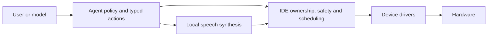
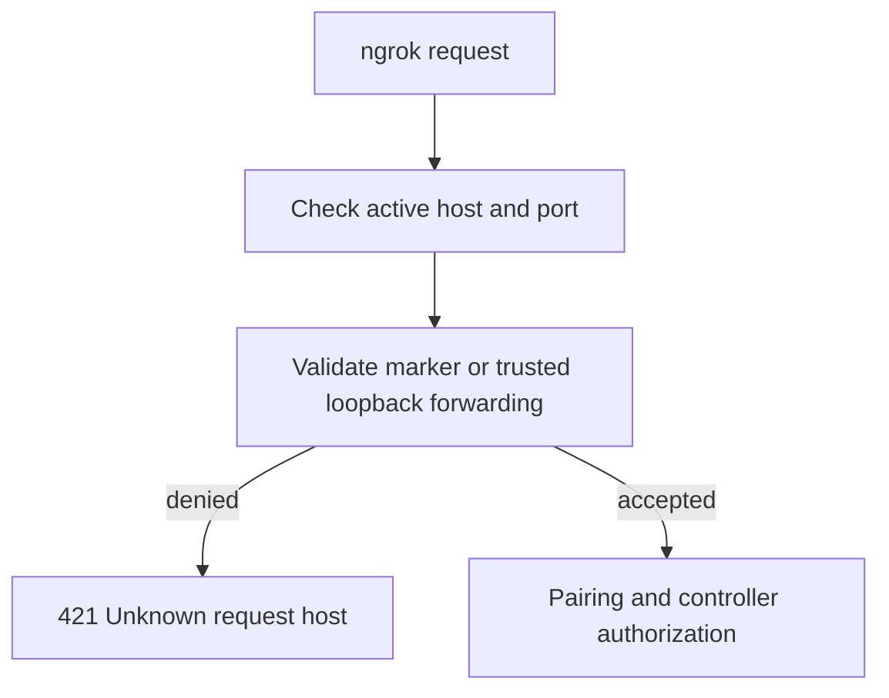
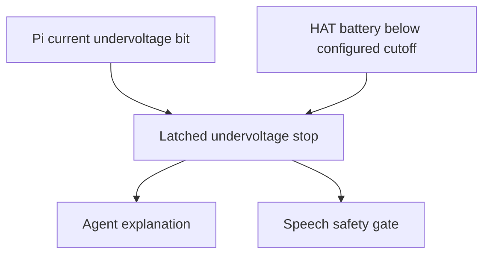
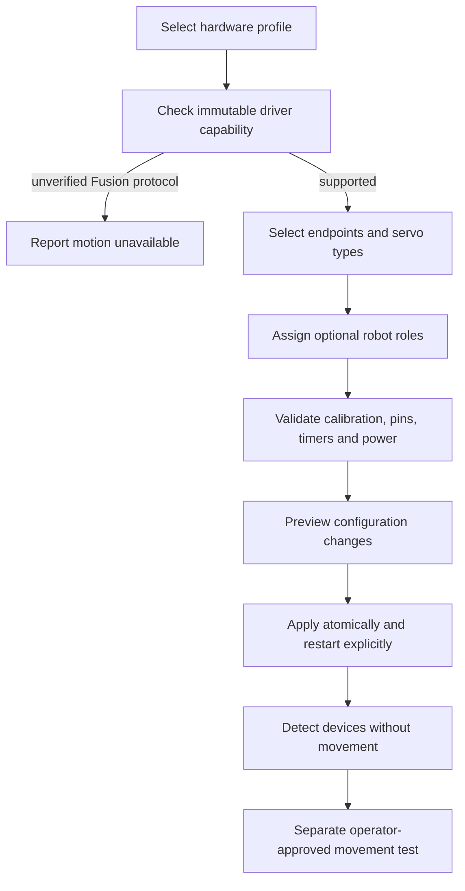

# NinjaRobotPi5 multi-HAT integration audit

Audit date: 2026-11-02. Inspected checkout: `bad557d`.
Filename corrected to the audit date at owner request. Status: **audit findings and constrained roadmap; Fusion motion release blocked**.
This document records source-confirmed findings, not physical hardware certification.
No runtime code, private configuration, boot settings, or managed drivers were changed.

## Executive summary

Multi-HAT support exists in onboarding, configuration import, and servo drivers.
It is not yet justified to claim complete compatibility. The installed board is
SunFounder Fusion HAT+, powered from its HAT battery. The owner prioritizes this
board, with older Robot HAT support where feasible. PCA9685 should retain the
original USB microphone and Bluetooth speaker experience.

The strongest finding is a Fusion register-address mismatch. The battery safety
message also merges two different causes, making the reported Pi undervoltage
an unreliable diagnosis. Speech readiness is gated by safety state, so a speaker
that passed onboarding can subsequently become unavailable by design.

The owner has confirmed PWM servos only: positional and continuous-rotation
servos, with arbitrary user-assigned channels and robot roles. Bare DC motor
control is excluded. All existing `pi5*` libraries must remain untouched.
Fusion shares PWM resources with motor outputs, which must remain unused under
this scope. Full Fusion motion support cannot currently be promised under the
immutable-driver constraint because of the protocol mismatch below.
No physical movement or power command was executed.

## Architecture and evidence

HAT means a Raspberry Pi expansion board. PWM (pulse-width modulation) supplies
servo control pulses. I2C is the shared two-wire device bus. The IDE is the
project's deterministic hardware coordination layer.



The key inspected paths, relative to the repository root, are:

| Area | Evidence |
| --- | --- |
| Migration intent | `DevelopmentPlanDoc/hardware/SunFounder_RobotHAT/SunFunderMigrationPlan.md` |
| Remote classification | `ninjarobot_pi5_agent/src/ninjarobot_pi5_agent/pairing.py`, `request_scope` |
| Host rejection and server startup | `ninjarobot_pi5_agent/src/ninjarobot_pi5_agent/web_app.py`, `pairing_boundary`, `_is_loopback_proxy_request`, Uvicorn construction |
| Tunnel creation | `ninjarobot_pi5_agent/src/ninjarobot_pi5_agent/remote_access.py`, `PyngrokTunnelBackend._connect_sync` |
| Power stop | `ninjarobot_pi5_ide/src/ninjarobot_pi5_ide/safety.py`, `raspberry_pi_undervoltage_active`, `_undervoltage_monitor` |
| Fusion protocol | `pi5servo/src/pi5servo/core/backends/sunfounder_robot_hat.py`, `_write_timer_registers`, `set_pulse_us`, `off`, `read_battery_voltage` |
| Profile import | `ninjarobot_pi5_ide/src/ninjarobot_pi5_ide/config_import.py`, servo import branch |
| Speech | `ninjarobot_pi5_agent/src/ninjarobot_pi5_agent/speech.py`, `SpeechService`, `LocalSynthesizer` |
| Playback | `ninjarobot_pi5_ide/src/ninjarobot_pi5_ide/audio_output.py`, `health`, `_set_speaker_amplifier` |
| Speech safety binding | `ninjarobot_pi5_ide/src/ninjarobot_pi5_ide/integrated.py:919` |

Serena provided the remote-access symbol overview; targeted source reads supplied
implementation details. The wiki architecture page remains `draft`, with an AI
semantic review dated 27 October, not human hardware verification. Its README
identifies 25 October successor manuals. `python scripts/wiki.py check` failed
because the separate wiki environment is missing. No dependencies were installed.
Wiki search, source drift, and semantic-review validity remain unverified.

## Hardware compatibility matrix

Entries describe intended configuration or inspected software, not tested hardware.

| Capability | DFR0566 + X1208 baseline | Fusion HAT+ priority | PCA9685 target |
| --- | --- | --- | --- |
| Wheel endpoints | Legacy GPIO12/13 | Must confirm actual actuator wiring | Explicit calibrated PWM role assignment |
| Servo implementation | Existing legacy backend | 12-channel backend, register defect below | Existing PCA9685 backend; physical acceptance pending |
| Power | Preserve X1208 configuration | HAT battery; shared Pi/servo supply | Supply topology remains board-specific |
| Audio | Bluetooth speaker, USB mic | Embedded speaker; input selection must remain explicit | Bluetooth speaker, USB mic |
| Safety | Preserve current protections | Separate Pi rail and battery causes | Pi monitoring plus configured optional battery source |
| Peripheral compatibility | Baseline to preserve | Verify pin reservations and shared timers | Verify bus address and GPIO wiring |

Fusion's manufacturer specifies 12 PWM channels, eight shared with motor control,
and a 5 V supply shared by the Pi and servos. This makes total load and resource
allocation part of acceptance testing, even with a charged battery.
[Manufacturer power and interface specifications](https://docs.sunfounder.com/projects/fusion-hat/en/latest/hardware/features.html).

The supplied [PCA9685 module description](https://electra.store/storage/uploads/2022/07/PCA9685-16-Channel-12-bit-data-sheet.pdf)
is a module overview, not enough evidence to approve arbitrary board wiring,
regulator capability, or servo supply voltage. A chip datasheet and actual board
schematic must be checked before a wiring guide is finalized.

## Migration-plan gaps and additional risks

### Fusion register addressing: high priority

The manufacturer lists PWM high-byte registers at `0x60`, `0x62`, and so on;
timer high-byte registers likewise advance by two. The implementation writes
`base + channel` and `base + timer_idx`. Thus channel 1 targets `0x61` rather than
`0x62`; timer 1 targets `0x41` rather than `0x42`. This is a confirmed mismatch
against the published register map. It can affect movement and stopping, not
merely calibration. Exact electrical effects require firmware-level verification.
[Manufacturer register map](https://docs.sunfounder.com/projects/fusion-hat/en/latest/hardware/onboard_mcu.html).

A driver-level repair would normally require variant-specific register descriptors
and independent protocol fixtures. It is **excluded by the owner’s latest
instruction**. Do not patch, monkey-patch, copy, or replace the driver protocol
inside the IDE to disguise a driver change. Do not remap channels to compensate: 
timer initialization and stopping remain affected. Treat Fusion motion as blocked
until the existing driver is independently shown compatible, or the owner later
changes the constraint to allow a separately validated driver release.

### Configuration import assigns wheel roles implicitly

The servo import branch assigns `left_motor` and `right_motor` to P0/P1 when
present, otherwise the first two calibrated HAT endpoints; it can also add a
companion endpoint when only one calibration exists. Calibration does not prove
that a device is a wheel. Preserve explicit roles and require deliberate role
assignment before motion. Profile switching must also clear only obsolete
profile-owned settings while preserving user overrides.

### Initialization is not passive identification

`_initialize_timers` attempts register writes, switches addresses after errors,
and may reset the microcontroller. A successful write is insufficient proof of
board identity. Separate detection from initialization and expose the effective
variant/address. Review reset ownership and interaction with other HAT functions.

## Reported issue 1: ngrok host rejection

The exact message originates in `pairing_boundary` when `request_scope` returns
`denied`; it is not evidence that the tunnel failed to connect. Remote requests
must match the active remote origin and either carry the correct private marker
or satisfy the loopback-forwarding fallback. The tunnel backend retries without
the marker policy after certain paid-policy rejections.



Confirmed rejection mechanism and locally reproduced proxy interaction; the
deployed triggering condition is unresolved.
Candidates are a stale public origin, absent/incorrect marker, or loss of the
loopback peer identity during proxy-header processing. Uvicorn construction does
not explicitly configure proxy-header behavior. An in-memory reproduction with the installed Uvicorn middleware changed
`127.0.0.1` to the synthetic forwarded address `203.0.113.8`; the project’s
`_is_loopback_proxy_request` then returned false. This confirms a defect in the
marker-free fallback under proxy processing, but not that the user’s tunnel
actually selected that branch. No live tunnel was opened.
[Uvicorn proxy behavior](https://uvicorn.dev/settings/).

Recommended repair: preserve transport-peer provenance, explicitly configure the
trusted proxy boundary, synchronize active origin and QR generation, and test
marker and fallback paths separately. Never allow all hosts or trust forwarded
headers from arbitrary peers. Capture only redacted classification diagnostics,
never pairing tokens, cookies, or marker secrets. This path is independent of HAT
selection in the inspected code.

## Reported issue 2: undervoltage stop

The Pi detector reads `vcgencmd get_throttled` and checks **bit zero only**.
Historical bit 16 is not used by this movement detector. The same monitor also
reads the SunFounder battery when configured at `0x14` or `0x17`, and latches the
same `undervoltage` reason below `cutoff_voltage`. Import installs 6.90 V cutoff
and 7.15 V warning values.



Confirmed diagnostic conflation: a low battery can produce an explanation blaming
the Pi rail. Actual voltage sag, battery depletion, and battery conversion error
remain distinct hypotheses. Fusion battery code interprets registers `0x18/0x19`
as millivolts; the register table alone does not establish that conversion.
Verify it against the matching vendor implementation and a meter before changing
thresholds. Calibration success does not validate the agent safety path.

Keep current Pi protections. Add distinct reason codes, measured value, threshold,
source, and sample age. Verify idle and loaded Pi rail alongside battery voltage;
resume only after the active condition clears. Do not suppress real voltage faults.

## Reported issue 3: speech unavailable

The path is text → `SpeechService.speak` → IDE playback health → Piper local
text-to-speech synthesis → IDE playback. `/speech on` enables a session setting;
it does not install Piper, select a speaker, or validate the voice model.

Playback health rejects safety-stopped or foreground-busy operation before
synthesis. `integrated.py` binds permission to `not robot.system_safety.stopped`.
Piper additionally requires an executable interpreter, model and JSON metadata,
and a supported language. Synthesis/playback exceptions are collapsed into
`speech_unavailable_or_interrupted`.

Confirmed mechanisms, not a confirmed cause of this deployment's failure.
Onboarding tone success proves neither Piper readiness nor the service user's
audio session. Inspect `/speech status` and `/speech outputs` under the actual
agent session; distinguish synthesis, output routing, safety, and interruption.
Review PipeWire availability, saved sink identity, ALSA fallback, amplifier
ownership, and service environment. Preserve interruption safety while improving
structured failure reporting. Do not automatically retain generated speech.

## Recommended architecture and provisional roadmap

Preserve Agent commands and the Agent → IDE → driver boundary. Give each board
variant explicit capabilities, reserved pins, timer groups, register protocol,
power reader, and audio enable method. The IDE owns cross-device conflicts.
Do not infer motor type from calibration order or board address.

The following order respects the immutable-library constraint and is not
implementation approval:

| Phase | Objective and likely files | Validation and acceptance | Risk |
| --- | --- | --- | --- |
| 0 | Record immutable driver hashes, vendor protocol, deployed versions and redacted status | Independent register/voltage fixtures; explicit Fusion compatibility decision | Read-only |
| 1 | Add IDE capability validation and explicit unsupported-profile status; no driver changes | No Fusion motion initialization when compatibility is unproven; baseline remains usable | Safety critical |
| 2 | Separate power causes in IDE safety and Agent presentation | Current versus historical Pi flags, battery cutoff, read failures and resume tested | Safety critical |
| 3 | Repair verified proxy boundary defect in pairing/web/remote access | Active URL works; stale hosts, spoofed headers and invalid sessions rejected; reconnect tested | Network security |
| 4 | Diagnose speech stages and stabilize playback lifecycle | Real service-user synthesis/playback; stop, foreground interruption and reconnect pass | Audio/privacy |
| 5 | Explicit profile ownership and roles in onboarding/import/config | Idempotent import, preview, rollback, custom role preservation and all profile-switch pairs pass | Configuration/motion |
| 6 | Cross-profile regression and documentation | Existing functions pass on baseline and supported boards; limitations recorded | Hardware acceptance |

Each phase needs explicit implementation approval. Preserve all managed-driver files and baseline hashes. No driver change or
update is authorized by this roadmap. No dependency change is proposed until protocol and
service requirements are established.

## Regression strategy and handoff gates

Run every required root gate in `AGENTS.md` after implementation phases, including
both driver verifiers, compilation, Ruff checks, mypy, pytest and `git diff --check`.
Run each managed driver suite in its own pytest process. Add protocol fixtures
from independent manufacturer evidence rather than mirroring implementation.

Cover legacy wheel behavior, auxiliary joints, stop/watchdog/obstacle handling,
calibration persistence, display, buzzer, distance sensor, camera and microphone
consent, speech, pairing, remote reconnect, controller leases, and profile-switch
rollback. Test failures must distinguish baseline from introduced defects.

Physical checks remain unperformed:

| Class | Expected result | Stop/rollback |
| --- | --- | --- |
| Safe smoke | Correct profile and service status without actuator commands | Stop service; restore backed-up profile |
| Device communication | Correct board identity and plausible telemetry without reset/write probing | Stop initialization on mismatch |
| Actuator moving | Raised wheels, operator ready to remove power; correct channel and reliable stop | Stop immediately; remove power if necessary |
| Power risk | Separate manual test of authorized shutdown behavior | Never exercise live shutdown in automated tests |

Wiki impact: this interim audit changes no product behavior. Before implementation
handoff, prepare successor InstallationGuide, DevelopmentGuide and DevelopmentLog
sources; update architecture, installation and feature pages, README and notices
as applicable. Present the exact semantic wiki diff for approval before applying.
Do not refresh fingerprints to conceal unreviewed implementation changes.

## Confirmed scope and architecture limits

No fixed robot chassis or wheel assignment is required. The IDE configuration
should describe each enabled endpoint: positional or continuous-rotation servo,
logical role, existing calibration reference, safe limits, inversion, and neutral
behavior. A head-only robot must not need wheel roles; differential drive must
require two explicitly assigned continuous-rotation wheel roles. Existing public
commands remain stable; unsupported actions get a clear capability explanation.
Never interpret a continuous-rotation servo's angle as measured shaft position.

Use the existing `pi5servo` configuration and runtime interfaces. Keep new robot
semantics in IDE configuration and safety. The selected profile limits available
channels and common frequency choices; it does not prescribe wheel channels.
Servos requiring incompatible frequencies or electrical levels are outside a
single shared timer configuration. “Any PWM port” does not mean every possible
servo is electrically compatible.



Do not add a new motor driver, import a vendor PWM package into the Agent, or
bypass `pi5servo` with IDE register writes. The supported architecture and the
current driver mismatch are a release constraint, not permission to weaken safety.
An independently corrected driver release would also change library contents;
it requires a future explicit scope decision and is not assumed here.

## Additional audit findings

- `audio_output._set_speaker_amplifier` attempts pinctrl, sysfs, direct I2C and
  lgpio operations, suppressing several failures. Its direct I2C operation opens
  a separate bus connection to the same MCU used by servos, outside that backend's
  lock. Consolidate ownership and use one verified board-specific enable path.
  The vendor now documents a sysfs speaker interface; its public register page
  labels `0x31` a buzzer switch. This terminology conflict requires matching
  firmware evidence before treating the direct write as a universally valid
  speaker operation. [Vendor device implementation](https://docs.sunfounder.com/projects/fusion-hat/en/latest/_modules/fusion_hat/device.html).
- Current vendor PWM Python code uses a kernel sysfs interface. The repository
  uses direct bus access. Verify whether the deployed kernel driver already owns
  the MCU before allowing another owner; do not infer that installation of the
  vendor package makes the repository backend compatible.
  [Vendor PWM implementation](https://docs.sunfounder.com/projects/fusion-hat/en/latest/_modules/fusion_hat/pwm.html).
- `ServoDevice._load_servo_runtime` does consume saved backend metadata and
  endpoint calibrations. The migration plan's earlier hardcoded-backend problem
  is addressed in current source; it should not be reimplemented.
- The onboarding wizard already presents three profiles and persists selection.
  Presence of this menu is not proof of detection, safe switching, or full device
  readiness. Import still overwrites wheel-role choices as described above.
- Current battery conversion cannot be certified from the vendor's Python
  sysfs conversion: a kernel-exposed value and raw MCU register value need not
  have identical units. This remains a measurement/protocol verification gate.
- The NXP chip provides 16 PWM channels with a shared frequency; it does not
  establish the external module's servo power regulator or current rating.
  Keep logic and servo-supply requirements separate and preserve USB microphone
  and Bluetooth speaker defaults for this profile.
  [NXP PCA9685 datasheet](https://www.nxp.com/docs/en/data-sheet/PCA9685.pdf).

## Validation performed

The following read-only software checks ran on this checkout:

```bash
uv run --frozen --no-sync pytest -q \
  ninjarobot_pi5_agent/tests/test_remote_access.py \
  ninjarobot_pi5_agent/tests/test_pairing.py \
  ninjarobot_pi5_agent/tests/test_speech.py \
  ninjarobot_pi5_ide/tests/test_audio_output.py \
  ninjarobot_pi5_ide/tests/test_safety.py \
  ninjarobot_pi5_ide/tests/test_config_import.py
uv run --frozen --no-sync python scripts/verify_immutable_drivers.py
```

Results: **89 passed in 4.33 seconds**. Driver verifier: **223 tracked files
across six drivers match the import baseline plus 63 previously authorized
repairs**. Those repairs predate this audit; no new authorization was recorded.
An in-memory proxy middleware reproduction independently demonstrated the
loopback identity loss. These tests do not prove the Fusion wire protocol,
physical power quality, or deployed service environment.

Full root compilation, formatting, typing and test gates were not run: this is a
report-only change. Wiki checks remain blocked by its missing environment.
No hardware actions, audio playback, capture, dependency installs, or system
configuration changes were performed.

## Safe diagnostic handoff

From the existing Agent session, run `/speech status` and `/speech outputs`.
Expected result: separate synthesis readiness, playback readiness and selected
output. Share only readiness/reason fields, not private paths or conversation
content. A safety-blocked result should be investigated alongside the stop cause.

On the Pi, `vcgencmd get_throttled` is a read-only observation. Record its result
at idle before authorizing a separate raised-wheel test. Bit zero distinguishes
current undervoltage from historical warnings. Battery readings require a verified
reader before their numeric values can justify threshold changes.

For ngrok, record whether marker policy or fallback was selected, whether the
active public origin matches the QR origin, and whether middleware saw a loopback
transport peer. Do not share the QR token, authentication token, cookie, or secret
header. Confirm the reproduced fallback condition before applying a proxy repair.

## Final recommendations and limits

Proceed first with read-only diagnostics and IDE/Agent fixes for remote access,
error provenance, speech readiness and explicit configuration ownership. Keep
all `pi5*` libraries unchanged. Do not claim all-channel Fusion motion support
until the protocol discrepancy is resolved under an explicitly agreed scope.

There is no evidence here proving that the three reported failures are all HAT
regressions: remote rejection is a service-boundary defect candidate; power and
speech have multiple distinguishable runtime causes. This audit records confirmed
source behavior and reproduction separately from deployed root causes still
requiring observations. Physical backward compatibility, complete service-unit
inspection and exhaustive peripheral regression remain outstanding; the report
is not a certification that every project subsystem has been validated.

## Issue 4: Ollama local models disappear after cloud authentication

### Confirmed source cause

`cloud_registry.py:ConfiguredProviderRegistry.create` checks whether the secret
store contains the Ollama key. If so, an absent base URL or even the explicit
standard local URL is replaced with `https://ollama.com`. `catalog` constructs
one adapter and queries only its endpoint. It never merges local and cloud
catalogs. This explains the reported behavior without requiring a failed local
installation. The adapter itself supports both endpoint types.

`agent_cli.py` interactive provider selection always displays API-key choices
before calling `_available_models`. `_provider_setup` in `setup_wizard.py`
explicitly requires a nonempty Ollama key. `OllamaProvider.list_models` queries
`/api/tags` against its single configured server. `ModelCatalogEntry` identifies
entries by provider and name without a distinct execution destination. Adding
local names to the cloud list alone would therefore be insufficient: selection
must carry the destination through runtime creation and persistence.

Additional source-confirmed concern: `create` attaches a credential whenever a
key exists, including when a local override is selected. Cloud credentials should
not be sent to the local daemon. Existing benchmark acceptance also matches model
name alone; local and cloud entries with identical names must not accidentally
share acceptance evidence.

### Intended behavior and boundaries

Show downloaded models reported by the configured local Ollama daemon alongside
available cloud catalog entries. Label execution location explicitly. A local
Ollama entry can itself proxy cloud execution; transport locality alone must not
be presented as proof of offline inference. Do not promise all downloadable
models from the public library or models stored under a different daemon account.

Local discovery requires no cloud key. Cloud errors must not hide local results.
Selecting a local model must preserve local routing even after adding a key;
selecting a cloud model must preserve cloud routing after restart. Do not download,
load, benchmark, or send user text merely to populate the menu. Keep explicit
cloud consent and existing deterministic hardware safety gates.

Official evidence: [Ollama authentication](https://github.com/ollama/ollama/blob/main/docs/api/authentication.mdx)
distinguishes unauthenticated local access from authenticated direct cloud access;
[Ollama cloud documentation](https://github.com/ollama/ollama/blob/main/docs/cloud.mdx)
describes the cloud catalog. These are moving upstream sources; pin the reviewed
API behavior in implementation fixtures rather than hardcoding current model names.

This is an Agent configuration/discovery defect, independent of HAT selection.
No real credentials, local model inventory, or cloud inference were accessed in
this audit. See [the implementation plan](NinjaSunFounderIntegrationImplementation_261102.md)
for route-aware selection, migration, and regression gates.
