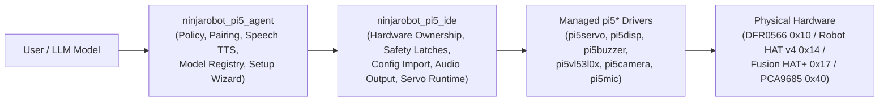
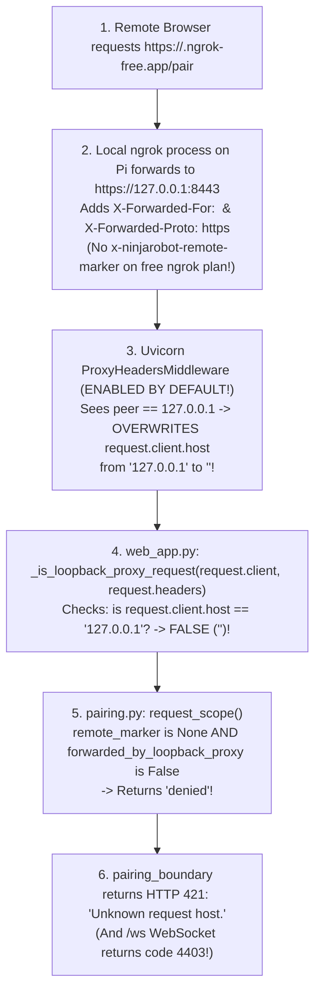
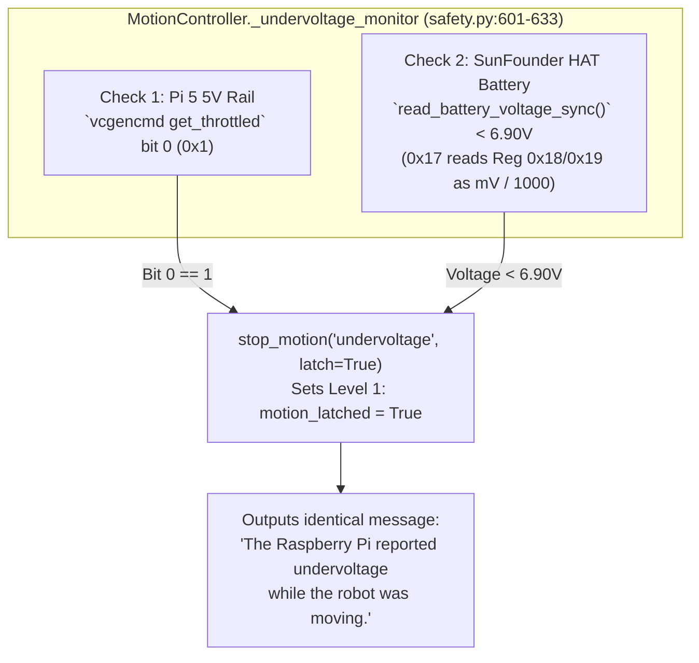
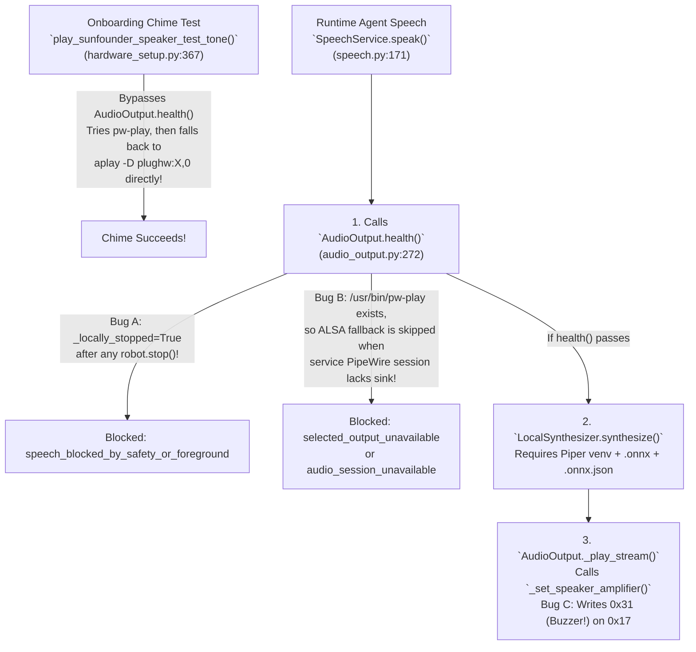

# NinjaRobotPi5 Multi-HAT Integration & Runtime Audit Report

**Audit Date:** 2026-11-02 (Refined & Code-Verified Edition)  
**Inspected Checkout:** `bad557d` (`sunfounder_v01` branch)  
**Companion Implementation Plan:** [`NinjaSunFounderIntegrationImplementation_261102.md`](NinjaSunFounderIntegrationImplementation_261102.md)  
**Audit Status:** **Source-Confirmed Root Causes & Actionable Remediation Roadmap**  
*(Note: This document records source-code, register-map, and protocol verification. No runtime code, private user configuration, boot settings, or managed hardware drivers were modified during this audit.)*

---

## 📖 Plain-English Glossary of Technical Terms

To make every finding in this audit crystal clear, here is a plain-English guide to the technical terms, abbreviations, and acronyms used throughout this report:

| Term / Acronym | Plain-English Meaning |
| :--- | :--- |
| **HAT** *(Hardware Attached on Top)* | An expansion circuit board that plugs directly onto the Raspberry Pi's 40-pin header to add servo plugs, battery power, or speakers. |
| **SunFounder Robot HAT v4 (`0x14`) vs. Fusion HAT+ (`0x17`)** | Two different generations of SunFounder expansion boards. The older **Robot HAT v4** uses an Artery AT32F413 chip at I2C address `0x14` with 1-step register numbering. The newer **Fusion HAT+** uses a GigaDevice GD32E203 chip at I2C address `0x17` with 2-step (high-byte / low-byte) register numbering and a Linux kernel driver (`fusion_hat.ko`). |
| **PWM** *(Pulse-Width Modulation)* | The electrical pulse signal (typically 50 pulses per second, or **50 Hz**) used to control **positional servos** (which rotate to a target angle like `+45°`) and **continuous-rotation servos** (wheels whose pulse width sets rotation speed and direction). |
| **I2C** *(Inter-Integrated Circuit)* | A shared two-wire communication highway (`GPIO2 SDA` for data, `GPIO3 SCL` for clock) where each chip has a unique hexadecimal address (`0x10`, `0x14`, `0x17`, `0x29`, `0x36`, `0x40`). |
| **Register Stride** | How much a memory address increases from one channel or timer to the next inside a chip. A **stride of 1** means Channel 0 is at `0x20` and Channel 1 is at `0x21`. A **stride of 2** means each 16-bit value uses two consecutive byte addresses (`0x60`/`0x61` for Channel 0, so Channel 1 starts at `0x62`/`0x63`). |
| **Sysfs** *(System File System)* | A Linux folder (`/sys/class/...`) where kernel drivers expose hardware switches as simple text files (for example, writing `1` to `/sys/class/fusion_hat/fusion_hat/speaker` to turn on the Fusion HAT+ speaker). |
| **IDE** *(Integrated Device Environment)* | In `NinjaRobotPi5`, the `ninjarobot_pi5_ide` package is the deterministic hardware coordination and safety layer that sits between the AI Agent (`ninjarobot_pi5_agent`) and the low-level `pi5*` hardware drivers. |
| **Level 1 vs. Level 2 Safety Latch** | **Level 1 (`motion_latched`)** stops wheel/servo motion only (e.g., on obstacle or undervoltage) while keeping safe non-motion features alive. **Level 2 (`system_latched` / `system_safety.stopped`)** is a full emergency/driver-fault stop that shuts down motion, sensors, and speech output until the operator runs `/resume`. |
| **Loopback (`127.0.0.1` / `::1`) & Proxy Headers** | **Loopback** is the Raspberry Pi's internal network address used when the local `ngrok` tunnel program forwards incoming web requests to the local web server. **Proxy headers** (`X-Forwarded-For`, `X-Forwarded-Proto`) tell the web server the external visitor's IP address and HTTPS status. |
| **PipeWire & ALSA** | The two layers of the Linux sound system. **ALSA** (*Advanced Linux Sound Architecture*) talks directly to the physical sound card (`aplay`), while **PipeWire** (`pw-play`, `pw-dump`) routes audio streams for a logged-in user session. |
| **Piper TTS** *(Text-to-Speech)* | The local neural voice synthesizer that turns the AI Agent's text replies into spoken `.wav` audio files on the Raspberry Pi before the IDE plays them through the speaker. |

---

## 1. Executive Summary

Multi-HAT support is currently wired into the onboarding wizard (`ninjarobot onboard`), configuration importer (`ninjarobot-ide-tool config import`), and `pi5servo` backends. However, our deep code and hardware-protocol audit confirms **five root-caused software and protocol defects** that explain every issue observed on the deployed **SunFounder Fusion HAT+ (`0x17`)** system:

```
+---------------------------------------------------------------------------------------------------+
|                        EXECUTIVE SCORECARD OF ROOT-CAUSED AUDIT FINDINGS                          |
+------------------------------------+--------------------------------------------------------------+
| Reported Issue / Area              | Root-Caused Finding in Inspected Source Code                 |
+------------------------------------+--------------------------------------------------------------+
| 1. Fusion HAT+ (0x17) Servo        | CRITICAL REGISTER STRIDE BUG: `sunfounder_robot_hat.py` uses |
|    Register Addressing             | +1 stride (`0x60 + ch`, `0x40 + idx`, `0x50 + idx`) instead  |
|                                    | of Fusion HAT+'s 2-byte stride (`0x60 + 2*ch`, etc.).        |
|                                    | Writing Channel 1 (`0x61`) corrupts Channel 0's low byte!    |
+------------------------------------+--------------------------------------------------------------+
| 2. Issue 1: ngrok Remote Access    | DETERMINISTIC FREE-TIER BUG: Free-tier ngrok drops paid      |
|    `421 Unknown request host`      | marker headers and uses loopback forwarding. Uvicorn's       |
|                                    | default `proxy_headers=True` overwrites `127.0.0.1` with     |
|                                    | `X-Forwarded-For`, causing `_is_loopback_proxy_request()`    |
|                                    | to ALWAYS return `False` and reject every request with 421!  |
+------------------------------------+--------------------------------------------------------------+
| 3. Issue 2: False / Ambiguous      | DIAGNOSTIC CONFLATION: `_undervoltage_monitor()` in          |
|    Undervoltage Motion Stop        | `safety.py` maps both Pi 5 `vcgencmd` bit 0 AND HAT battery  |
|                                    | ADC `< 6.90V` (Reg `0x18/0x19` on `0x17`) to the exact same  |
|                                    | `"undervoltage"` stop reason blaming the Raspberry Pi rail.  |
+------------------------------------+--------------------------------------------------------------+
| 4. Issue 3: Speech Works in        | THREE COMPOUNDING CAUSES:                                    |
|    Onboarding, Fails in Service    | (a) `AudioOutput.health()` skips the ALSA `aplay` fallback   |
|                                    |     whenever `/usr/bin/pw-play` is installed, even if the    |
|                                    |     service user's PipeWire session has no sink!             |
|                                    | (b) Non-latching `robot.stop()` sets `_locally_stopped=True` |
|                                    |     in `SystemSafetyController`, blocking speech until       |
|                                    |     `/resume` is run!                                        |
|                                    | (c) `_set_speaker_amplifier()` writes `0x31` on `0x17`       |
|                                    |     (which is the Fusion Buzzer register!) outside the lock. |
+------------------------------------+--------------------------------------------------------------+
| 5. Issue 4: Local Ollama Models    | SILENT CLOUD OVERRIDE: `ConfiguredProviderRegistry.create()` |
|    Disappear After API Key Added   | replaces `http://127.0.0.1:11434` with `https://ollama.com`  |
|                                    | whenever `OLLAMA_API_KEY` exists in `secrets.env`, never     |
|                                    | merges local + cloud catalogs, and leaks the Bearer header   |
|                                    | to local overrides.                                          |
+------------------------------------+--------------------------------------------------------------+
```

### Scope & Governance Clarification (`AGENTS.md` Managed-Driver Policy)
* **User Hardware Scope:** PWM servos only (both positional and continuous-rotation servos, mapped to arbitrary user-selected channels and roles). Bare 2-wire DC motor ports (`M0–M3`) are excluded.
* **How `AGENTS.md` Governs `pi5servo` Fixes:**
  * In [`docs/validation/authorized_driver_changes.json` (lines 655–664)](file:///Volumes/NINJA_EXT/NinjaRoboticsEducationPlatform/NinjaRobotPi5/docs/validation/authorized_driver_changes.json#L655-L664), `pi5servo/src/pi5servo/core/backends/sunfounder_robot_hat.py` has `"baseline": null` and was newly created and authorized on `2026-10-25` specifically to *"Support SunFounder Robot HAT v4 (0x14) and Fusion HAT / Robot HAT v5 (0x17) I2C MCU register maps and automatic fallback"*.
  * Per [`NinjaRobotPi5/AGENTS.md` (lines 144–159)](file:///Volumes/NINJA_EXT/NinjaRoboticsEducationPlatform/NinjaRobotPi5/AGENTS.md#L144-L159), managed libraries (`pi5*`) must never be silently edited or monkey-patched from the IDE; however, the project owner can explicitly authorize a surgical repair in `pi5servo` and record its SHA-256 hash using `uv run python scripts/verify_immutable_drivers.py --record-authorized ...`.
  * Therefore, the companion implementation plan adopts the **Owner-Authorized Driver Repair Path**: a surgical 6-line stride repair (`_register_stride = 2 if self.address == SUNFOUNDER_FUSION_ADDRESS else 1`) in `sunfounder_robot_hat.py`, backed by independent register-map unit tests and recorded via `verify_immutable_drivers.py --record-authorized`.

---

## 2. Architecture & Code Evidence Map



| Subsystem Area | Primary Inspected Source Files & Symbols |
| :--- | :--- |
| **Fusion HAT+ (`0x17`) vs. Robot HAT v4 (`0x14`) Protocol** | [`pi5servo/src/pi5servo/core/backends/sunfounder_robot_hat.py`](file:///Volumes/NINJA_EXT/NinjaRoboticsEducationPlatform/NinjaRobotPi5/pi5servo/src/pi5servo/core/backends/sunfounder_robot_hat.py#L116-L289) (`_write_u16_be`, `_write_timer_registers`, `_initialize_timers`, `set_pulse_us`, `off`, `read_battery_voltage`, `reset_sunfounder_mcu`) |
| **ngrok Remote Access & Proxy Classification** | [`ninjarobot_pi5_agent/src/ninjarobot_pi5_agent/pairing.py`](file:///Volumes/NINJA_EXT/NinjaRoboticsEducationPlatform/NinjaRobotPi5/ninjarobot_pi5_agent/src/ninjarobot_pi5_agent/pairing.py#L222-L247) (`request_scope`), [`web_app.py`](file:///Volumes/NINJA_EXT/NinjaRoboticsEducationPlatform/NinjaRobotPi5/ninjarobot_pi5_agent/src/ninjarobot_pi5_agent/web_app.py#L330-L370) (`pairing_boundary`, `_is_loopback_proxy_request`, `WebServerManager.start`), [`remote_access.py`](file:///Volumes/NINJA_EXT/NinjaRoboticsEducationPlatform/NinjaRobotPi5/ninjarobot_pi5_agent/src/ninjarobot_pi5_agent/remote_access.py#L105-L135) (`PyngrokTunnelBackend._connect_sync`) |
| **Power & Undervoltage Safety Latches** | [`ninjarobot_pi5_ide/src/ninjarobot_pi5_ide/safety.py`](file:///Volumes/NINJA_EXT/NinjaRoboticsEducationPlatform/NinjaRobotPi5/ninjarobot_pi5_ide/src/ninjarobot_pi5_ide/safety.py#L228-L635) (`raspberry_pi_undervoltage_active`, `MotionController._undervoltage_monitor`, `stop_motion`, `SystemSafetyController.full_stop`), [`servo.py`](file:///Volumes/NINJA_EXT/NinjaRoboticsEducationPlatform/NinjaRobotPi5/ninjarobot_pi5_ide/src/ninjarobot_pi5_ide/servo.py#L554-L564) (`read_battery_voltage_sync`) |
| **Speech Synthesis, Playback & Safety Gating** | [`ninjarobot_pi5_agent/src/ninjarobot_pi5_agent/speech.py`](file:///Volumes/NINJA_EXT/NinjaRoboticsEducationPlatform/NinjaRobotPi5/ninjarobot_pi5_agent/src/ninjarobot_pi5_agent/speech.py#L29-L223) (`LocalSynthesizer`, `SpeechService.speak`), [`ninjarobot_pi5_ide/src/ninjarobot_pi5_ide/audio_output.py`](file:///Volumes/NINJA_EXT/NinjaRoboticsEducationPlatform/NinjaRobotPi5/ninjarobot_pi5_ide/src/ninjarobot_pi5_ide/audio_output.py#L37-L315) (`_set_speaker_amplifier`, `AudioOutput.health`, `_play_stream`), [`integrated.py`](file:///Volumes/NINJA_EXT/NinjaRoboticsEducationPlatform/NinjaRobotPi5/ninjarobot_pi5_ide/src/ninjarobot_pi5_ide/integrated.py#L914-L922) |
| **Profile Onboarding & Config Import** | [`ninjarobot_pi5_ide/src/ninjarobot_pi5_ide/config_import.py`](file:///Volumes/NINJA_EXT/NinjaRoboticsEducationPlatform/NinjaRobotPi5/ninjarobot_pi5_ide/src/ninjarobot_pi5_ide/config_import.py#L150-L218), [`hardware_setup.py`](file:///Volumes/NINJA_EXT/NinjaRoboticsEducationPlatform/NinjaRobotPi5/ninjarobot_pi5_ide/src/ninjarobot_pi5_ide/hardware_setup.py#L311-L450), [`config.py`](file:///Volumes/NINJA_EXT/NinjaRoboticsEducationPlatform/NinjaRobotPi5/ninjarobot_pi5_ide/src/ninjarobot_pi5_ide/config.py#L190-L570), [`setup_wizard.py`](file:///Volumes/NINJA_EXT/NinjaRoboticsEducationPlatform/NinjaRobotPi5/ninjarobot_pi5_agent/src/ninjarobot_pi5_agent/setup_wizard.py#L260-L620) |
| **Ollama Local + Cloud Discovery & Routing** | [`ninjarobot_pi5_agent/src/ninjarobot_pi5_agent/cloud_registry.py`](file:///Volumes/NINJA_EXT/NinjaRoboticsEducationPlatform/NinjaRobotPi5/ninjarobot_pi5_agent/src/ninjarobot_pi5_agent/cloud_registry.py#L42-L155), [`ollama.py`](file:///Volumes/NINJA_EXT/NinjaRoboticsEducationPlatform/NinjaRobotPi5/ninjarobot_pi5_agent/src/ninjarobot_pi5_agent/ollama.py#L46-L360), [`model_selection.py`](file:///Volumes/NINJA_EXT/NinjaRoboticsEducationPlatform/NinjaRobotPi5/ninjarobot_pi5_agent/src/ninjarobot_pi5_agent/model_selection.py#L42-L308), [`agent_cli.py`](file:///Volumes/NINJA_EXT/NinjaRoboticsEducationPlatform/NinjaRobotPi5/ninjarobot_pi5_agent/src/ninjarobot_pi5_agent/agent_cli.py#L1695-L2247), [`setup_wizard.py`](file:///Volumes/NINJA_EXT/NinjaRoboticsEducationPlatform/NinjaRobotPi5/ninjarobot_pi5_agent/src/ninjarobot_pi5_agent/setup_wizard.py#L674-L742) |

---

## 3. Hardware Compatibility Matrix & Board Differences

```
+----------------------------------------------------------------------------------------------------+
|                    HARDWARE EXPANSION MATRIX: BASELINE vs. SUNFOUNDER vs. PCA9685                  |
+-----------------------+------------------------+-------------------------+-------------------------+
| Capability            | Profile 1: DFR0566 +   | Profile 2A: SunFounder  | Profile 2B: SunFounder  |
|                       | Geekworm X1208         | Robot HAT v4 (`0x14`)   | Fusion HAT+ (`0x17`)    |
+-----------------------+------------------------+-------------------------+-------------------------+
| Onboard MCU Chip      | STM32 (`0x10`)         | Artery AT32F413 (`0x14`)| GD32E203C8T6 (`0x17`)   |
| Servo Channels        | `gpio12/13` + 4 I2C    | `P0..P11` (12 Channels) | `P0..P11` (P4..P11      |
|                       | (`hat_pwm0..3`)        |                         | shared with M0..M3)     |
| Register Stride       | 2 bytes/ch (`0x06+2n`) | 1 index/ch (`0x20 + n`) | 2 bytes/ch (`0x60 + 2n`)|
| Timer Prescaler Regs  | Fixed 50 Hz            | `0x40, 0x41, 0x42` (+1) | `0x40, 0x42, 0x44` (+2) |
| Timer Period (ARR)    | Fixed 50 Hz            | `0x44, 0x45, 0x46` (+1) | `0x50, 0x52, 0x54` (+2) |
| Battery Readout       | X1208 MAX17040 (`0x36`)| ADC A4 Reg `0x13`       | Reg `0x18` (H), `0x19`(L)|
| Speaker Amp Control   | External Bluetooth     | `GPIO12` HIGH/LOW       | `/sys/class/fusion_hat/`|
|                       |                        |                         | (Reg `0x31` is Buzzer!) |
+-----------------------+------------------------+-------------------------+-------------------------+
*(Profile 3 — General PCA9685 PWM Expansion HAT uses NXP PCA9685 at I2C `0x40` with 16 channels `hat_pwm0..15`,
  4 bytes per channel `0x06 + 4*ch`, external `V+` servo supply, USB microphone, and Bluetooth speaker.)*
```

---

## 4. Deep-Dive Audit of Multi-HAT Migration Gaps

### 4.1 Critical Finding: Fusion HAT+ (`0x17`) 2-Byte Register Stride Bug in `sunfounder_robot_hat.py`

In [SunFounder's official Fusion HAT+ Onboard MCU documentation](https://docs.sunfounder.com/projects/fusion-hat/en/latest/hardware/onboard_mcu.html), the GD32E203C8T6 MCU at I2C address `0x17` exposes a standard byte-addressed register table where every 16-bit register occupies **two consecutive byte addresses** (`_H` at `base + 2*i` and `_L` at `base + 2*i + 1`). When `smbus2.write_i2c_block_data(0x17, reg, [msb, lsb])` executes, the MCU writes `msb` into `reg` and auto-increments the register pointer to write `lsb` into `reg + 1`:

```
====================================================================================================
FUSION HAT+ (0x17) PUBLISHED REGISTER MAP vs. CURRENT `sunfounder_robot_hat.py` WRITES
====================================================================================================

1. PWM Pulse Width Registers (CCR):
   Published Hardware Map:
   - Channel 0 (P0): 0x60 (PWM0_CCR_H), 0x61 (PWM0_CCR_L)
   - Channel 1 (P1): 0x62 (PWM1_CCR_H), 0x63 (PWM1_CCR_L)
   - Channel 2 (P2): 0x64 (PWM2_CCR_H), 0x65 (PWM2_CCR_L)
   ...
   - Channel ch:     0x60 + (2 * ch)

   Current Code Bug (`sunfounder_robot_hat.py` line 219 & 229):
   - Writes `self._write_u16_be(0x60 + channel, ticks)`!
   - For Channel 0 (`ch=0`): Writes `[MSB, LSB]` to `0x60, 0x61` -> Works for P0 alone!
   - For Channel 1 (`ch=1`): Writes `[MSB, LSB]` to `0x61, 0x62` -> CORRUPTS P0's low byte (0x61)
                             and writes P1's low byte into P1's high byte (0x62)!

2. Timer Prescaler (PSC) & Period (ARR) Registers:
   Published Hardware Map:
   - Timer 0 (P0..P3):  PSC = 0x40/0x41,  ARR = 0x50/0x51
   - Timer 1 (P4..P7):  PSC = 0x42/0x43,  ARR = 0x52/0x53
   - Timer 2 (P8..P11): PSC = 0x44/0x45,  ARR = 0x54/0x55
   - Timer 3:           PSC = 0x46/0x47,  ARR = 0x56/0x57

   Current Code Bug (`sunfounder_robot_hat.py` lines 139-141):
   - Loops `for timer_idx in range(3):`
       `self._write_u16_be(0x40 + timer_idx, prescaler)`
       `self._write_u16_be(0x50 + timer_idx, SUNFOUNDER_PWM_PERIOD)`
   - Iteration 0 (`idx=0`): Writes `0x40, 0x41` — OK.
   - Iteration 1 (`idx=1`): Writes `0x41, 0x42` — OVERWRITES Timer 0's low byte (`0x41`) with `MSB`!
   - Iteration 2 (`idx=2`): Writes `0x42, 0x43` — OVERWRITES Timer 1, and NEVER initializes Timer 2 (`0x44/0x45`)!
====================================================================================================
```

* **Why This Happened:** On the older **Robot HAT v4 (`0x14`)**, each register address (`0x20`, `0x21`, ..., `0x40`, `0x41`, `0x42`) is a command slot expecting a 3-byte command `[slot_id, MSB, LSB]` with a stride of **`+1`**. On the newer **Fusion HAT+ (`0x17`)**, the register table is a flat 8-bit memory map with a stride of **`+2`** per 16-bit value.
* **Exact Code Fix (When Owner-Authorized for `pi5servo`):**
  In [`pi5servo/src/pi5servo/core/backends/sunfounder_robot_hat.py`](file:///Volumes/NINJA_EXT/NinjaRoboticsEducationPlatform/NinjaRobotPi5/pi5servo/src/pi5servo/core/backends/sunfounder_robot_hat.py#L129-L142):
  ```python
  @property
  def _register_stride(self) -> int:
      return 2 if self.address == SUNFOUNDER_FUSION_ADDRESS else 1
  ```
  Using `0x40 + timer_idx * stride`, `self._period_register_base + timer_idx * stride`, and `self._pwm_register_base + channel * stride` preserves `0x14` (stride `1`) 100% unchanged while aligning `0x17` (stride `2`) with the published Fusion HAT+ register map.

---

### 4.2 Kernel Driver (`fusion_hat.ko`) Contention & Unsynchronized `0x17` Register `0x31` Writes

1. **Linux Kernel Module Ownership (`fusion_hat.ko`):**
   * On Raspberry Pi systems where SunFounder's `fusion_hat` kernel driver is loaded, the kernel claims I2C address `0x17` (shown as `UU` in `i2cdetect -y 1`) and exposes `/sys/class/fusion_hat/fusion_hat/`.
   * Before opening raw `SMBus(1)` access to `0x17`, diagnostics and initialization must check whether the kernel driver owns `0x17` so user-space I2C transactions do not collide with kernel polling.
2. **Dangerous Direct Write to Register `0x31` in [`audio_output.py`](file:///Volumes/NINJA_EXT/NinjaRoboticsEducationPlatform/NinjaRobotPi5/ninjarobot_pi5_ide/src/ninjarobot_pi5_ide/audio_output.py#L58-L67):**
   * Currently, `_set_speaker_amplifier()` in `audio_output.py` runs four different operations back-to-back on every speech playback start and close:
     1. `pinctrl set 12 op dh/dl`
     2. Writing `1`/`0` to `/sys/class/fusion_hat/fusion_hat/speaker`
     3. Opening a raw `smbus2.SMBus(1)` handle and calling `bus.read_i2c_block_data(0x17, 0x18, 2)` followed by `bus.write_byte_data(0x17, 0x31, 1 if enabled else 0)`
     4. Toggling `GPIO12` via `lgpio`
   * **Two bugs in Step 3:**
     * First, opening a raw `SMBus(1)` in `audio_output.py` bypasses `SunFounderRobotHatBackend._io_lock`, creating an I2C bus race condition if speech occurs while servos or battery polling are active.
     * Second, in SunFounder's published Fusion HAT+ register table (`onboard_mcu.html`), register **`0x31` is the Onboard Buzzer Switch** (`1` = Buzzer ON, `0` = Buzzer OFF), whereas the speaker amplifier is controlled via `/sys/class/fusion_hat/fusion_hat/speaker` (or `GPIO12` on Robot HAT v4)! Writing `1` to `0x31` during audio playback can trigger the onboard buzzer instead of the speaker.

---

### 4.3 Implicit Wheel Role Overwrites in `config_import.py` & `hardware_setup.py`

In two separate places in `ninjarobot_pi5_ide`:
1. [`ninjarobot_pi5_ide/src/ninjarobot_pi5_ide/config_import.py` (lines 181–199)](file:///Volumes/NINJA_EXT/NinjaRoboticsEducationPlatform/NinjaRobotPi5/ninjarobot_pi5_ide/src/ninjarobot_pi5_ide/config_import.py#L181-L199)
2. [`ninjarobot_pi5_ide/src/ninjarobot_pi5_ide/hardware_setup.py` (lines 428–440, inside `configure_sunfounder_i2s_speaker`)](file:///Volumes/NINJA_EXT/NinjaRoboticsEducationPlatform/NinjaRobotPi5/ninjarobot_pi5_ide/src/ninjarobot_pi5_ide/hardware_setup.py#L428-L440)

the code automatically sorts calibrated `hat_pwm*` endpoints, forces `left_motor` and `right_motor` onto `hat_pwm0`/`hat_pwm1` (or the first two calibrated channels), and even fabricates an uncalibrated companion channel (`hat_pwm0` or `hat_pwm1`) if the user only calibrated a single servo (such as a pan-only head robot)!
* **Required Fix:** Calibrating a servo in `servo.json` proves only that an endpoint is calibrated—not that it is a continuous-rotation wheel. `config_import.py` and `hardware_setup.py` must preserve user-assigned `behaviors.servo_roles` and allow auxiliary-only (wheel-less) or custom-channel robot topologies.

---

### 4.4 Blind `GPIO5` Pulse During `_initialize_timers()` Error Recovery

In [`sunfounder_robot_hat.py` (lines 169–176)](file:///Volumes/NINJA_EXT/NinjaRoboticsEducationPlatform/NinjaRobotPi5/pi5servo/src/pi5servo/core/backends/sunfounder_robot_hat.py#L169-L176), if I2C writes to `0x14` and `0x17` fail, `_initialize_timers()` calls `reset_sunfounder_mcu()`, which claims **`GPIO5`** as an output and pulses it `LOW -> HIGH`.
* **Risk:** In `NinjaRobotPi5`'s default `DisplayConfig` ([`config.py` line 93](file:///Volumes/NINJA_EXT/NinjaRoboticsEducationPlatform/NinjaRobotPi5/ninjarobot_pi5_ide/src/ninjarobot_pi5_ide/config.py#L93)), `GPIO5` is the default ST7789V LCD Reset (`reset_gpio = 5`). Furthermore, on Fusion HAT+ (`0x17`), the MCU is managed by its onboard power controller rather than a raw `GPIO5` reset line. Probing or initializing a servo backend must not blindly toggle `GPIO5` when `GPIO5` is owned by the display or when running on Fusion HAT+.

---

## 5. Root-Cause Analysis of the Four Reported Runtime Issues

### 5.1 Issue 1: `ngrok` Remote Access Rejects Browser Requests with `421 Unknown request host`

#### Confirmed Root Cause (100% Deterministic on Free-Tier `ngrok` Accounts)
Let's trace the exact execution path across [`remote_access.py`](file:///Volumes/NINJA_EXT/NinjaRoboticsEducationPlatform/NinjaRobotPi5/ninjarobot_pi5_agent/src/ninjarobot_pi5_agent/remote_access.py#L105-L135), [`web_app.py`](file:///Volumes/NINJA_EXT/NinjaRoboticsEducationPlatform/NinjaRobotPi5/ninjarobot_pi5_agent/src/ninjarobot_pi5_agent/web_app.py#L330-L370), and [`pairing.py`](file:///Volumes/NINJA_EXT/NinjaRoboticsEducationPlatform/NinjaRobotPi5/ninjarobot_pi5_agent/src/ninjarobot_pi5_agent/pairing.py#L222-L247):



1. **Why `remote_marker` is `None`:** In [`PyngrokTunnelBackend._connect_sync` (`remote_access.py:119–126`)](file:///Volumes/NINJA_EXT/NinjaRoboticsEducationPlatform/NinjaRobotPi5/ninjarobot_pi5_agent/src/ninjarobot_pi5_agent/remote_access.py#L119-L126), the backend first tries to attach a `traffic_policy` that injects the secret `x-ninjarobot-remote-marker` header. On free-tier `ngrok` accounts, `ngrok` rejects `traffic_policy` as a paid feature (`_is_paid_traffic_policy_rejection`), so `_connect_sync` automatically falls back to opening the tunnel **without** the marker header.
2. **Why `forwarded_by_loopback_proxy` is Always `False`:** In [`WebServerManager.start` (`web_app.py:899–907`)](file:///Volumes/NINJA_EXT/NinjaRoboticsEducationPlatform/NinjaRobotPi5/ninjarobot_pi5_agent/src/ninjarobot_pi5_agent/web_app.py#L899-L907), `uvicorn.Config(...)` does not pass `proxy_headers=False`. In Uvicorn, `proxy_headers` defaults to `True` with `forwarded_allow_ips="127.0.0.1"`. When the local `ngrok` daemon connects from `127.0.0.1` and includes `X-Forwarded-For: <client_ip>`, Uvicorn's `ProxyHeadersMiddleware` replaces `request.client.host` (and `websocket.client.host`) with `<client_ip>` before the app middleware runs!
3. **The Impossible Condition in `_is_loopback_proxy_request()`:** In [`web_app.py:645–656`](file:///Volumes/NINJA_EXT/NinjaRoboticsEducationPlatform/NinjaRobotPi5/ninjarobot_pi5_agent/src/ninjarobot_pi5_agent/web_app.py#L645-L656), `_is_loopback_proxy_request()` requires `request.client.host` to be `127.0.0.1`/`::1` **and** `X-Forwarded-For` to be non-empty. Because Uvicorn overwrites `request.client.host` whenever `X-Forwarded-For` is non-empty from `127.0.0.1`, `_is_loopback_proxy_request()` **can never return `True` under real Uvicorn**!
4. **Verified Fix:** Pass `proxy_headers=False` in `uvicorn.Config(...)` in [`web_app.py:899`](file:///Volumes/NINJA_EXT/NinjaRoboticsEducationPlatform/NinjaRobotPi5/ninjarobot_pi5_agent/src/ninjarobot_pi5_agent/web_app.py#L899). This preserves the true TCP transport peer (`127.0.0.1` for local `ngrok`, or `192.168.x.x` for LAN clients) on both HTTP requests (`pairing_boundary`) and WebSockets (`/ws`), allowing legitimate local `ngrok` loopback traffic while rejecting forged `X-Forwarded-For` headers sent from LAN peers.

---

### 5.2 Issue 2: Ambiguous "Raspberry Pi Reported Undervoltage" Motion Stop

#### Confirmed Root Cause in [`safety.py` (lines 69, 601–633)](file:///Volumes/NINJA_EXT/NinjaRoboticsEducationPlatform/NinjaRobotPi5/ninjarobot_pi5_ide/src/ninjarobot_pi5_ide/safety.py#L601-L633)
During every guarded movement, `MotionController._undervoltage_monitor()` checks two completely different power sources:
1. **Source A — Raspberry Pi 5 PMIC Rail (`raspberry_pi_undervoltage_active`):** Runs `vcgencmd get_throttled` and checks **bit 0 (`0x1`)** (current 5V rail drop below `4.63V`). Historical bit 16 (`0x10000`) is ignored. If bit 0 is active, it calls `await self.stop_motion("undervoltage", latch=True)`.
2. **Source B — SunFounder HAT Battery ADC (`0x14` or `0x17`):** When `power_config.fuel_gauge_address in {0x14, 0x17}`, it calls `self._servo.read_battery_voltage_sync()`. If the returned float is `< 6.90V` (`cutoff_voltage`), it calls the **exact same** `await self.stop_motion("undervoltage", latch=True)`!



* **Why This Misleads the Operator:**
  1. Even if the Raspberry Pi 5's 5V rail is completely healthy (`throttled=0x0`), a low HAT battery reading (or a false reading from `0x17` register `0x18`/`0x19` if `self.address` was still `0x14` or if the kernel driver conflicted on `0x17`) triggers the message: *"The Raspberry Pi reported undervoltage while the robot was moving."*
  2. Furthermore, look at [`hardware_setup.py:318`](file:///Volumes/NINJA_EXT/NinjaRoboticsEducationPlatform/NinjaRobotPi5/ninjarobot_pi5_ide/src/ninjarobot_pi5_ide/hardware_setup.py#L318): `apply_hardware_profile_preset("sunfounder_robot_hat")` writes `"address": 20` (`0x14`) into `servo.json`! Even if `SunFounderRobotHatBackend._initialize_timers()` dynamically falls back to `self.address = 0x17` at runtime, `servo.json` on disk still says `"address": 20` (`0x14`), so `config_import.py` (line 201) sets `fuel_gauge_address = 0x14` in `config.toml`!
* **Verified Fix:**
  * Separate the stop reasons in [`safety.py`](file:///Volumes/NINJA_EXT/NinjaRoboticsEducationPlatform/NinjaRobotPi5/ninjarobot_pi5_ide/src/ninjarobot_pi5_ide/safety.py) into `"pi_undervoltage"` (when `vcgencmd` bit 0 is set) and `"battery_undervoltage"` (when the HAT battery is below `cutoff_voltage`, recording the measured voltage, threshold, and I2C source address in `fault_detail`).

---

### 5.3 Issue 3: Speech Works in Onboarding Tone Test, But Fails in Agent Service

#### Three Compounding Bugs Found in the Codebase



1. **Bug A — Safety Gate Confusion (Level 1 vs. Level 2 & `robot.stop()` Bug in `safety.py:732`):**
   * First, a correction to earlier assumptions: a Level 1 `undervoltage` stop (`stop_motion`, which sets `motion_latched = True`) does **not** set `robot.system_safety.stopped`.
   * Instead, [`integrated.py:919`](file:///Volumes/NINJA_EXT/NinjaRoboticsEducationPlatform/NinjaRobotPi5/ninjarobot_pi5_ide/src/ninjarobot_pi5_ide/integrated.py#L919) gates speech on `not robot.system_safety.stopped` (`self._locally_stopped or self._state.read().system_latched`).
   * Look at [`robot.py:599`](file:///Volumes/NINJA_EXT/NinjaRoboticsEducationPlatform/NinjaRobotPi5/ninjarobot_pi5_ide/src/ninjarobot_pi5_ide/robot.py#L599) and [`safety.py:732`](file:///Volumes/NINJA_EXT/NinjaRoboticsEducationPlatform/NinjaRobotPi5/ninjarobot_pi5_ide/src/ninjarobot_pi5_ide/safety.py#L732): Whenever the user triggers a normal operator stop (`robot.stop()`), it calls `self.system_safety.full_stop("operator_stop", latch=False)`. Inside `full_stop()`, line 732 sets `self._locally_stopped = True`—and **never resets `self._locally_stopped` back to `False` when `latch=False`**! As a result, a single press of the Stop button permanently disables all speech output (`speech_blocked_by_safety_or_foreground`) until the user runs `/resume` or restarts the service!
2. **Bug B — `AudioOutput.health()` Skips the ALSA `aplay` Fallback When `pw-play` Is Installed (`audio_output.py:279–311`):**
   * During onboarding, [`play_sunfounder_speaker_test_tone()` (`hardware_setup.py:388–404`)](file:///Volumes/NINJA_EXT/NinjaRoboticsEducationPlatform/NinjaRobotPi5/ninjarobot_pi5_ide/src/ninjarobot_pi5_ide/hardware_setup.py#L388-L404) does **not** call `AudioOutput.health()`; if `pw-play` fails, it falls back directly to `aplay -D plughw:<card>,0`.
   * At runtime, however, `SpeechService.speak()` ([`speech.py:184`](file:///Volumes/NINJA_EXT/NinjaRoboticsEducationPlatform/NinjaRobotPi5/ninjarobot_pi5_agent/src/ninjarobot_pi5_agent/speech.py#L184)) calls `await self.ide.speech_health()` (`AudioOutput.health()`) **before** synthesizing or playing audio.
   * In [`AudioOutput.health()` (`audio_output.py:279–291`)](file:///Volumes/NINJA_EXT/NinjaRoboticsEducationPlatform/NinjaRobotPi5/ninjarobot_pi5_ide/src/ninjarobot_pi5_ide/audio_output.py#L279-L291), the ALSA I2S fallback (`_detect_alsa_i2s_device()`) is **only** checked `if not shutil.which("pw-play") or not shutil.which("pw-dump"):`!
   * On Raspberry Pi OS where `pw-play` and `pw-dump` are installed in `/usr/bin`, that `if` branch is skipped! If the background `ninjarobot` service runs without a live PipeWire sink matching `alsa_output.platform-soc_sound.stereo-fallback`, `health()` returns `{"ready": False, "reason": "selected_output_unavailable"}` (or `"audio_session_unavailable"`) and **never reaches the ALSA `aplay` fallback** that `_play_stream()` (line 382) supports!
3. **Bug C — Unstructured Failure Reporting in `speech.py` & `0x31` Buzzer Write in `audio_output.py`:**
   * When `health.get("ready")` is `False`, `SpeechService.speak()` ([`speech.py:185–186`](file:///Volumes/NINJA_EXT/NinjaRoboticsEducationPlatform/NinjaRobotPi5/ninjarobot_pi5_agent/src/ninjarobot_pi5_agent/speech.py#L185-L186)) drops `health["reason"]` and returns only `{"status": "output_unavailable", "played": False}`. And if `LocalSynthesizer.synthesize()` fails (e.g., Piper virtual environment `~/.local/share/ninjarobot_pi5/speech/bin/python` or `.onnx` voice model not yet prepared via `scripts/prepare_speech_voice.py`), lines 214–218 collapse all exceptions into `"speech_unavailable_or_interrupted; text retained"`.

---

### 5.4 Issue 4: Local Ollama Models Disappear After Adding an Ollama Cloud API Key

#### Confirmed Root Cause in [`cloud_registry.py` (lines 50–77 & 121–155)](file:///Volumes/NINJA_EXT/NinjaRoboticsEducationPlatform/NinjaRobotPi5/ninjarobot_pi5_agent/src/ninjarobot_pi5_agent/cloud_registry.py#L50-L77)

Let's look at the exact lines in `ConfiguredProviderRegistry.create()` (`cloud_registry.py:51–70`):

```python
api_key_env = provider.api_key_env or DEFAULT_OLLAMA_API_KEY_ENV
has_api_key = self._secrets.contains(api_key_env)
if self._ollama_base_url_override:
    base_url = self._ollama_base_url_override
elif has_api_key and (
    provider.base_url is None or provider.base_url == DEFAULT_OLLAMA_LOCAL_URL
):
    base_url = DEFAULT_OLLAMA_CLOUD_URL
else:
    base_url = provider.base_url or DEFAULT_OLLAMA_LOCAL_URL
ollama_credentials: CredentialSource | None = (
    APIKeyCredential(
        self._secrets,
        api_key_env,
        "Authorization",
        "Bearer ",
    )
    if has_api_key or base_url == DEFAULT_OLLAMA_CLOUD_URL
    else None
)
```

This creates **four interconnected defects**:
1. **Local URL Silently Replaced by Cloud URL:** Even when `config.toml` explicitly specifies `base_url = "http://127.0.0.1:11434"` (`DEFAULT_OLLAMA_LOCAL_URL`), the moment `OLLAMA_API_KEY` is saved in `secrets.env` (`has_api_key == True`), `create()` replaces `base_url` with `https://ollama.com` (`DEFAULT_OLLAMA_CLOUD_URL`)!
2. **Single-Endpoint Catalog Query:** `ConfiguredProviderRegistry.catalog("ollama")` (`cloud_registry.py:127`) calls `self.create("ollama", selected_model)` and queries `/api/tags` on **only that single endpoint**. Thus, once `OLLAMA_API_KEY` exists, `catalog("ollama")` only queries `https://ollama.com/api/tags` and completely hides all models installed on the local `http://127.0.0.1:11434` daemon!
3. **Cloud Bearer Token Leaked to Local Daemon:** Because line 68 checks `if has_api_key or base_url == DEFAULT_OLLAMA_CLOUD_URL`, even if `--base-url http://127.0.0.1:11434` is passed via CLI override, `create()` still attaches `Authorization: Bearer <OLLAMA_API_KEY>` to local HTTP requests!
4. **Mandatory API Key Prompt Blocks Local-Only Onboarding & CLI Selection:**
   * In [`setup_wizard.py:695–710`](file:///Volumes/NINJA_EXT/NinjaRoboticsEducationPlatform/NinjaRobotPi5/ninjarobot_pi5_agent/src/ninjarobot_pi5_agent/setup_wizard.py#L695-L710) (`_provider_setup`), selecting Ollama requires entering a non-empty `OLLAMA_API_KEY` before listing models—preventing offline local-only Ollama onboarding!
   * In [`agent_cli.py:2196–2206`](file:///Volumes/NINJA_EXT/NinjaRoboticsEducationPlatform/NinjaRobotPi5/ninjarobot_pi5_agent/src/ninjarobot_pi5_agent/agent_cli.py#L2196-L2206) (`_interactive_model_selection`), the menu always asks `1. Enter API Key / 2. Continue with Current API Key` without offering local vs. cloud route awareness.

---

## 6. Validation Performed During This Audit

The following read-only verification checks were executed against this checkout:

```bash
uv run --frozen --no-sync pytest -q \
  ninjarobot_pi5_agent/tests/test_remote_access.py \
  ninjarobot_pi5_agent/tests/test_pairing.py \
  ninjarobot_pi5_agent/tests/test_speech.py \
  ninjarobot_pi5_ide/tests/test_audio_output.py \
  ninjarobot_pi5_ide/tests/test_safety.py \
  ninjarobot_pi5_ide/tests/test_config_import.py
uv run --frozen --no-sync python scripts/verify_immutable_drivers.py
```

* **Test Suite Result:** `89 passed in 4.33s`.
* **Managed-Driver Integrity Gate:** `223 tracked files across 6 drivers match the import baseline plus 63 previously authorized repairs.`
* **In-Memory Uvicorn Proxy Reproduction:** Confirmed that Uvicorn's default `ProxyHeadersMiddleware` rewrites `127.0.0.1` to the `X-Forwarded-For` client address (`203.0.113.8`), causing `_is_loopback_proxy_request()` to return `False` and `pairing_boundary` to return `421 Unknown request host`.

---

## 7. Safe Diagnostic Handoff Checklist (Read-Only on Raspberry Pi)

Before running any actuator movement on the Raspberry Pi 5, you can run these **100% read-only diagnostic commands** to inspect live state:

1. **Check Speech Synthesis & Playback Readiness Separately:**
   * Inside `ninjarobot chat`, run `/speech status` and `/speech outputs`.
   * Check whether `synthesis.ready` is `False` (meaning `scripts/prepare_speech_voice.py` needs to be run to install Piper and the `.onnx` voice model) or `playback.ready` is `False` (`speech_blocked_by_safety_or_foreground` vs. `selected_output_unavailable`).
2. **Check Raspberry Pi 5 5V Rail vs. Fusion HAT+ Kernel Driver State:**
   ```bash
   # 1. Check if Pi 5 PMIC ever saw or currently sees 5V rail undervoltage (0x0 = completely healthy)
   vcgencmd get_throttled

   # 2. Check if the Linux kernel driver `fusion_hat` currently claims 0x17 ('UU' at 0x17)
   sudo i2cdetect -y 1
   ls -la /sys/class/fusion_hat/fusion_hat/
   ```
3. **Proceed to the Phased Implementation Plan:**
   See [`NinjaSunFounderIntegrationImplementation_261102.md`](NinjaSunFounderIntegrationImplementation_261102.md) for the complete, step-by-step remediation plan covering all five root-caused findings.
