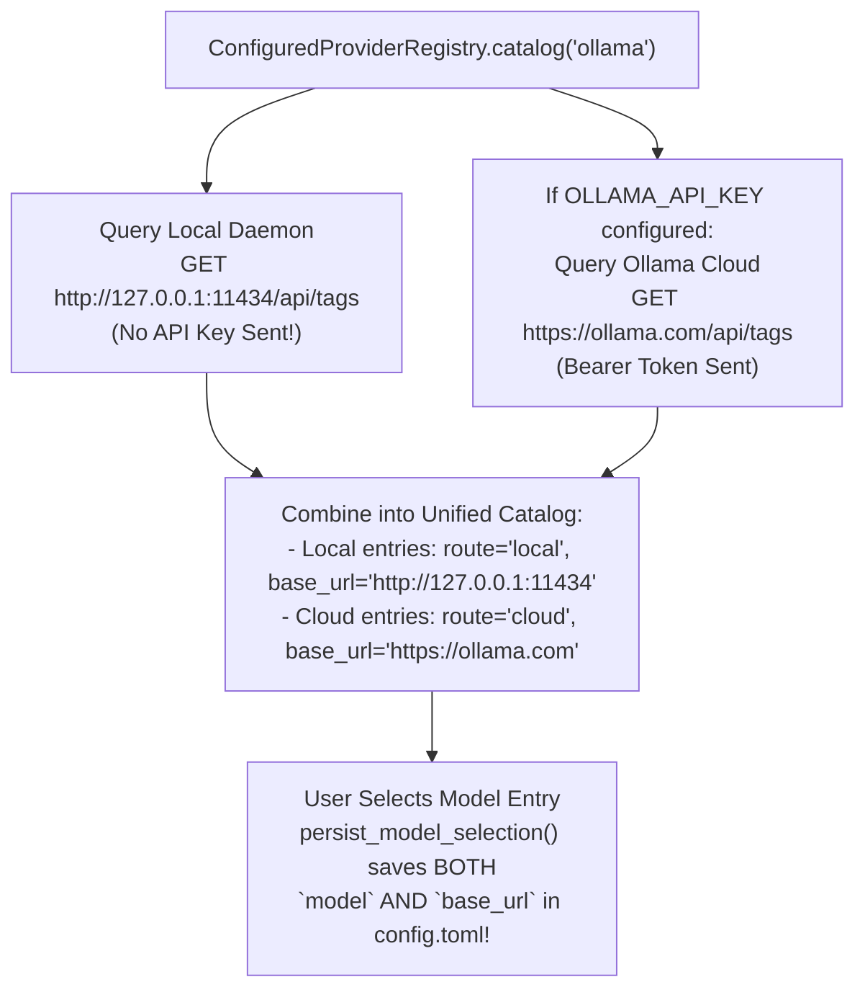

# NinjaRobotPi5 Multi-HAT Integration & Runtime Remediation Plan

**Date:** 2026-11-02 (Refined & Code-Verified Edition)  
**Status:** Ready for Phased Owner Review & Execution  
**Companion Audit Report:** [`NinjaSunFounderIntegrationAudit_261102.md`](NinjaSunFounderIntegrationAudit_261102.md)  
**Scope:**
1. **Phase 0:** Baseline Verification, Kernel Driver (`fusion_hat.ko`) Pre-Flight Check & Protocol Fixtures
2. **Phase 1:** Fix `ngrok` Free-Tier Loopback Proxy Request Rejection (`421 Unknown request host`)
3. **Phase 2:** Separate Raspberry Pi 5V Rail Undervoltage from SunFounder HAT Battery Cutoff
4. **Phase 3:** Fix Service-Mode Speech Availability, ALSA Fallback, `_locally_stopped` Latch & Amplifier Control
5. **Phase 4:** Fix Fusion HAT+ (`0x17`) 2-Byte Register Stride & Preserve Explicit Servo Roles
6. **Phase 5:** Unified Local (`127.0.0.1:11434`) + Cloud (`ollama.com`) Ollama Model Discovery & Routing
7. **Phase 6:** Full Automated Regression Gates, Hardware Acceptance & Canonical Wiki Sync

---

## 📖 Quick Plain-English Glossary

| Term / Acronym | Plain-English Explanation |
| :--- | :--- |
| **HAT** *(Hardware Attached on Top)* | An expansion board plugged onto the Raspberry Pi's 40-pin header (`DFR0566`, `SunFounder Robot HAT v4`, `SunFounder Fusion HAT+`, or `PCA9685`). |
| **PWM** *(Pulse-Width Modulation)* | A 50 Hz pulse signal whose pulse width (`500–2500 µs`) controls **positional servos** (angle) and **continuous-rotation servos** (wheel speed/direction). |
| **Register Stride (`+1` vs. `+2`)** | On Robot HAT v4 (`0x14`), each 16-bit register slot increases by **`+1`** (`0x20, 0x21, 0x22`). On Fusion HAT+ (`0x17`), each 16-bit register occupies two byte addresses (`_H` and `_L`), so channel and timer base addresses increase by **`+2`** (`0x60, 0x62, 0x64` and `0x40, 0x42, 0x44`). |
| **Uvicorn `proxy_headers`** | A setting in the Uvicorn web server. When `True` (the default), Uvicorn replaces the local `127.0.0.1` peer address of `ngrok` with the remote visitor's IP from `X-Forwarded-For`, breaking local loopback proxy detection. Setting `proxy_headers=False` preserves the real `127.0.0.1` peer. |
| **Level 1 (`motion_latched`) vs. Level 2 (`system_latched`)** | **Level 1** stops motor motion only; **Level 2** (`system_safety.stopped`) stops motors, sensors, and speech output until `/resume`. |
| **PipeWire vs. ALSA (`aplay`)** | **PipeWire** is the user-session audio router (`pw-play`); **ALSA** is the underlying Linux kernel sound card interface (`aplay -D plughw:X,0`). |
| **IPC** *(Inter-Process Communication)* | The local Unix socket (`~/.local/state/ninjarobot_pi5/agent.sock`) used by the `ninjarobot` CLI to talk to the background Agent service. |

---

## 🗺️ Visual Phased Remediation Roadmap


| Phase | Target Issue | Primary Files Modified | Hardware Risk |
| :--- | :--- | :--- | :--- |
| **Phase 0** | Reproducible baseline & protocol fixtures | `ninjarobot_pi5_ide/tests/`, `docs/validation/` | **None** (Read-Only / Tests) |
| **Phase 1** | Issue 1: `ngrok` `421 Unknown request host` | `ninjarobot_pi5_agent/src/ninjarobot_pi5_agent/web_app.py`, `tests/test_pairing.py`, `tests/test_remote_access.py` | **None** (Network / Web Boundary) |
| **Phase 2** | Issue 2: Undervoltage stop conflation | `ninjarobot_pi5_ide/src/ninjarobot_pi5_ide/safety.py`, `hardware_setup.py`, `config_import.py`, `tests/test_safety.py` | **Safety-Critical** (Power Monitoring) |
| **Phase 3** | Issue 3: Speech unavailable in service | `ninjarobot_pi5_ide/src/ninjarobot_pi5_ide/audio_output.py`, `safety.py`, `ninjarobot_pi5_agent/src/ninjarobot_pi5_agent/speech.py` | **Low** (Audio & Stop Lifecycle) |
| **Phase 4** | Fusion `0x17` register stride & explicit servo roles | `pi5servo/.../sunfounder_robot_hat.py` *(via `AGENTS.md` authorized record)*, `ninjarobot_pi5_ide/.../config.py`, `config_import.py`, `hardware_setup.py` | **Motion-Critical** (Requires Raised Wheels for Live Test) |
| **Phase 5** | Issue 4: Local + Cloud Ollama discovery | `ninjarobot_pi5_agent/src/ninjarobot_pi5_agent/cloud_registry.py`, `model_selection.py`, `agent_cli.py`, `setup_wizard.py`, `ollama.py` | **None** (Model Provider Routing) |
| **Phase 6** | Full regression gates & canonical wiki sync | `ninjarobot_pi5_wiki/`, `README.md`, `docs/validation/` | **Verification & Docs** |

---

## 🛡️ Non-Negotiable Architecture & Governance Contracts

1. **Strict Layer Ownership (`Agent -> IDE -> pi5* Driver -> Device`):**
   * `ninjarobot_pi5_agent` never imports `pi5*` libraries or touches `smbus2`/`lgpio`.
   * `ninjarobot_pi5_ide` coordinates safety latches, configuration validation, and audio playback, and never monkey-patches or duplicates `pi5servo` I2C register writes.
2. **Managed-Driver Governance (`AGENTS.md` Lines 132–159):**
   * Unrelated managed libraries (`pi5buzzer`, `pi5camera`, `pi5disp`, `pi5mic`, `pi5vl53l0x`) remain 100% untouched.
   * For `pi5servo/src/pi5servo/core/backends/sunfounder_robot_hat.py` (which was added on `2026-10-25` in `docs/validation/authorized_driver_changes.json` with `"baseline": null`), Phase 4 applies the surgical 2-byte stride fix (`_register_stride = 2 if self.address == SUNFOUNDER_FUSION_ADDRESS else 1`) in `sunfounder_robot_hat.py`, tests it in its isolated `pi5servo` pytest process, and records the new SHA-256 hash using `uv run python scripts/verify_immutable_drivers.py --record-authorized ...`.
3. **100% Backward Compatibility for Existing Profiles:**
   * **Profile 1 (`dfr0566` + Geekworm X1208)** and **Profile 3 (`pca9685`)** keep their exact existing defaults, wiring, USB microphone, and Bluetooth speaker workflows.

---

## Phase 0: Establish Reproducible Evidence & Protocol Fixtures

### Objective
Verify the current repository integrity hashes, inspect the Raspberry Pi runtime environment without modifying any files, and write independent register-level test fixtures for both **Robot HAT v4 (`0x14`)** and **Fusion HAT+ (`0x17`)**.

### Step-by-Step Actions
1. **Run Baseline Integrity Verifiers:**
   ```bash
   uv run --frozen python scripts/verify_immutable_drivers.py
   uv run --frozen python scripts/verify_workspace_driver_sources.py
   ```
2. **Read-Only Pi Environment Check (When Connected to the Raspberry Pi):**
   * Check whether the SunFounder kernel module `fusion_hat.ko` is loaded and claiming `0x17` (`UU` in `sudo i2cdetect -y 1` and `/sys/class/fusion_hat/fusion_hat/`).
   * Check `vcgencmd get_throttled` at idle.
   * Check `/speech status` and `/speech outputs` in the running Agent session.
3. **Create Independent Protocol Fixtures:**
   * Add expected I2C packet fixtures verifying:
     * **Robot HAT v4 (`0x14`, stride `1`):** Timer 0..2 Prescaler at `0x40, 0x41, 0x42`; Period at `0x44, 0x45, 0x46`; PWM Channel `0..11` at `0x20..0x2B`; Battery ADC at `0x13`.
     * **Fusion HAT+ (`0x17`, stride `2`):** Timer 0..2 Prescaler at `0x40, 0x42, 0x44`; Period at `0x50, 0x52, 0x54`; PWM Channel `0..11` at `0x60, 0x62, ..., 0x76`; Battery mV at `0x18, 0x19`.

* **Acceptance Gate:** Baseline driver verifiers pass; fixtures clearly prove the `0x14` (stride `1`) vs. `0x17` (stride `2`) register contract.

---

## Phase 1: Repair `ngrok` Free-Tier Loopback Proxy Classification (`Issue 1`)

### Objective
Fix the deterministic `421 Unknown request host` error when accessing the robot over a free-tier `ngrok` tunnel (which operates without paid traffic-policy marker headers).

### Target Files
* [`ninjarobot_pi5_agent/src/ninjarobot_pi5_agent/web_app.py`](file:///Volumes/NINJA_EXT/NinjaRoboticsEducationPlatform/NinjaRobotPi5/ninjarobot_pi5_agent/src/ninjarobot_pi5_agent/web_app.py#L899-L907)
* [`ninjarobot_pi5_agent/tests/test_pairing.py`](file:///Volumes/NINJA_EXT/NinjaRoboticsEducationPlatform/NinjaRobotPi5/ninjarobot_pi5_agent/tests/test_pairing.py)
* [`ninjarobot_pi5_agent/tests/test_remote_access.py`](file:///Volumes/NINJA_EXT/NinjaRoboticsEducationPlatform/NinjaRobotPi5/ninjarobot_pi5_agent/tests/test_remote_access.py)

### Exact Code Remediation
In [`WebServerManager.start()` (`ninjarobot_pi5_agent/src/ninjarobot_pi5_agent/web_app.py:899–907`)](file:///Volumes/NINJA_EXT/NinjaRoboticsEducationPlatform/NinjaRobotPi5/ninjarobot_pi5_agent/src/ninjarobot_pi5_agent/web_app.py#L899-L907), explicitly disable Uvicorn's `ProxyHeadersMiddleware` (`proxy_headers=False`) so `request.client.host` and `websocket.client.host` always reflect the real TCP socket peer (`127.0.0.1` when forwarded by the local `ngrok` binary on the Pi, or the LAN IP when accessed directly over Wi-Fi):

```python
# In ninjarobot_pi5_agent/src/ninjarobot_pi5_agent/web_app.py (lines 899-908)
config = uvicorn.Config(
    self._app,
    host=self._host,
    port=self._port,
    ssl_certfile=str(certificate),
    ssl_keyfile=str(key),
    access_log=False,
    log_level="warning",
    proxy_headers=False,  # Preserve true loopback peer (127.0.0.1) for _is_loopback_proxy_request
)
```

### Why This Is Secure & Complete
1. **Fixes Free-Tier `ngrok` HTTP & WebSocket (`/ws`):** When the local `ngrok` daemon on the Raspberry Pi forwards a request to `https://127.0.0.1:8443`, `request.client.host` (and `websocket.client.host`) remains `"127.0.0.1"`, while `X-Forwarded-Proto: https` and `X-Forwarded-For: <client_ip>` remain intact in `headers`. Thus `_is_loopback_proxy_request()` returns `True` for both HTTP (`pairing_boundary`) and WebSocket (`websocket_endpoint`).
2. **Blocks LAN Spoofing:** If an untrusted device on the local Wi-Fi (`192.168.1.50`) sends a request directly to `https://<pi-ip>:8443` with a forged `Host: <id>.ngrok-free.app` and forged `X-Forwarded-For` / `X-Forwarded-Proto` headers, `request.client.host` is `"192.168.1.50"` (not loopback), so `_is_loopback_proxy_request()` returns `False` and `pairing_boundary` rejects it with `421`!
3. **Preserves Paid Marker Validation:** If a `x-ninjarobot-remote-marker` header *is* present, `pairing.request_scope()` (`pairing.py:236–241`) continues to verify it via `hmac.compare_digest` first.

* **Validation Gate:** Add unit tests wrapping `create_web_app` with `uvicorn.Config(..., proxy_headers=False)` verifying: (a) valid marker accepted, (b) invalid marker rejected, (c) marker-free loopback `127.0.0.1` + `X-Forwarded-Proto: https` + `X-Forwarded-For` accepted for active ngrok origin on both HTTP `/pair` and WebSocket `/ws`, and (d) forged `X-Forwarded-For` from non-loopback `192.168.1.50` rejected with `421`.

---

## Phase 2: Separate Power Stop Causes & Sync Fusion `0x17` Battery Address (`Issue 2`)

### Objective
Eliminate the diagnostic confusion where a low SunFounder HAT battery reading reports *"The Raspberry Pi reported undervoltage while the robot was moving"*, and ensure the battery monitor polls the actual active MCU address (`0x17` on Fusion HAT+ vs. `0x14` on Robot HAT v4).

### Target Files
* [`ninjarobot_pi5_ide/src/ninjarobot_pi5_ide/safety.py`](file:///Volumes/NINJA_EXT/NinjaRoboticsEducationPlatform/NinjaRobotPi5/ninjarobot_pi5_ide/src/ninjarobot_pi5_ide/safety.py#L65-L115) (`STOP_GUIDANCE`, `_undervoltage_monitor`, `stop_motion`)
* [`ninjarobot_pi5_ide/src/ninjarobot_pi5_ide/hardware_setup.py`](file:///Volumes/NINJA_EXT/NinjaRoboticsEducationPlatform/NinjaRobotPi5/ninjarobot_pi5_ide/src/ninjarobot_pi5_ide/hardware_setup.py#L311-L345) (`apply_hardware_profile_preset`)
* [`ninjarobot_pi5_ide/src/ninjarobot_pi5_ide/config_import.py`](file:///Volumes/NINJA_EXT/NinjaRoboticsEducationPlatform/NinjaRobotPi5/ninjarobot_pi5_ide/src/ninjarobot_pi5_ide/config_import.py#L200-L210)
* [`ninjarobot_pi5_ide/tests/test_safety.py`](file:///Volumes/NINJA_EXT/NinjaRoboticsEducationPlatform/NinjaRobotPi5/ninjarobot_pi5_ide/tests/test_safety.py)

### Step-by-Step Implementation
1. **Add Distinct `"battery_undervoltage"` Reason in `safety.py` (While Preserving `"undervoltage"` for Pi 5V Rail):**
   * Keep `"undervoltage"` mapped to Raspberry Pi 5 PMIC (`vcgencmd get_throttled` bit 0 `0x1`), so all existing tests and persisted state files remain 100% compatible.
   * Add `"battery_undervoltage"` to `STOP_GUIDANCE` in [`safety.py:65–90`](file:///Volumes/NINJA_EXT/NinjaRoboticsEducationPlatform/NinjaRobotPi5/ninjarobot_pi5_ide/src/ninjarobot_pi5_ide/safety.py#L65-L90):
     ```python
     "battery_undervoltage": StopGuidance(
         cause="The expansion HAT battery voltage dropped below the safe cutoff while the robot was moving.",
         recovery_instruction=(
             "Recharge or replace the expansion HAT battery, verify battery voltage is above "
             "the cutoff threshold, then confirm motion resume."
         ),
     ),
     ```
2. **Pass Measured Voltage & Threshold in `fault_detail`:**
   * Extend `SafetyStateStore.latch_motion(reason, *, fault_detail: str | None = None)` and `MotionController.stop_motion(reason, *, latch: bool, fault_detail: str | None = None)` so when `voltage < self._power_config.cutoff_voltage` in `_undervoltage_monitor()` ([`safety.py:624–626`](file:///Volumes/NINJA_EXT/NinjaRoboticsEducationPlatform/NinjaRobotPi5/ninjarobot_pi5_ide/src/ninjarobot_pi5_ide/safety.py#L624-L626)):
     ```python
     if voltage < self._power_config.cutoff_voltage:
         cutoff_v = self._power_config.cutoff_voltage
         await self.stop_motion(
             "battery_undervoltage",
             latch=True,
             fault_detail=f"measured={voltage:.2f}V cutoff={cutoff_v:.2f}V",
         )
         return
     ```
   * Also guard against bogus `0.00V` / negative / `> 15.0V` I2C read glitches (e.g., when no battery is connected or during an I2C NACK) by treating `voltage <= 0.5 or voltage > 15.0` as an uncalibrated/unavailable telemetry warning rather than a false battery cutoff latch!
3. **Auto-Detect `0x17` (Fusion HAT+) vs. `0x14` (Robot HAT v4) When Writing Profile Preset:**
   * In [`hardware_setup.py:327–344` (`apply_hardware_profile_preset`)](file:///Volumes/NINJA_EXT/NinjaRoboticsEducationPlatform/NinjaRobotPi5/ninjarobot_pi5_ide/src/ninjarobot_pi5_ide/hardware_setup.py#L327-L344), when `profile == "sunfounder_robot_hat"`, probe whether `/sys/class/fusion_hat` exists or I2C `0x17` responds before `0x14`, and write `"address": 23` (`0x17`) for Fusion HAT+ or `"address": 20` (`0x14`) for Robot HAT v4 into `servo.json` so `config_import.py` sets `fuel_gauge_address` accurately!

---

## Phase 3: Fix Speech Readiness, ALSA Fallback, Stop Latch & Amplifier Control (`Issue 3`)

### Objective
Ensure speech output works reliably in the background Agent service on SunFounder Fusion HAT+ (`0x17`) and Robot HAT v4 (`0x14`), survives normal non-latching operator stops (`robot.stop()`), and reports exact diagnostic reasons on failure.

### Target Files
* [`ninjarobot_pi5_ide/src/ninjarobot_pi5_ide/safety.py`](file:///Volumes/NINJA_EXT/NinjaRoboticsEducationPlatform/NinjaRobotPi5/ninjarobot_pi5_ide/src/ninjarobot_pi5_ide/safety.py#L716-L760) (`SystemSafetyController.full_stop`)
* [`ninjarobot_pi5_ide/src/ninjarobot_pi5_ide/audio_output.py`](file:///Volumes/NINJA_EXT/NinjaRoboticsEducationPlatform/NinjaRobotPi5/ninjarobot_pi5_ide/src/ninjarobot_pi5_ide/audio_output.py#L37-L315) (`_set_speaker_amplifier`, `AudioOutput.health`)
* [`ninjarobot_pi5_agent/src/ninjarobot_pi5_agent/speech.py`](file:///Volumes/NINJA_EXT/NinjaRoboticsEducationPlatform/NinjaRobotPi5/ninjarobot_pi5_agent/src/ninjarobot_pi5_agent/speech.py#L171-L223) (`SpeechService.speak`)
* [`ninjarobot_pi5_ide/tests/test_audio_output.py`](file:///Volumes/NINJA_EXT/NinjaRoboticsEducationPlatform/NinjaRobotPi5/ninjarobot_pi5_ide/tests/test_audio_output.py), [`ninjarobot_pi5_agent/tests/test_speech.py`](file:///Volumes/NINJA_EXT/NinjaRoboticsEducationPlatform/NinjaRobotPi5/ninjarobot_pi5_agent/tests/test_speech.py)

### Step-by-Step Implementation

1. **Fix `SystemSafetyController.full_stop(..., latch=False)` Leaving `_locally_stopped = True` Permanently (`safety.py:732`):**
   * In [`safety.py:716–765`](file:///Volumes/NINJA_EXT/NinjaRoboticsEducationPlatform/NinjaRobotPi5/ninjarobot_pi5_ide/src/ninjarobot_pi5_ide/safety.py#L716-L765), `full_stop()` sets `self._locally_stopped = True` at the start of cleanup so no idle face animation overwrites the emergency stop icon during the 2-second hold (`_display_hold_seconds`).
   * However, when `latch=False` (a normal `robot.stop()` operator stop, **not** a persistent Level 2 hardware driver failure), `self._locally_stopped` was left `True` forever—causing `robot.system_safety.stopped` to remain `True` and blocking all subsequent `AudioOutput` playback (`speech_blocked_by_safety_or_foreground`)!
   * **Fix:** In `full_stop()`, when `not latch and not self._state.read().system_latched`, reset `self._locally_stopped = False` in a `finally:` block after the cleanup and display hold complete!

2. **Fix `AudioOutput.health()` to Fall Back to ALSA I2S (`_detect_alsa_i2s_device()`) When Service PipeWire Has No Sink (`audio_output.py:279–311`):**
   * Currently, [`AudioOutput.health()` (`audio_output.py:279–311`)](file:///Volumes/NINJA_EXT/NinjaRoboticsEducationPlatform/NinjaRobotPi5/ninjarobot_pi5_ide/src/ninjarobot_pi5_ide/audio_output.py#L279-L311) only checks `_detect_alsa_i2s_device()` when `pw-play` or `pw-dump` binaries are missing from `PATH`.
   * On Raspberry Pi OS where `pw-play` and `pw-dump` are installed, if `await self.outputs()` returns no matching PipeWire sink or raises an exception (common when running inside a headless service or without a desktop PipeWire session), `health()` immediately returns `{"ready": False, "reason": "selected_output_unavailable"}` instead of checking `_detect_alsa_i2s_device()`.
   * **Fix:** Create a helper `_alsa_i2s_fallback_ready()` and invoke it inside `AudioOutput.health()` not only when `pw-play`/`pw-dump` are missing, **but also** when `ready` is `False` or `self.outputs()` raises an exception for an I2S output node! This makes `AudioOutput.health()` 100% consistent with `AudioOutput._play_stream()` (which already falls back to `aplay -D <alsa_dev>` at line 382) and `play_sunfounder_speaker_test_tone()`.

3. **Remove the Unsynchronized I2C `0x17` Register `0x31` Write from `_set_speaker_amplifier()` (`audio_output.py:58–67`):**
   * In [`audio_output.py:37–88`](file:///Volumes/NINJA_EXT/NinjaRoboticsEducationPlatform/NinjaRobotPi5/ninjarobot_pi5_ide/src/ninjarobot_pi5_ide/audio_output.py#L37-L88), delete lines 58–67 (`smbus2.SMBus(1)` writing to `0x17` register `0x31`, which is the Fusion HAT+ Buzzer Switch and races with `pi5servo` I2C access).
   * Instead, if `/sys/class/fusion_hat/fusion_hat/speaker` exists (Fusion HAT+), write `"1\n"` / `"0\n"` to that sysfs node (or invoke `fusion_hat speaker enable/disable` if installed); otherwise (Robot HAT v4), toggle `gpio_pin` (`GPIO12`) via `pinctrl` / `lgpio`.

4. **Surface Exact Stage & Reason in `SpeechService.speak()` (`speech.py:184–219`):**
   * When `health.get("ready")` is `False`, include `"reason": health.get("reason", "output_unavailable")` and `"stage": "playback_health"` in the returned dictionary and `self._last`.
   * When `self.synthesizer.synthesize()` raises `ValueError` (such as `"piper_not_installed"`, `"speech_model_missing"`, or `"speech_model_not_configured"`), preserve that exact safe reason code in `result["reason"]` and `"stage": "synthesis"` instead of collapsing everything into `"speech_unavailable_or_interrupted; text retained"`.

---

## Phase 4: Fix Fusion HAT+ (`0x17`) Register Stride & Preserve Explicit Servo Roles

### Objective
Fix the 2-byte register stride mismatch on Fusion HAT+ (`0x17`) so all 12 PWM channels (`P0–P11`) and all 3 timers initialize, move, and stop accurately, and fix `config_import.py` / `hardware_setup.py` so user-configured servo roles are never overwritten by implicit `hat_pwm0`/`hat_pwm1` assumptions.

### Target Files
* [`pi5servo/src/pi5servo/core/backends/sunfounder_robot_hat.py`](file:///Volumes/NINJA_EXT/NinjaRoboticsEducationPlatform/NinjaRobotPi5/pi5servo/src/pi5servo/core/backends/sunfounder_robot_hat.py#L129-L286) *(with owner authorization recorded via `verify_immutable_drivers.py --record-authorized`)*
* [`pi5servo/tests/test_backend.py`](file:///Volumes/NINJA_EXT/NinjaRoboticsEducationPlatform/NinjaRobotPi5/pi5servo/tests/test_backend.py)
* [`ninjarobot_pi5_ide/src/ninjarobot_pi5_ide/config.py`](file:///Volumes/NINJA_EXT/NinjaRoboticsEducationPlatform/NinjaRobotPi5/ninjarobot_pi5_ide/src/ninjarobot_pi5_ide/config.py#L200-L285)
* [`ninjarobot_pi5_ide/src/ninjarobot_pi5_ide/config_import.py`](file:///Volumes/NINJA_EXT/NinjaRoboticsEducationPlatform/NinjaRobotPi5/ninjarobot_pi5_ide/src/ninjarobot_pi5_ide/config_import.py#L180-L215)
* [`ninjarobot_pi5_ide/src/ninjarobot_pi5_ide/hardware_setup.py`](file:///Volumes/NINJA_EXT/NinjaRoboticsEducationPlatform/NinjaRobotPi5/ninjarobot_pi5_ide/src/ninjarobot_pi5_ide/hardware_setup.py#L425-L445)

### Step-by-Step Implementation

#### 4.1 Surgical 2-Byte Register Stride Fix in `sunfounder_robot_hat.py`
In [`pi5servo/src/pi5servo/core/backends/sunfounder_robot_hat.py`](file:///Volumes/NINJA_EXT/NinjaRoboticsEducationPlatform/NinjaRobotPi5/pi5servo/src/pi5servo/core/backends/sunfounder_robot_hat.py#L129-L142):
1. Add `_register_stride`:
   ```python
   @property
   def _register_stride(self) -> int:
       """Return 2 for Fusion HAT+ (0x17 _H/_L byte pairs) and 1 for Robot HAT v4 (0x14)."""
       return 2 if self.address == SUNFOUNDER_FUSION_ADDRESS else 1

   def _pwm_register(self, channel: int) -> int:
       return self._pwm_register_base + (channel * self._register_stride)

   def _write_timer_registers(self, prescaler: int) -> None:
       stride = self._register_stride
       with self._io_lock:
           for timer_idx in range(3):  # Timers 0, 1, 2 -> Channels P0..P11
               self._write_u16_be(0x40 + (timer_idx * stride), prescaler)
               self._write_u16_be(
                   self._period_register_base + (timer_idx * stride),
                   SUNFOUNDER_PWM_PERIOD,
               )
   ```
2. In `set_pulse_us()`, `off()`, and `close()`, replace `self._pwm_register_base + channel` with `self._pwm_register(channel)`.
3. In `_initialize_timers()`, only call `reset_sunfounder_mcu()` (`GPIO5`) when `orig_address == SUNFOUNDER_DEFAULT_ADDRESS` (`0x14`) and `not Path("/sys/class/fusion_hat").exists()`, so Fusion HAT+ (`0x17`) or displays wired to `GPIO5` are never pulsed blindly.
4. Record the authorized change in `docs/validation/authorized_driver_changes.json`:
   ```bash
   uv run python scripts/verify_immutable_drivers.py \
     --record-authorized pi5servo/src/pi5servo/core/backends/sunfounder_robot_hat.py \
     --record-authorized pi5servo/tests/test_backend.py \
     --reason "Fix Fusion HAT+ (0x17) 2-byte register stride (0x40+2*i, 0x50+2*i, 0x60+2*ch) while preserving Robot HAT v4 (0x14) 1-byte stride." \
     --authorized-by "Project owner" \
     --authorized-on 2026-11-02
   ```

#### 4.2 Preserve Explicit Servo Roles & Fix GPIO Conflict Validation in `ninjarobot_pi5_ide`
1. **In [`config_import.py` (lines 181–199)](file:///Volumes/NINJA_EXT/NinjaRoboticsEducationPlatform/NinjaRobotPi5/ninjarobot_pi5_ide/src/ninjarobot_pi5_ide/config_import.py#L181-L199) and [`hardware_setup.py` (lines 428–440)](file:///Volumes/NINJA_EXT/NinjaRoboticsEducationPlatform/NinjaRobotPi5/ninjarobot_pi5_ide/src/ninjarobot_pi5_ide/hardware_setup.py#L428-L440):**
   * Do **not** fabricate an uncalibrated companion channel when `len(hat_endpoints) == 1`.
   * If existing `behaviors.servo_roles` in `config.toml` already map valid endpoints inside `hat_endpoints` (for example, a user-configured `head_pan = "hat_pwm3"` or custom wheel channels `left_motor = "hat_pwm10"`, `right_motor = "hat_pwm11"`), **preserve those user-configured roles** instead of overwriting them with `hat_pwm0`/`hat_pwm1`!
   * Only assign default `left_motor` / `right_motor` to `hat_pwm0`/`hat_pwm1` (or `hat_endpoints[0]`/`hat_endpoints[1]`) when migrating away from legacy `gpio12`/`gpio13` and at least 2 `hat_pwm` endpoints are calibrated.
2. **In [`config.py` (`enabled_release_features_require_configured_hardware`)](file:///Volumes/NINJA_EXT/NinjaRoboticsEducationPlatform/NinjaRobotPi5/ninjarobot_pi5_ide/src/ninjarobot_pi5_ide/config.py#L558-L565):**
   * Check `speech_output.speaker_enable_gpio` not only against `hardware.servos.endpoints`, but also against `hardware.display` (`dc_gpio`, `reset_gpio`, `backlight_gpio`, `8, 9, 10, 11`), `hardware.buzzer.gpio`, and I2C (`2, 3`).
   * In `config_import.py`, do not force `charging_gpio = 23` on Fusion HAT+ (`0x17`), where charging and battery telemetry are handled by the MCU over I2C (`0x18/0x19`) rather than `GPIO23`.

---

## Phase 5: Unified Local + Cloud Ollama Model Discovery & Routing (`Issue 4`)

### Objective
Display locally downloaded Ollama models (`http://127.0.0.1:11434`) and Ollama Cloud models (`https://ollama.com`) **together** in the model list, keep local models selectable without an API key, never send cloud Bearer tokens to the local daemon, and persist the exact route (`local` vs. `cloud`) in `config.toml` (`providers.ollama.base_url`).

### Target Files
* [`ninjarobot_pi5_agent/src/ninjarobot_pi5_agent/model_selection.py`](file:///Volumes/NINJA_EXT/NinjaRoboticsEducationPlatform/NinjaRobotPi5/ninjarobot_pi5_agent/src/ninjarobot_pi5_agent/model_selection.py#L42-L308)
* [`ninjarobot_pi5_agent/src/ninjarobot_pi5_agent/cloud_registry.py`](file:///Volumes/NINJA_EXT/NinjaRoboticsEducationPlatform/NinjaRobotPi5/ninjarobot_pi5_agent/src/ninjarobot_pi5_agent/cloud_registry.py#L42-L155)
* [`ninjarobot_pi5_agent/src/ninjarobot_pi5_agent/setup_wizard.py`](file:///Volumes/NINJA_EXT/NinjaRoboticsEducationPlatform/NinjaRobotPi5/ninjarobot_pi5_agent/src/ninjarobot_pi5_agent/setup_wizard.py#L674-L742)
* [`ninjarobot_pi5_agent/src/ninjarobot_pi5_agent/agent_cli.py`](file:///Volumes/NINJA_EXT/NinjaRoboticsEducationPlatform/NinjaRobotPi5/ninjarobot_pi5_agent/src/ninjarobot_pi5_agent/agent_cli.py#L1695-L2247)
* [`ninjarobot_pi5_agent/tests/test_cloud_providers.py`](file:///Volumes/NINJA_EXT/NinjaRoboticsEducationPlatform/NinjaRobotPi5/ninjarobot_pi5_agent/tests/test_cloud_providers.py), [`tests/test_model_selection.py`](file:///Volumes/NINJA_EXT/NinjaRoboticsEducationPlatform/NinjaRobotPi5/ninjarobot_pi5_agent/tests/test_model_selection.py), [`tests/test_setup_wizard.py`](file:///Volumes/NINJA_EXT/NinjaRoboticsEducationPlatform/NinjaRobotPi5/ninjarobot_pi5_agent/tests/test_setup_wizard.py)

### Step-by-Step Implementation



1. **Add Optional `route` Metadata to `ModelCatalogEntry` (`model_selection.py:42–56`):**
   ```python
   class ModelCatalogEntry(BaseModel):
       model_config = ConfigDict(extra="forbid", frozen=True, strict=True)
       provider: Annotated[str, StringConstraints(min_length=1, max_length=64)]
       name: Annotated[str, StringConstraints(min_length=1, max_length=100)]
       route: Literal["local", "cloud"] | None = None
       ...
   ```
2. **Fix `ConfiguredProviderRegistry.create()` (`cloud_registry.py:50–77`) So `base_url` Determines Credentials (Never Vice Versa!):**
   * If `self._ollama_base_url_override` is set, use it.
   * Otherwise, if `provider.base_url` is explicitly set in `config.toml` (either `"http://127.0.0.1:11434"` or `"https://ollama.com"`), **respect `provider.base_url`**! Only default `None` to `DEFAULT_OLLAMA_CLOUD_URL` when `has_api_key` is True and `provider.base_url is None`.
   * Crucially, attach `APIKeyCredential` **only when `base_url == DEFAULT_OLLAMA_CLOUD_URL`** (never send `Authorization: Bearer <OLLAMA_API_KEY>` to `http://127.0.0.1:11434`!):
     ```python
     is_cloud = base_url.rstrip("/") == DEFAULT_OLLAMA_CLOUD_URL
     ollama_credentials: CredentialSource | None = (
         APIKeyCredential(self._secrets, api_key_env, "Authorization", "Bearer ")
         if is_cloud and has_api_key
         else None
     )
     ```
3. **Merge Local + Cloud Models in `ConfiguredProviderRegistry.catalog("ollama")` (`cloud_registry.py:121–155`):**
   * Query the local daemon (`DEFAULT_OLLAMA_LOCAL_URL`, `credentials=None`) and—when `has_api_key` is True—query Ollama Cloud (`DEFAULT_OLLAMA_CLOUD_URL`, with `APIKeyCredential`) concurrently via `asyncio.gather(..., return_exceptions=True)`.
   * Tag local models with `route="local"` and cloud models with `route="cloud"` (preserving `-cloud` suffix or route distinction so a model name present on both local and cloud appears as two distinct selectable options: `[local]` vs. `[cloud]`).
   * If the local daemon is offline (`ConnectError`) while cloud succeeds, return the cloud models; if cloud fails (`401` or offline) while local succeeds, return the local models! Only raise an error if **both** fail.
4. **Persist `base_url` Alongside `model` in `persist_model_selection()` (`model_selection.py:287–308`):**
   * When selecting an Ollama model with `route="local"` (or not ending in `-cloud` when selected from local), save `base_url = DEFAULT_OLLAMA_LOCAL_URL` (`"http://127.0.0.1:11434"`) in `config.providers["ollama"]`.
   * When selecting an Ollama model with `route="cloud"`, save `base_url = DEFAULT_OLLAMA_CLOUD_URL` (`"https://ollama.com"`).
5. **Allow Keyless Local Ollama Selection in `setup_wizard.py` & `agent_cli.py`:**
   * In `_provider_setup` (`setup_wizard.py:694–711`) and `_interactive_model_selection` (`agent_cli.py:2192–2207`), allow the user to press Enter / choose *"Use local Ollama only (or keep current key)"* without forcing a cloud API key when local models are installed on `127.0.0.1:11434`!

---

## Phase 6: Integrated Regression Gates, Hardware Acceptance & Wiki Sync

### 6.1 Required Automated Verification Gates (Run After Every Phase)
From the `NinjaRobotPi5` repository root:

```bash
# 1. Verify managed-driver integrity and workspace sources
uv run --frozen python scripts/verify_immutable_drivers.py
uv run --frozen python scripts/verify_workspace_driver_sources.py

# 2. Bytecode compilation, Ruff lint/format, and Mypy static type checking
uv run --frozen python -m compileall -q ninjarobot_pi5_ide/src ninjarobot_pi5_agent/src scripts tests
uv run --frozen ruff check .
uv run --frozen ruff format --check .
uv run --frozen mypy ninjarobot_pi5_ide/src ninjarobot_pi5_agent/src

# 3. Root & package pytest suites
uv run --frozen pytest -q

# 4. Standalone driver pytest suites (each in its own process)
for drv in pi5buzzer pi5camera pi5disp pi5mic pi5servo pi5vl53l0x; do
  uv run --frozen pytest -q "$drv/tests"
done

# 5. Whitespace & diff hygiene
git diff --check
```

### 6.2 Safe Physical Raspberry Pi Acceptance Sequence (Operator-Run)

| Step | Test Category | Command / Procedure | Expected Result & Rollback Gate |
| :--- | :--- | :--- | :--- |
| **1** | **Safe Smoke & Ollama Catalog** | `ninjarobot` -> `1. Set Agent Model` -> `Ollama` | Shows both `[local]` (`127.0.0.1:11434`) and `[cloud]` (`ollama.com`) models; selecting a local model persists `base_url = "http://127.0.0.1:11434"` even when `OLLAMA_API_KEY` is stored. |
| **2** | **Service-Mode Speech Output** | In `ninjarobot chat`: `/speech on`, `/speech status`, then send `"Hello"` | `/speech status` reports `synthesis.ready=true` and `playback.ready=true`; spoken audio plays through the Fusion HAT+ speaker without triggering the `0x31` buzzer; `/stop` followed by another message still speaks. |
| **3** | **Free-Tier `ngrok` Remote Access** | Activate `ngrok` remote access and scan the QR code from a phone on cellular data | Phone opens `/pair` and connects to `/ws` without `421 Unknown request host`. |
| **4** | **Power & Battery Telemetry** | Inspect `vcgencmd get_throttled` and battery voltage reading at idle | Reports accurate `0x17` battery voltage (`~7.4V–8.4V`); any low-battery stop clearly says `"battery_undervoltage"` with measured voltage instead of blaming the Pi 5V rail. |
| **5** | **Raised-Wheel Servo Motion (Fusion HAT+ `0x17`)** | **With robot wheels raised off the table**, test `P0`, `P1`, and an auxiliary channel in `servo-tool`, then via Agent chat | Each channel moves independently without cross-channel corruption on `0x61`/`0x62`, and `stop` cleanly de-energizes pulses. |

### 6.3 Canonical `ninjarobot_pi5_wiki` Documentation Sync
Once all code phases and tests pass:
1. Create a new dated source folder under `ninjarobot_pi5_wiki/raw/articles/ninjarobotpi5/2026-11-02/` (`InstallationGuide.md`, `DevelopmentGuide.md`) and `raw/notes/ninjarobotpi5/2026-11-02/` (`DevelopmentLog.md`) without editing dated folders in place. Ensuring it reflects and convered all new implemented featues.
2. Do not run wiki ingestion and review workflow, I will do wiki ingestion and review workflow on my own after maual validated.
