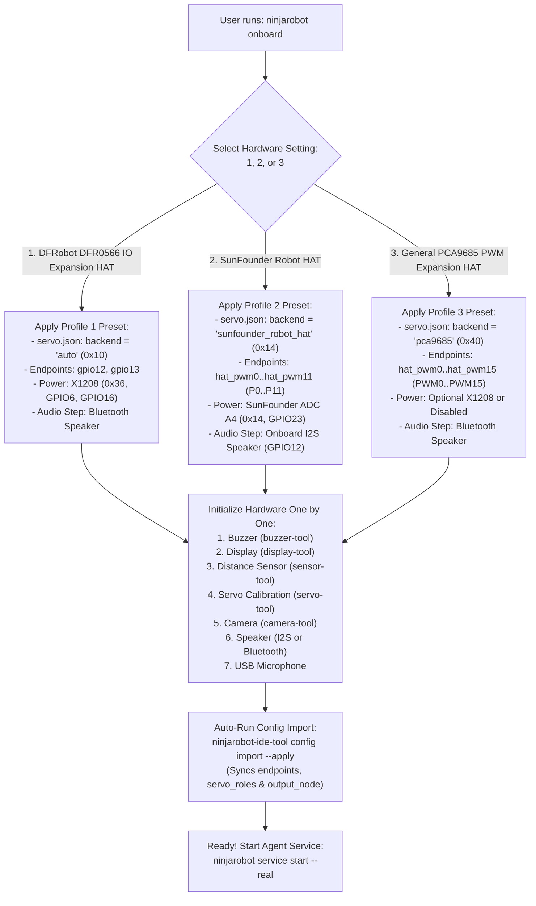

# Phased Hardware & Software Migration Plan: Multi-HAT Support for NinjaRobotPi5

**Target Repository:** `NinjaRobotPi5`  
**Supported Hardware Profiles:**
1. **`1. DFRobot DFR0566 IO Expansion HAT`** *(+ Geekworm X1208 UPS — Existing Baseline, 100% Preserved)*
2. **`2. SunFounder Robot HAT`** *(SunFounder Robot HAT v5 — All-in-One Power, I2S Speaker & 12-Ch Servo MCU)*
3. **`3. General PCA9685 PWM Expansion HAT`** *(16-Channel I2C PWM Servo Driver)*

**Companion Compatibility Report:** `NinjaPi5Compatibility.md`  
**Document Version:** 3.0 (Verified against `NinjaRobotPi5` Codebase & `ninjarobot_pi5_wiki`)

---

## 📖 Quick Plain-English Glossary

New to some of the hardware or software terms in this plan? Here is a quick guide:
* **HAT** (*Hardware Attached on Top*): An expansion circuit board that plugs directly onto the Raspberry Pi's 40-pin header.
* **GPIO** (*General-Purpose Input/Output*) & **BCM** (*Broadcom Pin Numbering*): The 40 metal pins on the Raspberry Pi and the logical numbers (`GPIO12`, `GPIO17`) software uses to talk to them.
* **RP1** (*Raspberry Pi 5 Southbridge*): The chip on Raspberry Pi 5 that controls all GPIO pins. Because of RP1, Pi 5 requires the **`lgpio`** Python library instead of the old Pi 4 `RPi.GPIO` library.
* **PWM** (*Pulse-Width Modulation*): Sending 50 electrical pulses per second (**50 Hz**) to a servo motor. The pulse width in microseconds (**µs**)—from `500 µs` (`-90°`) to `1500 µs` (`0°` center) to `2500 µs` (`+90°`)—sets the servo's angle or wheel speed.
* **I2C** (*Inter-Integrated Circuit*): A two-wire bus (`GPIO2 SDA`, `GPIO3 SCL`) where multiple chips share the same wires using unique hexadecimal addresses (`0x10` for DFR0566, `0x14` for SunFounder MCU, `0x29` for VL53L0X distance sensor, `0x36` for X1208 UPS, `0x40` for PCA9685).
* **Big-Endian vs. Little-Endian**: The byte order used when sending a 16-bit number (`0..65535`) over I2C. **Big-Endian** sends the high byte (`MSB`) first and low byte (`LSB`) second. The SunFounder MCU requires **Big-Endian** 3-byte packets (`[register, MSB, LSB]`).
* **SPI** (*Serial Peripheral Interface*): A fast 4-wire bus used to drive the ST7789V 2.0" color LCD eye screen.
* **I2S** (*Inter-IC Sound*) & **PipeWire**: I2S sends pure digital audio over GPIO pins (`18, 19, 20, 21`) to the SunFounder HAT's built-in speaker chip; **PipeWire** is the Linux audio router that sends the robot's voice to a named speaker (`output_node`).
* **MCU** (*Microcontroller Unit*) & **ADC** (*Analog-to-Digital Converter*): The onboard helper chip (**Artery AT32F413** on the SunFounder HAT) that generates servo pulses and measures analog battery voltage.
* **MCP** (*Model Context Protocol*): The structured tool-calling protocol used by `ninjarobot_pi5_agent` to request safe robot actions from `ninjarobot_pi5_ide`.

---

## 🗺️ Master Migration Roadmap


| Phase | Focus Area | Packages / Files Touched | Key Outcome |
| :--- | :--- | :--- | :--- |
| **Phase 1** | Physical Assembly & Power Verification | Hardware Only | Safe power-up for Profile 1 (DFR0566+X1208), Profile 2 (SunFounder), or Profile 3 (PCA9685). |
| **Phase 2** | OS Boot Overlay & Onboard I2S Audio | `/boot/firmware/config.txt`, `ninjarobot_pi5_ide/audio_output.py` | Built-in I2S speaker enabled (`GPIO12` amp + PipeWire `output_node`) for Profile 2; Bluetooth preserved for Profiles 1 & 3. |
| **Phase 3** | Existing Peripheral Verification | `pi5disp`, `pi5vl53l0x`, `pi5buzzer`, Camera, Mic | Confirms LCD, Laser Distance Sensor (`0x29`), Buzzer (`GPIO17`), Camera, and USB Mic work identically without code changes. |
| **Phase 4** | `pi5servo` Multi-HAT Backend Upgrade | `pi5servo` (`sunfounder_robot_hat.py`, `pca9685.py`, `endpoint.py`, `backend.py`, `config_manager.py`, `cli/_common.py`) | Unified support for `dfr0566` (`0x10`), `sunfounder_robot_hat` (`0x14`), and `pca9685` (`0x40`) with `0..15` channel addressing. |
| **Phase 5** | `ninjarobot_pi5_ide` Runtime, Safety & Battery Integration | `ninjarobot_pi5_ide` (`servo.py`, `config.py`, `hardware_setup.py`, `config_import.py`, `safety.py`) | IDE dynamically loads the active HAT backend, validates HAT servo calibrations, supports multi-joint movements, and monitors battery voltage safely. |
| **Phase 6** | Interactive Hardware Initialization | CLI Tools (`buzzer-tool`, `display-tool`, `sensor-tool`, `servo-tool`, `camera-tool`) | Step-by-step initialization and neutral/min/max servo calibration using the real TUI tools. |
| **Phase 7** | `ninjarobot onboard` 3-Profile Wizard & Agent Control | `ninjarobot_pi5_agent` (`setup_wizard.py`) | User runs `ninjarobot onboard`, picks `1`, `2`, or `3`, initializes each hardware module, and controls the robot via the AI Agent. |
| **Phase 8** | Automated Regression Testing & Wiki Sync | `pytest`, `authorized_driver_changes.json`, `ninjarobot_pi5_wiki` | 100% test pass rate across all packages and canonical wiki documentation updated. |

---

## Phase 1: Physical Assembly, Pre-Flight Safety & Power Verification

### 1.1 Safety First: Pre-Assembly Checklist
Before unplugging or plugging any wires on your Raspberry Pi 5:
1. Run `sudo poweroff` and wait until the Raspberry Pi 5 status LED turns solid red/off.
2. Disconnect all USB-C power cables and switch **OFF** any battery power switches.
3. Keep all servo motors **unplugged** during initial board power-up (you will plug them in during Phase 6 after verifying the I2C bus).

---

### 1.2 Hardware Wiring by Profile

#### Option 1: DFRobot DFR0566 IO Expansion HAT + Geekworm X1208 UPS *(Existing Baseline)*
* **No physical changes required!** Keep the Geekworm X1208 mounted underneath the Pi 5, the DFR0566 mounted on top, the left wheel servo on `D12` (`GPIO12`), and the right wheel servo on `D13` (`GPIO13`).

#### Option 2: SunFounder Robot HAT (v5)
1. **Remove the Geekworm X1208 UPS (Recommended):** The SunFounder Robot HAT has its own built-in `5V/5A` power regulator and 2S battery protection circuit. Removing the bottom X1208 UPS reduces weight and avoids double-powering the 5V GPIO rail.
2. **Mount the SunFounder Robot HAT:** Align the 40-pin female header on the underside of the SunFounder Robot HAT with the Raspberry Pi 5's 40-pin GPIO header and press down firmly on the standoffs.
3. **Reconnect Existing Peripherals to the SunFounder Pass-Through Header:**
   * **CSI Camera Ribbon:** Route the ribbon cable through the HAT's camera slot into the Pi 5 `CAM/DISP` MIPI CSI port.
   * **ST7789V SPI LCD (`pi5disp`):** Plug jumper wires into the top 40-pin pass-through header: `VCC -> 3.3V (Pin 1)`, `GND -> GND (Pin 6)`, `CS -> GPIO8 (Pin 24)`, `MOSI -> GPIO10 (Pin 19)`, `SCLK -> GPIO11 (Pin 23)`, `DC -> GPIO24 (Pin 18)`, `RST -> GPIO25 (Pin 22)`, `BL -> GPIO14 (Pin 8)`. *(Note: Do not press the small physical `USR` tactile button on the HAT while LCD `RST` is wired to `GPIO25`.)*
   * **VL53L0X Distance Sensor (`pi5vl53l0x`):** Connect to the HAT's 4-pin **I2C** header (`3.3V`, `GND`, `SDA -> GPIO2`, `SCL -> GPIO3`).
   * **External Buzzer (`pi5buzzer`):** Connect `SIG -> GPIO17 (Pin 11)`, `VCC -> 3.3V`, `GND -> GND`.
   * **2S Battery (`7.4V–8.4V`):** Plug the 3-wire XH2.54 battery plug into the white battery socket in the corner of the HAT.

#### Option 3: General PCA9685 PWM Expansion HAT
1. Mount the PCA9685 HAT onto the 40-pin header (or connect via `3.3V`, `GND`, `GPIO2 SDA`, `GPIO3 SCL`).
2. Connect an external `5V–6V` high-current power supply (or UBEC) to the green **`V+` and `GND` screw terminal** on the PCA9685 board to power the servo rail.
3. Connect the LCD (`SPI0`), VL53L0X (`I2C1`), and Buzzer (`GPIO17`) to the pass-through GPIO pins exactly as in Option 1.

---

### 1.3 Initial Power-Up & I2C Bus Verification
Turn on the power switch, boot into Raspberry Pi OS, and run:

```bash
# 1. Verify no undervoltage or throttling occurred during boot (must return throttled=0x0)
vcgencmd get_throttled

# 2. Scan I2C Bus 1 to confirm your HAT and distance sensor are visible
sudo i2cdetect -y 1
```

**Expected `i2cdetect -y 1` Output by Profile:**
* **Profile 1 (DFR0566 + X1208):** Shows `10` (DFR0566), `29` (VL53L0X), and `36` (X1208 Fuel Gauge).
* **Profile 2 (SunFounder Robot HAT):** Shows **`14`** (AT32F413 MCU) and **`29`** (VL53L0X).
* **Profile 3 (PCA9685 HAT):** Shows **`29`** (VL53L0X) and **`40`** (PCA9685 PWM Driver; plus `70` all-call address if enabled).

> **Troubleshooting if `14` is missing on SunFounder Robot HAT:**  
> Pulse the MCU Reset pin (`GPIO5`) using Raspberry Pi 5's built-in `pinctrl` tool (never `RPi.GPIO`):
> ```bash
> pinctrl set 5 op dl && sleep 0.05 && pinctrl set 5 op dh && sleep 0.2
> sudo i2cdetect -y 1
> ```

---

## Phase 2: OS Boot Configuration & Onboard I2S Audio Setup

### 2.1 Boot Overlay Configuration (`/boot/firmware/config.txt`)

Ensure `/boot/firmware/config.txt` enables `i2c_arm` and `spi` for all profiles, and adds the **HiFiBerry I2S DAC overlay** plus **`GPIO12` speaker enable** when using the SunFounder Robot HAT:

```ini
# --- NinjaRobotPi5 Core Buses (All Profiles) ---
dtparam=i2c_arm=on
dtparam=spi=on

# --- SunFounder Robot HAT Onboard I2S Speaker (Safe on All Profiles when GPIO12 is not used for PWM) ---
# Note: Only active when Profile 2 (SunFounder Robot HAT) is selected, or enabled via setup script.
dtparam=i2s=on
dtoverlay=hifiberry-dac
```

> **Important Compatibility Note for Profile 1 (DFR0566):**  
> On Profile 1, `GPIO18`–`GPIO21` are unused, so loading `dtoverlay=hifiberry-dac` does not touch `GPIO12` or `GPIO13`! However, do **not** hardcode `gpio=12=op,dh` in `/boot/firmware/config.txt` if you switch back and forth to Profile 1 (which uses `GPIO12` as hardware PWM `Alt0` for the left wheel servo). Instead, let `NinjaRobotPi5` toggle `GPIO12` dynamically in software via `lgpio` whenever Profile 2's I2S speaker is active!

---

### 2.2 Integrating Onboard I2S Audio with `ninjarobot_pi5_ide/audio_output.py`

In the existing codebase, [`ninjarobot_pi5_ide/src/ninjarobot_pi5_ide/audio_output.py`](file:///Volumes/NINJA_EXT/NinjaRoboticsEducationPlatform/NinjaRobotPi5/ninjarobot_pi5_ide/src/ninjarobot_pi5_ide/audio_output.py#L64-L66) requires an explicit PipeWire `output_node` in `config.toml` (`[speech_output]`) and runs `pw-play --target=<output_node>` with `"node.dont-fallback": True`. Furthermore, the SunFounder Robot HAT has a hardware mute/enable switch on **`GPIO12`** (`HIGH` = Speaker Amplifier ON, `LOW` = Muted).

#### Required Enhancement to `ninjarobot_pi5_ide/src/ninjarobot_pi5_ide/audio_output.py`:
1. Add a helper function `discover_i2s_output_node()` that inspects `pw-dump` for a PipeWire `Audio/Sink` whose `node.name` or `node.description` matches `hifiberry` / `soc_sound` / `rpi_hifiberry_dac` (typically `alsa_output.platform-soc_sound.stereo-fallback`).
2. Add optional `speaker_enable_gpio: int | None = None` to [`SpeechOutputConfig`](file:///Volumes/NINJA_EXT/NinjaRoboticsEducationPlatform/NinjaRobotPi5/ninjarobot_pi5_ide/src/ninjarobot_pi5_ide/config.py#L298-L315) in `config.py` (set to `12` for Profile 2 `sunfounder_robot_hat`, and `None` for Profiles 1 & 3).
3. Inside `AudioOutput._play_stream()`, when `self.config.speaker_enable_gpio is not None`:
   * Use `lgpio` to assert `GPIO12` `HIGH` (`1`) before spawning `pw-play`, and optionally keep it `HIGH` (or pull `LOW` on `close()`) so the built-in speaker always plays clearly even right after a cold reboot!

```python
# Helper in ninjarobot_pi5_ide/src/ninjarobot_pi5_ide/audio_output.py
def _set_speaker_amplifier(gpio_pin: int | None, enabled: bool) -> None:
    """Drive the SunFounder Robot HAT speaker amplifier switch (GPIO 12) via lgpio."""
    if gpio_pin is None:
        return
    try:
        import lgpio
        for chip in (4, 0):
            try:
                handle = lgpio.gpiochip_open(chip)
                break
            except Exception:
                continue
        else:
            return
        try:
            lgpio.gpio_claim_output(handle, gpio_pin, 1 if enabled else 0)
            lgpio.gpio_write(handle, gpio_pin, 1 if enabled else 0)
        finally:
            lgpio.gpiochip_close(handle)
    except Exception:
        pass
```

#### Quick CLI Verification for Onboard I2S Speaker (Profile 2):
```bash
# Enable amplifier on GPIO 12 using Pi 5's pinctrl and play a 2-second test tone
pinctrl set 12 op dh
speaker-test -t sine -f 440 -c 2 -l 1
```

---

## Phase 3: Existing Hardware Verification (Zero Code Changes Needed)

Before touching any servo code, verify that the four non-servo peripherals work identically across your mounted HAT:

```bash
# 1. Verify Buzzer on GPIO 17
uv run --frozen --no-sync pi5buzzer buzzer-tool

# 2. Verify ST7789V SPI LCD Display
uv run --frozen --no-sync pi5disp display-tool

# 3. Verify VL53L0X Laser Distance Sensor on I2C 0x29
uv run --frozen --no-sync pi5vl53l0x sensor-tool

# 4. Verify Pi 5 CSI Camera
rpicam-hello --list-cameras

# 5. Verify USB Microphone
arecord -l
```

---

## Phase 4: `pi5servo` Multi-HAT Driver & Endpoint Upgrade

> **Governance Reminder (`NinjaRobotPi5/AGENTS.md`):**  
> Because `pi5servo` is a managed hardware driver package checked by `scripts/check_driver_ modifications.py`, any intentional edits to `pi5servo/` must also be recorded in `authorized_driver_changes.json` with an explicit reason and change ID.

### 4.1 Implementing `SunFounderRobotHatBackend` (`pi5servo/src/pi5servo/core/backends/sunfounder_robot_hat.py`)

#### Critical Hardware Protocol Rules (Verified from `OnboardMCU.md` & `sunfounder/robot-hat`):
1. **Big-Endian 3-Byte Packet Format:** The Artery AT32F413 MCU at `0x14` reads fixed 3-byte I2C packets: `[register, value_high_byte, value_low_byte]`. Standard SMBus `write_word_data` sends Little-Endian (`[register, LSB, MSB]`), which corrupts 16-bit numbers like `PERIOD = 4095` (`0x0FFF` -> `0xFF0F = 65295`). Therefore, **all 16-bit writes must use `bus.write_i2c_block_data(address, reg, [(val >> 8) & 0xFF, val & 0xFF])`**!
2. **Timer Register Layout on AT32F413 MCU:**
   * Channels `P0–P11` (indices `0..11`) are grouped into 3 hardware timers of 4 channels each:
     * **Timer 0 (`P0–P3`):** Prescaler Reg `0x40`, Period (ARR) Reg `0x44`
     * **Timer 1 (`P4–P7`):** Prescaler Reg `0x41`, Period (ARR) Reg `0x45`
     * **Timer 2 (`P8–P11`):** Prescaler Reg `0x42`, Period (ARR) Reg `0x46`
   * Pulse width register for channel `ch` (`0..11`): **`0x20 + ch`** (`0x20` to `0x2B`).
3. **Thread-Safe Bus Lock (`threading.RLock`) & `lgpio` MCU Reset (`GPIO5`):**
   * Both servo PWM writes and battery ADC reads (`A4`, Reg `0x13`) share the same MCU state machine at `0x14`. A class-level `threading.RLock()` ensures an ADC battery read never interleaves mid-packet with a servo write.
   * If an I2C `OSError` occurs, the backend can optionally pulse `GPIO5` (`MCURST`) via `lgpio` and re-initialize the timers.

```python
"""SunFounder Robot HAT (v5) I2C servo & battery ADC backend for pi5servo."""

from __future__ import annotations

import threading
import time
from collections.abc import Callable
from typing import Any

from ..endpoint import parse_servo_endpoint
from .base import BackendConfigurationError, BackendUnavailableError, ServoBackend

SUNFOUNDER_DEFAULT_ADDRESS = 0x14
SUNFOUNDER_PWM_CHANNELS = range(0, 12)  # P0 through P11 (0-indexed)
SUNFOUNDER_MCU_CLOCK_HZ = 72_000_000
SUNFOUNDER_PWM_PERIOD = 4095
SUNFOUNDER_ADC_BATTERY_CHANNEL = 4  # A4 internal 20k/10k voltage divider


class SunFounderRobotHatBackend(ServoBackend):
    """Drive up to 12 servos (P0..P11) and read battery ADC via SunFounder Robot HAT MCU (0x14)."""

    name = "sunfounder_robot_hat"
    _io_lock = threading.RLock()

    def __init__(
        self,
        *,
        bus_id: int = 1,
        address: int = SUNFOUNDER_DEFAULT_ADDRESS,
        frequency_hz: int = 50,
        bus: Any | None = None,
        bus_factory: Callable[[int], Any] | None = None,
    ) -> None:
        if address < 0x03 or address > 0x77:
            raise BackendConfigurationError(f"Invalid I2C address 0x{address:02X}.")
        if frequency_hz < 40 or frequency_hz > 300:
            raise BackendConfigurationError(
                f"Invalid servo PWM frequency {frequency_hz}Hz. Expected 40-300Hz."
            )

        self.bus_id = int(bus_id)
        self.address = int(address)
        self.frequency_hz = int(frequency_hz)
        self.period_us = 1_000_000.0 / float(self.frequency_hz)
        self._owns_bus = bus is None
        self._bus = bus or self._open_bus(bus_factory)
        self._pulses: dict[int, float] = {}
        self._closed = False
        self._initialize_timers()

    def _open_bus(self, bus_factory: Callable[[int], Any] | None) -> Any:
        if bus_factory is not None:
            return bus_factory(self.bus_id)
        try:
            from smbus2 import SMBus
        except ImportError as exc:
            raise BackendUnavailableError(
                "SunFounder Robot HAT backend requires 'smbus2'."
            ) from exc
        try:
            return SMBus(self.bus_id)
        except Exception as exc:
            raise BackendUnavailableError(
                f"Unable to open I2C bus {self.bus_id} for SunFounder Robot HAT "
                f"at 0x{self.address:02X}: {exc}"
            ) from exc

    def _write_u16_be(self, register: int, value: int) -> None:
        """Write a 16-bit unsigned integer in Big-Endian [MSB, LSB] format to the AT32F413 MCU."""
        clamped = max(0, min(65535, int(value)))
        msb = (clamped >> 8) & 0xFF
        lsb = clamped & 0xFF
        with self._io_lock:
            self._bus.write_i2c_block_data(self.address, register, [msb, lsb])

    def _initialize_timers(self) -> None:
        """Configure Timers 0, 1, and 2 (covering P0..P11) for 50Hz PWM."""
        prescaler = max(
            1,
            int(
                round(
                    SUNFOUNDER_MCU_CLOCK_HZ
                    / (self.frequency_hz * (SUNFOUNDER_PWM_PERIOD + 1))
                )
            )
            - 1,
        )
        try:
            with self._io_lock:
                for timer_idx in range(3):  # Timers 0, 1, 2 -> Channels P0..P11
                    self._write_u16_be(0x40 + timer_idx, prescaler)
                    self._write_u16_be(0x44 + timer_idx, SUNFOUNDER_PWM_PERIOD)
        except Exception as exc:
            if self._owns_bus and hasattr(self._bus, "close"):
                self._bus.close()
            raise BackendUnavailableError(
                f"Unable to initialize SunFounder Robot HAT MCU at 0x{self.address:02X}: {exc}"
            ) from exc

    def _resolve_channel(self, identifier: int | str) -> int:
        endpoint = parse_servo_endpoint(identifier)
        if endpoint.kind != "hat_pwm":
            raise BackendConfigurationError(
                f"SunFounder Robot HAT requires HAT PWM endpoints (pwm0..pwm11 / p0..p11), got {identifier!r}."
            )
        if endpoint.value not in SUNFOUNDER_PWM_CHANNELS:
            raise BackendConfigurationError(
                f"SunFounder Robot HAT channel {endpoint.value} out of range (expected 0..11)."
            )
        return endpoint.value

    def set_pulse_us(self, identifier: int | str, pulse_us: float) -> None:
        channel = self._resolve_channel(identifier)
        if pulse_us <= 0:
            self.off(channel)
            return
        ticks = int(
            round((float(pulse_us) / self.period_us) * float(SUNFOUNDER_PWM_PERIOD))
        )
        ticks = max(0, min(SUNFOUNDER_PWM_PERIOD, ticks))
        self._write_u16_be(0x20 + channel, ticks)
        self._pulses[channel] = float(pulse_us)

    def get_pulse_us(self, identifier: int | str) -> float:
        channel = self._resolve_channel(identifier)
        return self._pulses.get(channel, 0.0)

    def off(self, identifier: int | str) -> None:
        channel = self._resolve_channel(identifier)
        self._write_u16_be(0x20 + channel, 0)
        self._pulses[channel] = 0.0

    def read_battery_voltage(self) -> float:
        """Thread-safe read of onboard 2S battery voltage via ADC channel A4 (Reg 0x13)."""
        channel_reg = (SUNFOUNDER_ADC_BATTERY_CHANNEL | 0x10)  # 0x14 -> 0x13 for A4 (7 - 4 | 0x10)
        channel_reg = (7 - SUNFOUNDER_ADC_BATTERY_CHANNEL) | 0x10  # 0x13
        with self._io_lock:
            self._write_u16_be(channel_reg, 0)
            msb = self._bus.read_byte(self.address)
            lsb = self._bus.read_byte(self.address)
        raw = (msb << 8) | lsb
        return round((raw / 4095.0) * 3.3 * 3.0, 2)

    def close(self) -> None:
        if self._closed:
            return
        for ch in list(self._pulses):
            try:
                self.off(ch)
            except Exception:
                pass
        self._closed = True
        if self._owns_bus and hasattr(self._bus, "close"):
            self._bus.close()
```

---

### 4.2 Updating `PCA9685ServoBackend` (`pi5servo/src/pi5servo/core/backends/pca9685.py`) for Direct `hat_pwm0..15` & `smbus2` Support

#### Why `pca9685.py` Must Be Updated:
In the current codebase, [`PCA9685ServoBackend._normalize_identifier()`](file:///Volumes/NINJA_EXT/NinjaRoboticsEducationPlatform/NinjaRobotPi5/pi5servo/src/pi5servo/core/backends/pca9685.py#L57-L64) rejects any endpoint where `endpoint.kind != "gpio"` and requires `adafruit-blinka` + `adafruit-circuitpython-pca9685` (which are not installed in the base `uv` environment).
To satisfy **Requirement #2 and #3** (smooth support for **General PCA9685 PWM Expansion HAT** using `hat_pwm0..15` / `pwm0..15`), update `PCA9685ServoBackend` in [`pi5servo/src/pi5servo/core/backends/pca9685.py`](file:///Volumes/NINJA_EXT/NinjaRoboticsEducationPlatform/NinjaRobotPi5/pi5servo/src/pi5servo/core/backends/pca9685.py) to:
1. Accept `endpoint.kind == "hat_pwm"` with `0 <= endpoint.value <= 15` directly as PCA9685 channel `0..15` (while still supporting legacy `endpoint.kind == "gpio"` via `channel_map` so existing unit tests in `pi5servo/tests/test_backends.py` pass 100% unchanged!).
2. Provide a built-in **`smbus2` register implementation** (using PCA9685 registers `MODE1 = 0x00`, `PRESCALE = 0xFE`, and `LED0_ON_L = 0x06 + 4 * ch`) whenever `pca9685_device` / `adafruit_pca9685` is not passed, so the General PCA9685 HAT works out-of-the-box with `smbus2` just like `dfr0566` and `sunfounder_robot_hat`!

---

### 4.3 Expanding `ServoEndpoint` (`pi5servo/src/pi5servo/core/endpoint.py`) & `ConfigManager` (`config_manager.py`)

1. **In [`pi5servo/src/pi5servo/core/endpoint.py`](file:///Volumes/NINJA_EXT/NinjaRoboticsEducationPlatform/NinjaRobotPi5/pi5servo/src/pi5servo/core/endpoint.py#L18-L62):**
   * Change `ServoEndpoint.__post_init__` validation from `1 <= self.value <= 4` to **`0 <= self.value <= 15`**:
     ```python
     if self.kind == "hat_pwm" and not 0 <= self.value <= 15:
         raise ValueError(
             f"Invalid HAT PWM channel {self.value}. Supported channels are 0 to 15."
         )
     ```
   * In `parse_servo_endpoint()`, accept `"hat_pwm0"`..`"hat_pwm15"`, `"pwm0"`..`"pwm15"`, and `"p0"`..`"p15"` (case-insensitive), all returning `ServoEndpoint(kind="hat_pwm", value=channel)` whose canonical `.identifier` is `f"hat_pwm{self.value}"` and `.label` is `f"HAT_PWM{self.value}"`.
   * Note: `DFR0566ServoBackend` continues to enforce `DFR0566_PWM_CHANNELS = range(1, 5)` inside `dfr0566.py`, so DFR0566's 1-indexed `hat_pwm1..4` validation remains 100% unchanged!

2. **In [`pi5servo/src/pi5servo/core/backend.py`](file:///Volumes/NINJA_EXT/NinjaRoboticsEducationPlatform/NinjaRobotPi5/pi5servo/src/pi5servo/core/backend.py) & [`pi5servo/src/pi5servo/cli/_common.py`](file:///Volumes/NINJA_EXT/NinjaRoboticsEducationPlatform/NinjaRobotPi5/pi5servo/src/pi5servo/cli/_common.py):**
   * Register `"sunfounder_robot_hat"` (and aliases `"sunfounder"`, `"robot_hat"`) in `create_servo_backend()` and `BACKEND_CHOICES`.
   * Update `_create_auto_backend()` in `backend.py` so that when `hat_endpoints` are present, it checks `hat_backend` / `address` (`0x14` -> `SunFounderRobotHatBackend`, `0x40` -> `PCA9685ServoBackend`, default `0x10` -> `DFR0566ServoBackend`) instead of unconditionally instantiating `DFR0566ServoBackend`.

---

## Phase 5: `ninjarobot_pi5_ide` Runtime, Safety, Power & Config Import Integration

To ensure the IDE (`ninjarobot-ide-tool`) and AI Agent (`ninjarobot_pi5_agent`) work seamlessly across all 3 HATs, update the following five files in `ninjarobot_pi5_ide`:

### 5.1 Dynamic Backend Loading in [`ninjarobot_pi5_ide/src/ninjarobot_pi5_ide/servo.py`](file:///Volumes/NINJA_EXT/NinjaRoboticsEducationPlatform/NinjaRobotPi5/ninjarobot_pi5_ide/src/ninjarobot_pi5_ide/servo.py#L100-L136)

**Current Bug:** `_load_servo_runtime()` ignores `manager.get_backend_config()` stored in `~/.config/pi5servo/servo.json` (`__backend__`) and hardcodes `backend="auto"` and `backend_kwargs={"bus_id": i2c_bus, "address": dfr0566_address}` (`0x10`).  
**Fix:** Read `backend_cfg = manager.get_backend_config()` from `ConfigManager`. If `backend_cfg["name"]` is `"sunfounder_robot_hat"` or `"pca9685"` (or `hat_pwm` endpoints are used with saved `kwargs`), pass the saved `backend_name` and merged `backend_kwargs` (`bus_id`, `address`, `frequency_hz`) to `MultiServos(...)`!

```python
# Inside _load_servo_runtime() in ninjarobot_pi5_ide/src/ninjarobot_pi5_ide/servo.py
backend_cfg = manager.get_backend_config()
saved_backend = str(backend_cfg.get("name", "auto") or "auto")
saved_kwargs = dict(backend_cfg.get("kwargs") or {})
effective_kwargs = {
    "bus_id": saved_kwargs.get("bus_id", i2c_bus),
    "address": saved_kwargs.get("address", dfr0566_address),
    **saved_kwargs,
}
group = group_type(
    None,
    pins=list(endpoints),
    calibrations=calibrations,
    backend=saved_backend,
    backend_kwargs=effective_kwargs,
)
```

---

### 5.2 Endpoint Canonicalization in [`ninjarobot_pi5_ide/src/ninjarobot_pi5_ide/config.py`](file:///Volumes/NINJA_EXT/NinjaRoboticsEducationPlatform/NinjaRobotPi5/ninjarobot_pi5_ide/src/ninjarobot_pi5_ide/config.py#L46-L65)

**Current Bug:** `_normalize_servo_endpoint()` in `config.py` only allows `hat_pwm1..4` and rejects `pwm0` / `hat_pwm0..15`. Furthermore, `ConfigManager` in `pi5servo` saves calibration keys as canonical `"hat_pwm0"`, so if `config.toml` has `"pwm0"`, `servo.py` thinks the endpoint is uncalibrated!  
**Fix:** Update `_normalize_servo_endpoint()` in `config.py` to accept `hat_pwm0..15`, `pwm0..15`, and `p0..15` and normalize all of them to the canonical string **`f"hat_pwm{channel}"`** (while keeping `gpio<N>` normalized to `f"gpio{pin}"`). That way, whether a user writes `"pwm0"`, `"p0"`, or `"hat_pwm0"` in `config.toml`, it always matches `servo.json`!

---

### 5.3 Multi-HAT Servo Setup Validation in [`ninjarobot_pi5_ide/src/ninjarobot_pi5_ide/hardware_setup.py`](file:///Volumes/NINJA_EXT/NinjaRoboticsEducationPlatform/NinjaRobotPi5/ninjarobot_pi5_ide/src/ninjarobot_pi5_ide/hardware_setup.py#L97-L157)

**Current Bug:** `hardware_setup_status("servo")` hardcodes `for pin in (12, 13):` and calls `manager.get_all_calibrations()` (which skips `hat_pwm` endpoints).  
**Fix:** Update `hardware_setup_status("servo")` to:
1. Call `all_calibrations = manager.get_all_endpoint_calibrations()`.
2. Determine the required wheel endpoints from `manager.get_backend_config()["name"]` (or `config.toml`):
   * If backend is `"sunfounder_robot_hat"` or `"pca9685"`: check `("hat_pwm0", "hat_pwm1")` (or any 2 calibrated `hat_pwm` endpoints).
   * Otherwise (default Profile 1 `dfr0566` / `hardware_pwm`): check `("gpio12", "gpio13")`.

---

### 5.4 Importing HAT Endpoints & Roles in [`ninjarobot_pi5_ide/src/ninjarobot_pi5_ide/config_import.py`](file:///Volumes/NINJA_EXT/NinjaRoboticsEducationPlatform/NinjaRobotPi5/ninjarobot_pi5_ide/src/ninjarobot_pi5_ide/config_import.py#L149-L155)

**Current Bug:** `import_pi5_configs()` only updates `servos.calibration_file` and leaves `servos.endpoints = ("gpio12", "gpio13")` and `behaviors.servo_roles = {"left_motor": "gpio12", "right_motor": "gpio13"}` unchanged.  
**Fix:** When `import_pi5_configs()` inspects `pi5servo`'s `servo.json`, also read `__backend__` and all calibrated endpoint keys:
* If `__backend__.name` is `"sunfounder_robot_hat"` or `"pca9685"`, automatically populate `hardware.servos.endpoints` with all calibrated `hat_pwm*` endpoints (defaulting to `("hat_pwm0", "hat_pwm1")`) and set `behaviors.servo_roles["left_motor"] = "hat_pwm0"` and `behaviors.servo_roles["right_motor"] = "hat_pwm1"`.
* If `__backend__.name` is `"sunfounder_robot_hat"`, also auto-configure `speech_output.speaker_enable_gpio = 12` and discover the I2S `output_node` if present.

---

### 5.5 Independent Auxiliary Servo Control & Battery Monitoring in [`ninjarobot_pi5_ide/src/ninjarobot_pi5_ide/safety.py`](file:///Volumes/NINJA_EXT/NinjaRoboticsEducationPlatform/NinjaRobotPi5/ninjarobot_pi5_ide/src/ninjarobot_pi5_ide/safety.py)

1. **Allowing Head/Arm/Gripper Movements Without Wheel Motion (`MotionController._resolve_targets`):**
   * Currently, [`MotionController._resolve_targets()`](file:///Volumes/NINJA_EXT/NinjaRoboticsEducationPlatform/NinjaRobotPi5/ninjarobot_pi5_ide/src/ninjarobot_pi5_ide/safety.py#L649-L653) raises `MotionSafetyError("movement is missing required motor roles: left_motor, right_motor")` if a `DriveOperation` only targets auxiliary servos like `{"head_pan": 30.0}` or `{"gripper": 45.0}`.
   * **Fix:** Require `left_motor` and `right_motor` **only** when at least one wheel motor role is included in `operation.targets` (or when `operation.targets` is empty). If `operation.targets` targets only auxiliary roles configured in `behaviors.servo_roles` (such as `head_pan`, `head_tilt`, `arm_shoulder`, `gripper`), resolve and move those endpoints directly!
2. **Supporting SunFounder Onboard Battery Monitoring Alongside Geekworm X1208 (`safety.py`):**
   * In `PowerConfig` (`config.py`), allow `fuel_gauge_address` to be `0x36` (Geekworm X1208 MAX17040) or `0x14` (SunFounder Robot HAT ADC A4).
   * When `fuel_gauge_address == 0x14`, `_undervoltage_monitor()` reads battery voltage through the shared `ServoDevice` / `SunFounderRobotHatBackend.read_battery_voltage()` lock (and optionally checks `GPIO23` for USB-C charging state via `lgpio`), triggering low-battery warnings below `7.15V` and safe motion cutoff below `6.90V`.

---

## Phase 6: Interactive Hardware Calibration Walkthrough

Once the software updates in Phases 4 and 5 are in place, here is how a user initializes and calibrates servos using the real `pi5servo` CLI tools:

### 6.1 Launching `servo-tool`
```bash
# Launch with the backend configured in ~/.config/pi5servo/servo.json:
uv run --frozen --no-sync pi5servo servo-tool

# Or explicitly pass the backend on the command line:
uv run --frozen --no-sync pi5servo servo-tool --backend sunfounder_robot_hat
uv run --frozen --no-sync pi5servo servo-tool --backend pca9685
```

### 6.2 Navigating the Real `pi5servo servo-tool` Interactive Menu
When `pi5servo servo-tool` starts (defined in [`pi5servo/src/pi5servo/cli/servo_tool.py`](file:///Volumes/NINJA_EXT/NinjaRoboticsEducationPlatform/NinjaRobotPi5/pi5servo/src/pi5servo/cli/servo_tool.py#L235-L268)), it displays:

```
============================================================
         Raspberry Pi 5 Servo Calibration Tool
============================================================

Commands:
  1. Quick Move    - Enter commands like 'gpio12:30/hat_pwm1:M'
  2. Single Move   - Move one servo to angle
  3. Calibrate     - Launch calibration TUI
  4. Set Speed     - Adjust servo speed limit
  5. Status        - Show backend and servo configs
  6. Config        - Show/export/import config
  q. Exit
```

### 6.3 Step-by-Step Calibration Inside `3. Calibrate` (`CalibApp`)
1. Type **`3`** (`Calibrate`) and enter the endpoint name when prompted:
   * For **Profile 1 (DFR0566):** Enter `12` (or `gpio12`), then repeat for `13` (or `gpio13`).
   * For **Profile 2 (SunFounder Robot HAT):** Enter `pwm0` (or `p0` / `hat_pwm0`) for Left Wheel, then repeat for `pwm1` (`p1` / `hat_pwm1`) for Right Wheel, plus any extra channels (`pwm2`..`pwm11`).
   * For **Profile 3 (PCA9685 HAT):** Enter `pwm0` (`hat_pwm0`) for Left Wheel, then repeat for `pwm1` (`hat_pwm1`) for Right Wheel, plus any extra channels (`pwm2`..`pwm15`).
2. Inside the interactive `CalibApp` screen (defined in [`pi5servo/src/pi5servo/cli/calib.py`](file:///Volumes/NINJA_EXT/NinjaRoboticsEducationPlatform/NinjaRobotPi5/pi5servo/src/pi5servo/cli/calib.py#L72-L94)), use the real keybindings:
   * Press **`c`** to select **Center (`0°`)**.
   * Use **`w` / `s`** for fine pulse adjustments (`+1 µs` / `-1 µs`) or **`Up` / `Down` Arrow Keys** for large adjustments (`+20 µs` / `-20 µs`) until a continuous wheel servo completely stops spinning (or a positional servo points straight ahead).
   * Press **`Enter`** (or **`Space`**) to save the **Center** pulse to `~/.config/pi5servo/servo.json`!
   * Press **`v`** to select **Min (`-90°`)**, adjust with `w`/`s` or `Up`/`Down`, and press **`Enter`** to save.
   * Press **`x`** to select **Max (`+90°`)**, adjust with `w`/`s` or `Up`/`Down`, and press **`Enter`** to save.
   * Press **`+` / `-`** to adjust the servo speed limit (`10%` steps), then press **`q`** to quit back to the main menu.

### 6.4 Verifying Movement from the Command Line (`pi5servo move`)
Note that `pi5servo move <endpoint> <angle>` (defined in [`pi5servo/src/pi5servo/cli/move.py`](file:///Volumes/NINJA_EXT/NinjaRoboticsEducationPlatform/NinjaRobotPi5/pi5servo/src/pi5servo/cli/move.py#L19-L85)) takes an **angle in degrees (`-90` to `90`) or position keyword (`min`, `center`, `max`)**, not raw microsecond numbers:

```bash
# Move P0 (hat_pwm0) to calibrated center (0°), then +30°, then -30°
uv run --frozen --no-sync pi5servo move pwm0 center
uv run --frozen --no-sync pi5servo move pwm0 30
uv run --frozen --no-sync pi5servo move pwm0 -30
```

---

## Phase 7: One-Command Onboarding Wizard (`ninjarobot onboard`) & Agent Control

### 7.1 User Requirement #3: Selecting the Hardware Profile in `ninjarobot onboard`

After installing `NinjaRobotPi5` on any of the three hardware settings, the user simply runs:

```bash
uv run --frozen --no-sync ninjarobot onboard
```

In [`ninjarobot_pi5_agent/src/ninjarobot_pi5_agent/setup_wizard.py`](file:///Volumes/NINJA_EXT/NinjaRoboticsEducationPlatform/NinjaRobotPi5/ninjarobot_pi5_agent/src/ninjarobot_pi5_agent/setup_wizard.py), add a profile selection prompt at the start of `SetupWizard.run()` that presents the exact 3 hardware settings in order:

```
======================================================================
Hardware Expansion Profile Selection
======================================================================
Select the Expansion HAT installed on your Raspberry Pi 5:
  1. DFRobot DFR0566 IO Expansion HAT
  2. SunFounder Robot HAT
  3. General PCA9685 PWM Expansion HAT
```

#### Critical `ProgressStore` Compatibility Detail (`setup_wizard.py` lines 145–153):
* `ProgressStore.load()` strictly validates `progress.steps` keys against `MANDATORY_HARDWARE + OPTIONAL_HARDWARE + ("provider", "mcp", "web_access")`, so adding a new key to `progress.steps` would raise `ValueError("invalid setup progress step; file was not changed")`.
* However, `progress.selections` is a validated `dict[str, str]` that accepts any string key/value pair!
* Therefore, store the user's choice in **`progress.selections["hardware_profile"]`** (`"dfr0566"`, `"sunfounder_robot_hat"`, or `"pca9685"`).

---

### 7.2 What Each Profile Selection Automatically Configures



When the user picks `1`, `2`, or `3`, `setup_wizard.py` writes the matching `__backend__` block into `~/.config/pi5servo/servo.json` before launching the step-by-step hardware tools:

| Setting Selected | `servo.json` `__backend__` Written | Servo Wizard Prompt Shown in Step 4 (`servo`) | Audio Wizard Behavior in Step 6 (`bluetooth`) |
| :--- | :--- | :--- | :--- |
| **`1. DFRobot DFR0566 IO Expansion HAT`** | `{"name": "auto", "kwargs": {"bus_id": 1, "address": 16, "frequency_hz": 50}}` | `"With both wheels raised, choose 3. Calibrate for gpio12 and gpio13."` | Standard Bluetooth speaker pairing + PipeWire sink selection. |
| **`2. SunFounder Robot HAT`** | `{"name": "sunfounder_robot_hat", "kwargs": {"bus_id": 1, "address": 20, "frequency_hz": 50}}` | `"With both wheels raised, choose 3. Calibrate for pwm0 (P0 Left) and pwm1 (P1 Right), plus any extra P2-P11 servos."` | Enables `GPIO12` amplifier via `lgpio`, selects the onboard I2S HiFiBerry DAC sink in PipeWire, and plays a test tone (no Bluetooth speaker needed!). |
| **`3. General PCA9685 PWM Expansion HAT`** | `{"name": "pca9685", "kwargs": {"bus_id": 1, "address": 64, "frequency_hz": 50}}` | `"With both wheels raised, choose 3. Calibrate for pwm0 (PWM0 Left) and pwm1 (PWM1 Right), plus any extra PWM2-PWM15 servos."` | Standard Bluetooth speaker pairing + PipeWire sink selection. |

---

### 7.3 Starting & Verifying the AI Agent (`ninjarobot service` & `ninjarobot chat`)

After `ninjarobot onboard` finishes, start the agent service in real hardware mode using the verified `ninjarobot` CLI commands (from [`ninjarobot_pi5_agent/src/ninjarobot_pi5_agent/agent_cli.py`](file:///Volumes/NINJA_EXT/NinjaRoboticsEducationPlatform/NinjaRobotPi5/ninjarobot_pi5_agent/src/ninjarobot_pi5_agent/agent_cli.py#L269-L284)):

```bash
# 1. Start the background agent service connected to real hardware
uv run --frozen --no-sync ninjarobot service start --real

# 2. Check service & hardware health status
uv run --frozen --no-sync ninjarobot status

# 3. Optionally start the local HTTPS web interface (https://ninjarobotpi5.local:8443)
uv run --frozen --no-sync ninjarobot web start

# 4. Send a natural-language movement command to verify end-to-end control
uv run --frozen --no-sync ninjarobot chat "Move forward slowly for 1 second, then stop."
```

---

## Phase 8: Automated Testing, Validation Gates & Wiki Knowledge Sync

### 8.1 Phased Validation Commands
Every phase must pass the repository's automated test suite before proceeding:

```bash
# 1. Run pi5servo unit tests (verifying DFR0566, SunFounder Robot HAT, and PCA9685 backends)
uv run --frozen --no-sync pytest pi5servo/tests

# 2. Run ninjarobot_pi5_ide unit & integration tests (verifying config, servo runtime, safety, hardware_setup, config_import)
uv run --frozen --no-sync pytest ninjarobot_pi5_ide/tests

# 3. Run ninjarobot_pi5_agent unit tests (verifying setup_wizard 3-profile flow and MCP tools)
uv run --frozen --no-sync pytest ninjarobot_pi5_agent/tests

# 4. Run the managed driver modification check
python3 scripts/check_driver_modifications.py

# 5. Run ruff linter and formatter check
uv run --frozen --no-sync ruff check .
```

### 8.2 Canonical `ninjarobot_pi5_wiki` Update Workflow
Per [`NinjaRobotPi5/AGENTS.md`](file:///Volumes/NINJA_EXT/NinjaRoboticsEducationPlatform/NinjaRobotPi5/AGENTS.md) and `ninjarobot_pi5_wiki/docs/PROJECT_WORKFLOW.md`, once implementation and tests are complete:
1. Create a new dated directory under `ninjarobot_pi5_wiki/raw/articles/ninjarobotpi5/YYYY-MM-DD/` and `ninjarobot_pi5_wiki/raw/notes/ninjarobotpi5/YYYY-MM-DD/` documenting the 3-profile multi-HAT architecture (`DFR0566`, `SunFounder Robot HAT v5`, `General PCA9685 PWM Expansion HAT`). *(Never edit previously registered original files in place.)*
2. Update `ninjarobot_pi5_wiki/project-knowledge.json` and the compiled pages in `ninjarobot_pi5_wiki/wiki/concepts/architecture.md`, `installation.md`, and `features-and-tools.md`.
3. Validate the wiki knowledge base:
   ```bash
   python3 scripts/wiki.py status
   python3 scripts/wiki.py check
   python3 scripts/wiki.py lint
   ```

---

## Appendix A: End-to-End Verification Checklist Against User Requirements

| Requirement | How This Plan Guarantees It | Verification Command / Gate |
| :--- | :--- | :--- |
| **1. Existing DFRobot DFR0566 + Geekworm X1208 works 100% identically** | Default `RobotConfig` in `config.py` remains `gpio12`/`gpio13` + X1208 `0x36`; `dfr0566.py` and `hardware_pwm.py` are untouched; Selecting Option `1` in `ninjarobot onboard` preserves exact legacy behavior. | `uv run --frozen --no-sync pytest` + hardware run on DFR0566 + X1208 |
| **2. Smooth support for SunFounder Robot HAT & General PCA9685 PWM Expansion HAT** | `SunFounderRobotHatBackend` (`0x14`, Big-Endian 3-byte protocol, `P0..P11`) and enhanced `PCA9685ServoBackend` (`0x40`, `smbus2` + `hat_pwm0..15`) + dynamic backend loading in `ninjarobot_pi5_ide/servo.py`. | `pi5servo servo-tool --backend sunfounder_robot_hat` & `--backend pca9685` |
| **3. User runs `ninjarobot onboard`, selects `1`, `2`, or `3`, and initializes hardware one by one** | `SetupWizard` in `setup_wizard.py` prompts for `1. DFRobot DFR0566 IO Expansion HAT`, `2. SunFounder Robot HAT`, or `3. General PCA9685 PWM Expansion HAT`, writes presets, runs each tool (`buzzer`, `display`, `distance`, `servo`, `camera`, `audio`, `mic`), and validates via `hardware_setup_status()`. | `uv run --frozen --no-sync ninjarobot onboard` |
| **4. `ninjarobot` agent recognizes and controls hardware across all expansion HATs** | `config_import.py` syncs active HAT endpoints and `servo_roles` into `config.toml`; `MotionController` (`safety.py`) and `ServoDevice` (`servo.py`) dispatch wheel and auxiliary joint actions across the active HAT backend. | `uv run --frozen --no-sync ninjarobot service start --real` + `ninjarobot chat` |
