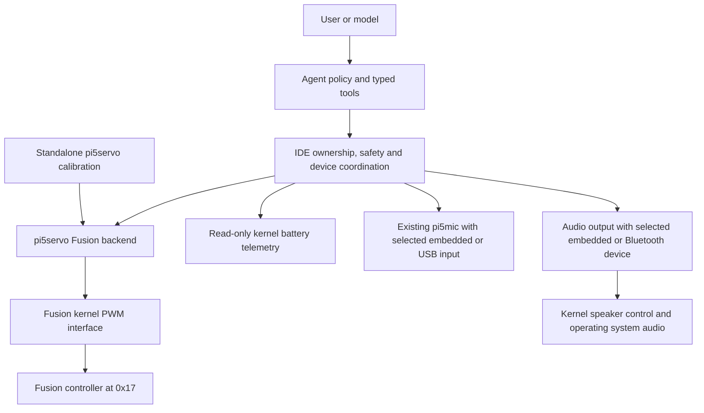

# Fusion HAT+ implementation plan

Finalize the seven-issue remediation with Fusion HAT+ as the only supported
SunFounder board, embedded audio by default, and independent control of all
twelve PWM servo channels.

Date: 3 November 2026. Original status: finalized plan before implementation.
For the subsequently approved implementation, software gates and pending physical
acceptance, see the [implementation record](../validation/fusion_implementation_261103.md).
The owner approved the recommendations and narrowed SunFounder support to
Fusion HAT+. This document supersedes the provisional phases and open product
choices in the [regression investigation](NinjaSunFounderRegressionInvestigation_261103.md)
and the conflicting older Robot HAT scope in the
[2 November plan](../../DevelopmentPlanDoc/NinjaSunFounderIntegrationImplementation_261102.md).
It does not supersede the investigation's observations or turn unverified
hardware behavior into a confirmed result.

## Contents

- Approved scope and compatibility contracts
- Hardware ownership and configuration design
- Phases 0–7, with acceptance gates
- Automated validation requirements
- Manual Raspberry Pi acceptance and rollback
- Documentation and completion criteria

## Approved scope and compatibility contracts

The hardware selection menu has exactly these supported choices:

1. DFRobot DFR0566 IO Expansion HAT + Geekworm X1208 UPS.
2. SunFounder Fusion HAT+.
3. General PCA9685 PWM Expansion HAT.

An uninterruptible power supply (UPS) is a battery-backed power source.
Pulse-width modulation (PWM) controls servo position or continuous-rotation
speed through timed electrical pulses. Bare DC motor outputs are outside scope.

| Contract | DFR0566 + X1208 | Fusion HAT+ | PCA9685 |
| --- | --- | --- | --- |
| Default voice input | Existing USB microphone workflow | Embedded microphone | Existing USB microphone workflow |
| Default speech output | Existing Bluetooth workflow | Embedded speaker | Existing Bluetooth workflow |
| Optional audio | Preserve existing choices | USB input and Bluetooth output, independently selectable | Preserve existing choices |
| Servo interface | Existing GPIO endpoints | `hat_pwm0` through `hat_pwm11` | `hat_pwm0` through `hat_pwm15` |
| Calibration and movement | Existing pi5servo and Agent contracts | Same pi5servo and Agent interfaces for all twelve channels | Existing pi5servo and Agent contracts |
| Power protection | Existing Pi and X1208 behavior | Pi rail warning plus verified Fusion battery monitoring | Existing explicitly configured power equipment |

Older Robot HAT is not a setup choice or a release qualification target. The
Fusion path must not fall back to address `0x14`, pulse legacy reset GPIO5, or
infer that absent kernel support means an older board. Removing unused historical
code is not required if it would broaden the managed-driver change; it must be
unreachable from the supported Fusion profile.

Preserve existing user commands, Agent tool names, web pairing, ngrok protections,
local/cloud Ollama routing, camera, distance sensing, display, buzzer, behaviors,
voice interruption, calibration, and private configuration. No new provider
logic or duplicate Agent hardware implementation is permitted.

The owner has approved narrowly scoped pi5servo changes needed for this outcome.
Other managed pi5 libraries remain untouched. Before each managed edit, list the
exact files and purpose in phase evidence, preserve the immutable baseline, test
independently, and record approved final hashes using the repository procedure.
Approval is limited to this feature and its tests, not a general driver rewrite.

## Hardware ownership and configuration design

### One path to each device



The target Fusion deployment uses the reviewed vendor kernel driver as controller
owner. Implement a kernel-interface transport inside pi5servo's Fusion backend;
keep the public servo API unchanged. The IDE continues to own cross-device safety
and reservations, while the standalone tool owns only its test/calibration session.

Do not run direct controller writes concurrently with the kernel driver. Do not
use forced I2C access to bypass kernel ownership. A missing driver is a clear
prerequisite failure for the new supported Fusion profile, not permission to
silently switch transport. Retain any historical raw implementation only where
needed for compatibility and offline tests; do not select it for this deployment.

Phase 0 must verify the pinned kernel PWM interface supports twelve channels,
frequency/pulse control, disable/cleanup and safe ownership. If it cannot meet
those contracts, stop the dependent phase and present a concrete revised design;
do not silently adopt a second runtime or broaden driver changes.

Standalone calibration and the Agent must not command the same channels at once.
Prefer a shared advisory session lock within the managed servo layer for these
project entry points, integrated with IDE ownership. Report the competing owner
and provide a safe exit path. Such a lock does not protect against arbitrary
third-party programs; document exclusive controller use during operation.

### Configuration and migration

Introduce an explicit Fusion profile identity, proposed internal value
`fusion_hat_plus`. Keep existing public commands and accept historical
`sunfounder_robot_hat` configuration identifiers as migration inputs. Do not
blindly reinterpret an arbitrary saved `0x14` board as Fusion: show the new profile
selection and require explicit Fusion selection when old identity is ambiguous.
The present owner's board choice is already established; no repeat product
question is needed for this implementation.

Migration must:

1. Read old configuration without touching hardware.
2. Preserve a recoverable backup before the first write.
3. Preserve calibration, explicit servo roles, unrelated settings and secrets.
4. Establish Fusion identity independently of driver presence.
5. Select kernel transport and the `0x17` identity contract.
6. Replace inferred legacy audio/power defaults only as part of the explicit
   profile migration; preserve explicitly selected USB/Bluetooth overrides.
7. Validate the complete candidate and save atomically.
8. Leave the original untouched on validation failure and be idempotent on rerun.

Use explicit input and output preferences rather than deriving them from PWM
address or speaker GPIO. Prefer existing schema fields when sufficient; add
backward-compatible fields only for distinctions that cannot be represented.
Profile defaults apply to new setup, not every startup.

Each component reports `not_configured`, `prerequisite_missing`,
`reboot_required`, `ready`, or `failed`, with a structured reason and corrective
next step. Display these as plain English. Do not fabricate output-device names
or report a saved preference as proof of device readiness. An optional audio
choice does not silently replace a missing default device.

### Power measurement and recovery

The follow-up investigation resolved the vendor software conversion contract at
commit `4bd1018ad5a70ee113160536f969cdadd9f22918`. It is a candidate pin for
installation review, not proof that all installer dependencies are pinned.
The [vendor battery implementation](https://github.com/sunfounder/fusion-hat/blob/4bd1018ad5a70ee113160536f969cdadd9f22918/driver/battery.c)
and [constants](https://github.com/sunfounder/fusion-hat/blob/4bd1018ad5a70ee113160536f969cdadd9f22918/driver/main.h)
convert a 12-bit ADC count using a 3.3 V reference and divider factor three.
The standard power-supply `voltage_now` interface reports microvolts.

Use the kernel's converted voltage for the kernel-owned deployment. Keep units
explicit at the boundary and establish freshness/error semantics from pinned
source; do not assume a readable cached value is current. If the kernel exposes
no reliable refresh/error indicator, Phase 0 must define and test an appropriate
failure detector before qualifying battery protection.

Illustrative pure conversions, not code to execute on hardware:

```python
def adc_count_to_volts(raw: int) -> float:
    if isinstance(raw, bool) or not 0 <= raw <= 4095:
        raise ValueError("battery ADC count outside its 12-bit range")
    return raw * 3.3 * 3.0 / 4095


def microvolts_to_volts(raw_uv: int) -> float:
    return raw_uv / 1_000_000
```

The first formula approximates the vendor's integer-millivolt calculation; tests
must account for its rounding. Never apply both conversions to the same reading.
A count of 3100 represents approximately 7.49 V, not 3.10 V.

Do not change voltage thresholds to compensate for wrong units. Keep Pi rail
warnings and HAT battery cutoff separate. A previous Pi event remains valid
evidence even after correcting battery conversion. For Fusion, unavailable or
stale required power telemetry should prevent new movement and stop active
movement through the existing motion-stop path with a distinct unavailable-data
reason. Preserve original-profile policy. Never label unavailable data as
confirmed undervoltage. Avoid permanent latching on a single ordinary polling
error: define a bounded freshness policy from measured polling behavior and test
its boundary; no motion starts before the first valid sample.

AI motion permission, current power eligibility and persisted safety recovery
are separate states. Recovery requires healthy current prerequisites and an
explicit user action, and never resumes interrupted movement automatically.

## Implementation sequence


Every phase includes the common software gate below, targeted tests, phase evidence
and documentation notes. Fix failures before progressing. Changes remain small
and reviewable; passing mocked tests does not count as Raspberry Pi acceptance.

### Phase 0 — Establish baseline and pinned driver contracts

Objective: make subsequent implementation reproducible without guessing hardware
interfaces. Risk: read-only research and simulated tests.

Affected areas: existing audit, tests and `docs/validation/`; inspect pi5servo
backend, vendor driver, installer, audio scripts and actual installed entry points.

Sequence:

1. Record clean/dirty checkout and current commit; preserve unrelated work. Run
   immutable/source verification and the complete baseline gate.
2. Record Python executable, installed module paths and service executable to
   distinguish checkout changes from the code actually being run.
3. Reproduce calibration rejection with a sanitized fixture containing PWM1
   `1500/1500/2200`. Capture structured diagnostics for speech, face and shutdown.
4. Review the pinned upstream source for PWM channel layout, timer grouping,
   locking, startup writes, cleanup, battery freshness, audio device registration,
   amplifier ownership and shutdown behavior. Use Serena for project references.
5. Review every installer side effect and transitive download. Record upstream
   provenance, licenses, kernel/header requirements and supported OS evidence.
6. Create contract fixtures for all twelve channels and failure cases. Do not
   instantiate live backends for discovery: initialization may write timers.

Acceptance: exact interfaces and ownership are documented; current versus vendor
battery units are distinguished; installation has a complete proposed file/package
manifest and rollback; no unidentified forced I2C access. If required interfaces
are insufficient, dependent work stops for a concrete design correction.

Documentation: baseline results and unresolved physical observations in validation
evidence. Keep original audit intact and link any corrected conclusions.

### Phase 1 — Fusion identity, endpoint selection and valid persistence

Objective: correct setup independently of device movement. Risk: configuration
migration affecting later motion; tests use temporary files only.

Primary modules: IDE `config.py`, `config_import.py`, `hardware_setup.py`; Agent
`setup_wizard.py`; pi5servo configuration/CLI files only where a proven writer
needs the approved validation repair.

Sequence:

1. Implement three supported profile choices and explicit Fusion identity.
2. Remove kernel-presence-based board selection from the Fusion path; remove
   legacy address/reset fallback for that profile.
3. Implement backed-up, atomic, idempotent migration and profile-switch cleanup.
4. Expose all supported endpoints independently. Calibration is required for
   selected populated ports, not all twelve empty ports.
5. Return endpoint-specific validation errors. Validate at persistence boundaries,
   not only at onboarding exit; preserve unrelated valid entries on failed save.
6. Remove assumptions that every setup requires two wheels. Do not assign wheel
   roles to arbitrary positional servos. Preserve explicitly assigned roles.
7. Make mandatory-step completion and subsequent audio progression testable.

Example expected diagnostic:

```json
{
  "component": "servo",
  "endpoint": "hat_pwm1",
  "field": "pulse_min",
  "reason": "must_be_less_than_center",
  "ready": false
}
```

Acceptance: bad PWM1 entry produces that actionable meaning; valid one-channel
and twelve-channel Fusion setups pass; channel 12 is rejected for Fusion; PCA
channel 15 remains valid; out-of-range endpoints fail before hardware access.
A second migration does not change saved settings. No obsolete amplifier or power
assignment survives a profile switch. DFRobot calibration and commands pass.

Documentation: migration behavior, endpoint notation, calibration repair and
explicit role assignment notes for the future manual successor.

### Phase 2 — Reviewed Fusion installation and preflight

Objective: make the required kernel/audio foundation reproducibly available.
Risk: privileged OS, boot, packages and reboot; repository tests remain simulated.

Primary modules: existing installation/deployment entry points and IDE setup;
new narrowly scoped prerequisite helper only if existing structure cannot host it;
`THIRD_PARTY_NOTICES.md` and installer tests.

Sequence:

1. Implement separate read-only check, preview and explicit apply stages. Present
   package, boot, module, audio configuration and service changes before applying.
2. Pin reviewed source and verify downloads. Do not execute a mutable remote
   script through `curl | sudo bash`. Audit nested downloads as well as the top pin.
3. Avoid blindly running the entire vendor installer: it can modify system Python
   packages and audio defaults. Install only reviewed necessities and preserve
   existing USB/Bluetooth configuration. Do not remove unrelated libraries.
4. Back up changed system files and record prior ownership/mode. Make reruns safe;
   roll back only this installation's changes, never later unrelated user edits.
5. Mark reboot-required explicitly. Do not automatically start the Agent, move
   servos, capture audio, change full-power-off settings or reboot.
6. After the operator reboots, verify kernel identity, PWM availability, speaker
   control, sound input/output and battery interface without activating them.
7. Detect kernel-version drift and provide repair guidance rather than silently
   claiming readiness after an OS upgrade.

Acceptance: dry-run touches no live system files; simulated missing headers,
unsupported kernel, download failure and interrupted installation leave recoverable
state. Installation on the Pi passes non-moving preflight. Original board profiles
do not activate Fusion prerequisites or rewrite global audio preferences.

Documentation: exact supported environment, pin, installation manifest, privilege
boundary, reboot and rollback instructions. Full battery power removal remains
separate from installing audio/controller support.

### Phase 3 — All-channel pi5servo operation and trustworthy power

Objective: same calibrated endpoints work in standalone and Agent sessions, with
one hardware owner and effective safety. Risk: actuator and power critical.

Primary modules: pi5servo SunFounder/Fusion backend, backend factory/configuration
and focused tests as necessary; IDE `servo.py`, `safety.py`, power/configuration
integration. Keep changes scoped; other managed drivers remain unchanged.

Sequence:

1. Implement verified kernel transport behind pi5servo's existing API. Validate
   endpoints before opening a device; enumerate capabilities without timer writes.
2. Implement pulse/frequency conversion from verified kernel semantics. Respect
   shared timer constraints; use a coherent supported servo frequency and reject
   incompatible requests rather than altering neighboring active channels.
3. Add shared session ownership for standalone versus Agent access, cancellation,
   off/close and failure cleanup. Closing one channel must not disable another
   session's channel. Do not promise arbitrary per-port frequencies.
4. Read converted battery telemetry through the kernel interface with explicit
   units, provenance and freshness. Keep legacy raw-count regression tests where
   useful, but do not use competing raw reads in the supported deployment.
5. Preserve active Pi-bit detection, distinguish battery low/unavailable/history,
   and implement the Fusion freshness policy. Verify authorization/recovery paths.
6. Show resolved backend/transport and safe diagnostics without exposing secrets.

Acceptance: fixtures cover PWM0–11, especially timer boundaries 3/4 and 7/8,
min/center/max, no adjacent register/channel changes, off, close, cancellation,
permission loss and competing session rejection. Agent cannot address an
uncalibrated or unconfigured endpoint. Physical signals and movement must be
qualified on each port; a PWM0 pass is not a twelve-channel pass.

Power tests: current Pi bit blocks motion; historical-only bits do not create a
new current event; low battery stops; stale telemetry is distinguishable; healthy
readings do not erase a persisted latch; `/resume` cannot recover an active fault;
recovery does not arm AI motion or restart an old command. Compare stationary
battery readings to an independent meter before any loaded movement tests.

Documentation: units, recovery messages, session ownership and channel acceptance
matrix; update the authorized-driver record only for independently validated edits.

### Phase 4 — Embedded voice defaults and optional external devices

Objective: Fusion onboarding and service speech use actual selected devices.
Risk: audio output and microphone privacy; simulated tests do not record or play.

Primary modules: IDE `hardware_setup.py`, `audio_output.py`, `microphone.py`,
`voice_input.py`, configuration; Agent `setup_wizard.py`, `speech.py` and service
configuration propagation. Existing pi5mic API remains unchanged.

Sequence:

1. Enumerate actual embedded input/output after prerequisites pass. Distinguish
   missing device, permission error, reboot pending and missing speech model.
2. Default new Fusion setup to embedded input/output. Offer USB input and Bluetooth
   output independently; retain explicit choices on restart and service launch.
3. Use stable device identities. Never persist an invented fallback name or silently
   switch to HDMI. Health and playback must resolve the same device/route.
4. Use kernel speaker enable for Fusion; remove GPIO12 fallback from that profile.
   Coordinate enable/disable and cancellation through IDE ownership.
5. Test output tone separately from text-to-speech (TTS), which converts generated
   text into audio. Verify synthesis assets before declaring speech ready.
6. Request consent for microphone capture; keep test media temporary and clean it
   on completion/error. Verify input selection without recording during discovery.
7. Preserve listen-then-speak coordination, wake-word behavior, interruption and
   recovery after output device disconnect/reconnect.
8. Expose distinct `/speech` failure stages and useful setup repair instructions.

Acceptance: embedded/embedded, USB/embedded, embedded/Bluetooth and USB/Bluetooth
selections work in mocked routes and operator-tested applicable combinations.
Foreground and deployed service use the same saved identities. A missing selected
device leaves text chat available and explains the audio failure. DFRobot and PCA
retain their original external-device defaults. `/speech on` does not claim to
install drivers or bypass missing prerequisites.

Documentation: input/output selection, separate tone/TTS checks, permissions,
service troubleshooting and non-retention of test recordings.

### Phase 5 — Expression lifecycle independent of motion eligibility

Objective: welcome returns to idle and interactions present the correct face.
Risk: display state and safety integration; no movement needed for face tests.

Primary modules: IDE `robot.py`, behavior coordination and safety presentation;
Agent `onboarding.py` and speech/interaction lifecycle events.

Sequence:

1. Define presentation priority: system/emergency-stop presentation, explicit
   foreground behavior, current interaction face, then silent idle.
2. Let a motion-only fault prohibit movement while allowing appropriate silent
   display interaction. Preserve authoritative system-stop presentation.
3. Balance foreground counters and release ownership in success, exception and
   cancellation paths. Prevent old speech completion from overwriting a newer face.
4. Resolve `_idle_suppressed` and transient stop semantics explicitly. Do not use
   display recovery to clear a safety latch or restart motion.
5. Log actual final presentation status instead of unconditional idle success.

Acceptance: initial greeting, web reconnect and chat startup return to idle;
thinking/speaking transition correctly; speech unavailable/cancelled also restores
appropriate presentation. Motion-latched tests show no movement but functional
silent faces. System stop remains visible and cannot be overwritten by late tasks.

Documentation: state diagram and expected behavior during motion versus system
stops; identify the exact regression fixtures.

### Phase 6 — Web power-off readiness and orderly shutdown

Objective: restore the existing authorized OS shutdown flow with actionable status.
Risk: privilege, service lifecycle and power; automated execution is prohibited.

Primary modules: Agent `deployment.py`, `shutdown.py`, service integration,
web capability/UI and relevant tests.

Sequence:

1. Report disabled configuration, missing helper, invalid helper permissions and
   unavailable authorization distinctly in deployment and web UI.
2. Reuse the fixed helper and narrow sudo permission workflow. Enable the saved
   capability only after prerequisites validate; do not just force a UI flag.
3. Preserve authenticated controller ownership and expiring single-use
   confirmation nonce. Test rejection and replay paths.
4. Stop movement, cancel pending work, close audio/devices and terminate relevant
   service work with bounded cleanup, then invoke the fixed OS shutdown helper.
5. Report failure if shutdown cannot be invoked; do not claim the Pi powered off.
   Keep Fusion battery power cutting and EEPROM shutdown settings separate from
   this OS-shutdown requirement.

Acceptance: mocked tests assert cleanup ordering, timeout behavior, invalid nonce,
wrong controller, disabled capability and helper failure. No arbitrary shell
command reaches privileged execution. A final operator test verifies orderly OS
shutdown; physical battery removal is neither required nor inferred from OS halt.

Documentation: deployment repair, button states, confirmation and shutdown test
procedure, recovery after helper failure.

### Phase 7 — Cross-profile qualification and documentation handoff

Objective: prove compatibility and make the installed behavior understandable.
Risk: combines separately authorized device tests; preserve test categories.

Primary areas: root/driver suites, packaging, installer dry-runs, validation
records, README and new wiki raw source versions.

Sequence:

1. Run the complete gate and each managed driver's suite separately. Add packaging,
   service configuration, installer and security tests for changed boundaries.
2. Exercise all three profiles and switch Fusion → DFRobot → PCA → Fusion using
   temporary settings. Verify retained calibration, no leaked GPIO assignment,
   no unwanted battery monitor and no overwritten audio override.
3. Regression-test ngrok pairing/host checks, local/cloud Ollama selection, Agent
   tools, emergency stop/recovery, existing behaviors, distance, display, buzzer,
   camera and voice workflows. Mark hardware-unavailable cases unverified.
4. Execute the operator checklist below and retain sanitized results per channel
   and device combination. Do not store conversations, credentials or recordings.
5. Create successor wiki sources, reconcile contradictory inherited descriptions,
   and update root README to actual supported behavior. Do not claim planned work
   as implemented or mock tests as hardware acceptance.

Acceptance: software gates pass, all required Fusion channels physically pass,
embedded speech/input pass in service mode, orderly shutdown passes manually,
and original-profile regressions have explicit results. If reference hardware is
unavailable, release evidence must name that limitation; do not certify full
physical compatibility from software tests alone.

## Automated validation after every implementation phase

From the repository root, run the required common gate. Expected result: all
commands pass, or a baseline failure is reproduced, explained and repaired in
scope before phase completion.

```bash
uv run --frozen python scripts/verify_immutable_drivers.py
uv run --frozen python scripts/verify_workspace_driver_sources.py
uv run --frozen python -m compileall -q \
  ninjarobot_pi5_ide/src ninjarobot_pi5_agent/src scripts tests
uv run --frozen ruff check .
uv run --frozen ruff format --check .
uv run --frozen mypy ninjarobot_pi5_ide/src ninjarobot_pi5_agent/src
uv run --frozen pytest -q
git diff --check
```

Run immutable verification before as well as after each phase. The managed suites
reuse test module names, so invoke each in a separate pytest process using its
established environment. Every suite must use simulated devices; no test may
move servos, record, play audio, expose a tunnel or shut down the host.

Each phase evidence entry records commit, changed files, exact commands/results,
fixture coverage, installed-module provenance when relevant, unresolved concerns,
manual tests not run and rollback. Never regenerate the immutable baseline to
make a changed file pass. Approved managed changes follow the existing
`--record-authorized` procedure with actual date, owner authorization and precise
reason, after independent tests.

## Manual Raspberry Pi acceptance

Perform only after the relevant software gates pass. The interactive tool is the
main user acceptance surface, but it cannot alone establish driver ownership,
voltage accuracy, per-port waveforms or safe OS shutdown.

### Safe smoke checks — no device activation

1. Confirm installed code revision and service interpreter match the tested build.
2. Open setup and check the three supported choices and Fusion prerequisites.
3. Inspect saved preferences and structured calibration errors without movement.
4. Confirm local/cloud model selection, local web login and existing ngrok pairing.
5. Confirm power-off capability explains its current state without activating it.

Pass: no automatic movement/capture, correct profile and actionable errors.
Rollback: restore the saved configuration backup and prior application build.

### Device communication — no servo movement

1. After explicit installation and reboot, inspect Fusion kernel interfaces and
   sound input/output enumeration; do not open a PWM backend just for discovery.
2. Compare stationary battery telemetry with an independent measurement and
   check the Pi's current warning separately. Record value, unit and time.
3. Run a deliberate speaker tone at a modest volume; verify the selected output.
4. With consent, test a short microphone input without retained recordings.
5. Verify TTS output and input behavior in both foreground and deployed service.

Pass: selected devices are real, stable and available; measured voltage agrees
within the documented sensor/meter tolerance; no unsupported unit assumptions.
Rollback: restore prior audio configuration and reviewed driver deployment using
the recorded manifest. Stop on ownership or voltage discrepancies.

### Actuator-moving tests

Raise wheels, unload mechanisms and keep an operator ready to remove power.
Use a known suitable servo and its verified safe range. Do not command a universal
90-degree travel on an unknown servo type. Keep bare DC motor ports unused.

1. Stop the Agent session before standalone calibration.
2. Test `hat_pwm0` through `hat_pwm11` individually, recording calibration,
   bounded movement, stop/off and whether neighboring ports remain unaffected.
3. Verify timer-boundary channels and, where available, measure pulse timing.
4. Exit calibration, start Agent, enable AI motion explicitly, then repeat bounded
   commands through the same endpoints and saved calibration.
5. Verify competing-session rejection and explicit emergency-stop/recovery.
6. Increase simultaneous load only after individual passes and within verified
   power limits. Twelve accessible channels do not imply twelve unrestricted
   high-current servos can operate simultaneously.

Pass: every channel responds independently, safety interlocks hold and no old
movement restarts after recovery. Rollback: stop, restore prior code/configuration,
and investigate the first failing channel before proceeding.

### Power-risk test

Save work first. With the operator present, use the authenticated web power-off
confirmation once. Verify actuator cleanup, service termination and orderly OS
halt. Never run this through pytest or an unattended automation.

Pass: the fixed shutdown path is invoked and the OS halts cleanly. Battery power
may remain physically present depending on separately configured hardware behavior.
Rollback: after powering back on, inspect bounded shutdown evidence and restore
prior deployment configuration if necessary; do not bypass failed authorization.

## Documentation impact and completion criteria

Use new source versions under `ninjarobot_pi5_wiki/raw/`; never edit registered
2 November originals. Update InstallationGuide for setup/migration/operations,
DevelopmentGuide for ownership/schema/safety, and DevelopmentLog with actual
changes and validation. Review NinjaRobot_MCP_Skill for changed tool guidance;
if interfaces remain unchanged, record why no successor is needed. Update
`THIRD_PARTY_NOTICES.md` for approved driver/software dependencies.

The owner retains wiki ingestion and review. Do not run ingestion, semantic plan
application or review. Run read-only wiki check/lint after source updates where
the environment exists; report missing setup and mapping drift honestly without
installing dependencies or refreshing fingerprints automatically. Provide the
source diff for the owner's workflow and do not advertise it as ingested.

Completion requires a seven-issue acceptance table with software and physical
results separate, all applicable phase gates, unchanged unauthorized managed
files, installation rollback evidence, accurate new manuals and a beginner
manual-test handoff. This plan requires no runtime changes or privileged actions
merely to finalize it.

For investigation context and unresolved physical observations, see the
[regression report](NinjaSunFounderRegressionInvestigation_261103.md). For the
implementation baseline, see the
[previous validation evidence](../validation/sunfounder_runtime_remediation_261102.md).
