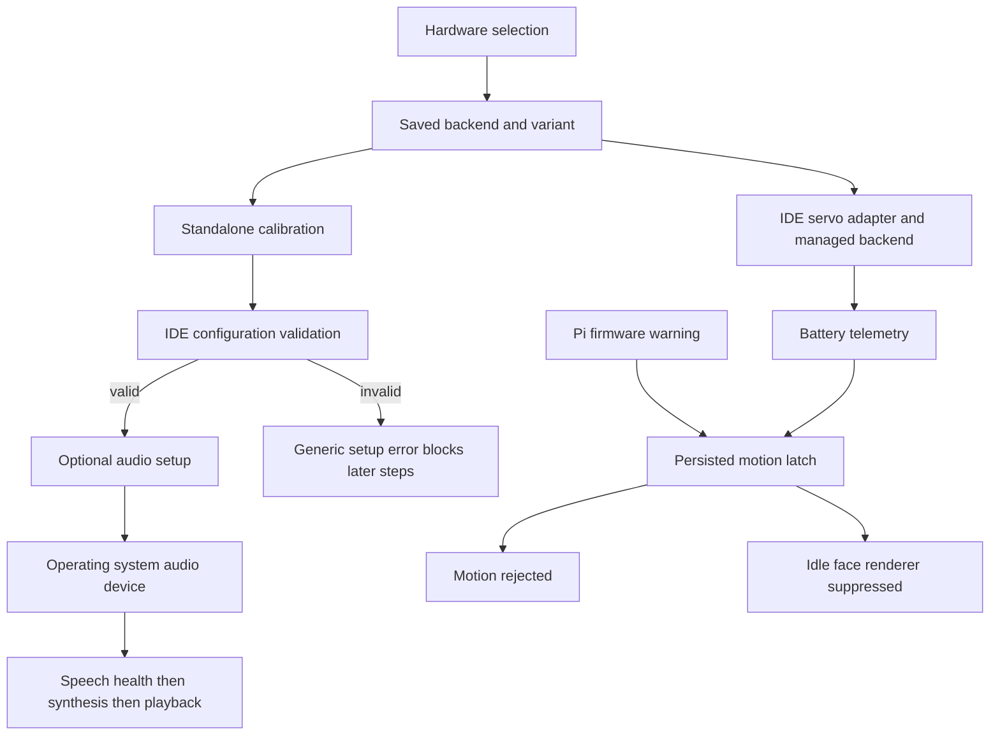

# SunFounder regression investigation and proposed repair phases

Date: 3 November 2026. Investigated checkout: `c2ed2a0`, branch `sunfounder_v01`.
Status: investigation findings and provisional implementation plan; no runtime fixes applied.

## Executive assessment

Several failures share incomplete hardware identification and onboarding, but they do not have one universal cause. Current software accepts all twelve SunFounder pulse-width modulation (PWM) servo endpoints. Physical channel operation remains unverified. The saved calibration contains an invalid PWM1 range. Embedded audio is absent from the current operating system's sound-card list. Power-off is explicitly disabled in the local deployment configuration. The idle renderer is coupled to motion safety state. A recorded Pi undervoltage event is distinct from a suspected Fusion battery conversion problem.

Do not lower voltage thresholds, automatically clear safety latches, fabricate audio device names, or declare twelve-channel hardware acceptance from mock tests. Preserve the working ngrok and local/cloud Ollama changes.

## Scope, method, and limitations

This is a read-only runtime audit. The only repository change is this report. No motors were moved, microphones recorded, speakers played, services restarted, boot files modified, or shutdown invoked. Configuration inspection printed only hardware fields; log inspection used bounded content and reported event categories rather than conversations or secrets.

Evidence includes Serena symbol inspection (including endpoint parsing), targeted source reads, saved local settings, application log summaries, a user-service journal query, official Fusion documentation, the previous implementation plan, and current wiki source excerpts. This is a targeted cross-module audit, not a claim that every repository line or dependency was reviewed.

The wiki search command reported a missing wiki environment. No dependencies were installed. Direct files were used: wiki README, workflow, document map, overview and current 2 November DevelopmentGuide. The overview is marked draft with an AI semantic review; that is not physical or human acceptance. The registered manuals describe successful software tests and pending physical validation. Older portions of the DevelopmentGuide retain conflicting GPIO12/raw-control descriptions despite the newer checkpoint. Those passages need reconciliation in a successor source version.

Local observations are a snapshot, not proof of the state during every reported failure:

| Observation | Result and implication |
| --- | --- |
| Saved servo backend | `sunfounder_robot_hat`, bus 1, address 20 decimal (`0x14`), 50 Hz; not an explicit Fusion configuration |
| Saved endpoints | `hat_pwm0`, `hat_pwm1`, `hat_pwm10`, `hat_pwm11`; presence proves persistence, not movement |
| PWM1 calibration | minimum 1500, center 1500, maximum 2200 microseconds; violates strict ordering |
| Other inspected calibrations | minimum 800, center 1500, maximum 2200 microseconds |
| Whole-config import of saved servo file | Succeeded; default-config import is not the observed validation failure |
| Fusion kernel interface | `/sys/class/fusion_hat` absent |
| Sound cards | `/proc/asound/cards` lists only `vc4-hdmi-1`; no embedded card |
| Speech configuration | enabled; output `alsa_output.platform-soc_sound.stereo-fallback`; amplifier GPIO12 |
| Web power-off configuration | `deployment.web_poweroff_enabled = false` |
| Pi firmware warning now | `vcgencmd get_throttled`: `0x0` |
| Bounded service log | One `reason=undervoltage` match, dated 2 November 12:09:04; eight greeting-completed matches; no `battery_undervoltage` match |
| User journal query | No useful entries for `ninjarobot-agent.service`; journal silence is not proof of no failures |

The bounded log did not establish a speech exception or a measured battery-voltage failure. Installed-running-package provenance and a contemporaneous PWM failure trace remain necessary.

## Hardware specification boundary

The user's installed product is Fusion HAT+, battery powered, with PWM servos only. Older Robot HAT is a separate variant, not a synonymous name. Bare DC motor support is outside scope.

Fusion documents twelve ports P0–P11, a built-in microphone and mono speaker, battery input 6–8.4 V, and speaker enable on GPIO20; GPIO12 is marked unconnected. These facts conflict with the shared GPIO12 setup fallback. [Official interfaces](https://docs.sunfounder.com/projects/fusion-hat/en/latest/hardware/interfaces.html)

The Fusion controller address is `0x17`; PWM register pairs advance by two bytes starting at `0x60`. Battery registers are `0x18`/`0x19`. The page describes analog conversion values as 12-bit counts, whereas the repository treats the combined battery register value as millivolts. The battery-specific unit contract must be resolved against pinned firmware/kernel source before changing conversion. [Official controller documentation](https://docs.sunfounder.com/projects/fusion-hat/en/latest/hardware/onboard_mcu.html)

| Contract | DFR0566 + X1208 | Fusion HAT+ | Older Robot HAT | General PCA9685 |
| --- | --- | --- | --- | --- |
| Servo addressing | Preserve existing GPIO endpoints | P0–P11, explicit variant | P0–P11, independently verified variant | 0–15 controller endpoints |
| Backend | Existing GPIO implementation | `0x17` protocol / ownership decision pending | `0x14` protocol | PCA9685 protocol |
| Audio | Existing USB mic/Bluetooth speaker | Embedded input/output | Do not assume Fusion microphone hardware | Existing USB mic/Bluetooth speaker |
| Power | Existing Pi warning and X1208 behavior | Pi warning plus separately validated battery telemetry | Separate battery protocol | Explicit installed power equipment; do not infer a battery monitor from PWM board |
| Compatibility gate | Existing commands and role mappings unchanged | All twelve independently calibrated | Separate fixtures and physical acceptance | All sixteen independently addressed |

## Execution paths and shared causes



The permitted ownership path remains user/model → Agent → IDE → device driver. Standalone calibration and Agent operation have different orchestration and safety contexts; success in calibration does not authorize integrated movement.

## 1. PWM1–11

**Confirmed:** `pi5servo/core/endpoint.py::parse_servo_endpoint` recognizes `hat_pwmN`, `pwmN`, and `pN`. Bare integers mean GPIO, not HAT channels. `cli/servo_tool.py::single_move` accepts explicit endpoints; the SunFounder backend resolves channels through `_resolve_channel`. `_pwm_register` uses stride two at `0x17`. Thus a blanket assertion that current source only implements PWM0 is incorrect.

**Confirmed configuration gap:** IDE `hardware_setup.py::apply_hardware_profile_preset` chooses Fusion only when its kernel interface exists. That interface is absent here, so selecting SunFounder can save the older `0x14` profile even for Fusion. The saved file indeed has `0x14`.

**Important qualification:** `_initialize_timers` retries the alternate address and updates the backend object's address. Consequently, the saved wrong address alone does not prove wrong runtime register writes. The fallback is not persisted back to the IDE power profile. A working PWM0 does not prove correct timer/channel ownership.

**Unresolved physical cause:** Need exact failing command/error, runtime backend address, installed module path, driver/kernel ownership and, eventually, measured PWM output per channel. Could involve stale installation, endpoint notation, initialization, or physical wiring. Do not claim any of these confirmed.

**Repair direction:** explicit Fusion/legacy subprofile, side-effect-free preflight, no address inference solely from kernel presence, precise endpoint labels and independent channel tests. Do not introduce another servo runtime in the Agent or IDE to evade managed-driver policy. Any additional managed-driver edit needs specific approval and independently recorded validation.

## 2. Onboarding validation

**Confirmed immediate cause:** PWM1 has `pulse_min == pulse_center == 1500`. `ninjarobot_pi5_ide/hardware_setup.py::hardware_setup_status` requires `500 <= min < center < max <= 2500` for every selected saved calibration, then catches the error and returns the generic invalid-settings message. One bad entry rejects the entire servo step. The inspected import succeeds; it is not the cause here.

**Upstream provenance unresolved:** Current `pi5servo/cli/calib.py` rejects a minimum equal to center during adjustment. The invalid saved entry could predate this code or originate from another writer. Persistence needs a reproducible write trace before assigning this regression to the current calibrator.

**Repair direction:** report endpoint, field and violated invariant; offer targeted repair without discarding other channels. Validate atomically before save at every permitted writer. Retain strict physical limits. Do not silently replace the invalid value or assume a safe travel range. Add fixture reproducing exactly 1500/1500/2200 and verify other calibrations remain intact.

## 3. Embedded input/output onboarding

**Confirmed:** `setup_wizard.py` reaches optional hardware after mandatory setup. The failed servo step prevents reaching embedded speaker setup. The SunFounder branch exists; its apparent absence is partly an upstream validation consequence.

**Independent gap:** The microphone branch still describes USB microphone setup for all profiles. There is no complete Fusion-specific embedded microphone initialization workflow. `hardware_setup.py::configure_sunfounder_i2s_speaker` conditionally ensures an overlay only with `play_test_tone=True`; the wizard's normal configure call uses the default false and performs the tone separately. It can save an invented fallback output when discovery fails. Detection, installation, reboot requirements and actual readiness are conflated.

**Repair direction:** explicit per-variant audio prerequisites, detected input/output selection, an installation preview and post-reboot verification. Do not save readiness until actual devices exist. Preserve USB/Bluetooth flows for the original and PCA boards. Microphone capture requires consent, and device enumeration must not capture audio.

## 4. Welcome and interaction expressions

**Confirmed code behavior:** `onboarding.py` logs completed greeting. `RobotAssembly.start_liveliness` starts greeting; foreground cleanup `_end_foreground_behavior` sets the ambient face to idle and requests `_start_idle_if_safe`. Therefore the missing explicit restore in one onboarding branch is not, by itself, the root cause.

`_start_idle_if_safe` refuses rendering when either motion or system safety is latched. `show_agent_face` uses that same renderer. A motion-only undervoltage latch can leave the last rendered greeting visible and prevent conversational faces. Also `RobotAssembly.stop` sets `_idle_suppressed=True`; clearing the transient full-stop gate does not clear this separate flag. This is a residual lifecycle gap after the previous stop-gate repair.

**Limit:** The log confirms greeting completion, not the exact face or state snapshot at failure. Correlate latch/suppression/foreground counters with a reproduction before attributing every instance to one gate.

**Repair direction:** separate silent display presentation from actuator eligibility, with explicit priority for emergency/system-stop presentation. Define ownership and cleanup for greeting, thinking, speaking, cancelled speech and idle. Never restart motion as a side effect of restoring the face.

## 5. Undervoltage and authorization

**Confirmed:** `safety.py::_default_undervoltage_provider` masks current bit zero from Pi firmware output, not the historical undervoltage bit. `_undervoltage_monitor` latches `undervoltage` on that signal. Battery cutoff uses a distinct `battery_undervoltage` reason. Current firmware reports clear, but an earlier Pi event exists in the service log. A persistent safety latch can remain after the electrical condition clears; enabling AI motion is not a safety reset.

**Not established:** Whether the original event was sustained rail loss or a transient, whether the tested service used the current checkout, and the actual battery voltage during refusal. No evidence supports lowering the threshold or attributing the logged Pi event to HAT battery conversion.

**Additional safety concern:** Fusion battery decoding assumes millivolts. The official register description does not conclusively support that assumption. A raw count incorrectly divided by 1000 could appear plausibly numeric but below cutoff. Existing finite/range checks would not catch all such unit errors. Conversely invalid telemetry currently warns and permits movement; the product's intended unavailable-telemetry policy needs explicit agreement.

**Repair direction:** report active signal versus latched history separately; include source, timestamp, sampled value/unit and recovery eligibility. Preserve explicit recovery and independent AI authorization. Validate battery conversion from pinned upstream evidence and measurements; retain Pi rail protection. Do not treat battery indicator thresholds as proof of a safe servo cutoff.

## 6. Speech output

**Confirmed current-host blockers:** No embedded ALSA (Linux sound-device interface) card is registered. Configuration points to a fabricated fallback name. Fusion kernel speaker control is absent and GPIO12 fallback contradicts the Fusion pin mapping. These are sufficient reasons not to consider embedded playback ready.

`SpeechService` checks IDE playback health before text-to-speech synthesis, then plays through IDE audio ownership. `/speech on` enables the feature; it does not install a kernel audio device. The wizard tone and Agent speech also exercise different readiness paths. An earlier successful tone does not prove the current service sees the same device or session.

**Unresolved:** Exact speech failure stage in the user's run, PipeWire session visibility, synthesis-model availability and permissions. The inspected bounded log does not prove a TTS-engine failure.

**Repair direction:** resolve actual card initialization first; use correct variant amplifier control and detected stable device identifiers; verify health and playback use the same route. Surface separate device, synthesis, permission, cancellation and safety reasons. Test foreground versus service execution, device disappearance, reappearance, and cleanup. Preserve listen-then-speak microphone coordination.

## 7. Web power-off

**Confirmed immediate configuration cause:** `deployment.web_poweroff_enabled` is false. `shutdown.py::PoweroffCoordinator` refuses nonce issuance/confirmation when disabled. Deployment code has an enable path; the control is not simply missing.

**Further prerequisites:** An enabled flag is insufficient. The fixed helper, ownership/mode, narrow sudo rule, authenticated controller lease and expiring single-use confirmation nonce must validate. Their readiness has not been certified here. Do not flip the flag blindly or grant arbitrary shell access.

**Repair direction:** explain the disabled reason in the UI; make the existing deployment setup validate/install the reviewed helper explicitly and persist capability only after success. Keep emergency stop, bounded service cleanup and orderly `systemctl poweroff` sequencing. OS shutdown and battery power removal are different operations; do not substitute HAT power cutting. Automated tests must mock the privileged boundary.

## Additional risks and classifications

| Finding | Classification | Required action |
| --- | --- | --- |
| Kernel-presence-based variant selection | Existing integration gap | Explicit identity and distinct readiness |
| Address fallback changes runtime but not saved profile | Consistency risk | One resolved hardware identity across servo/power/audio |
| Potential kernel and direct-I2C ownership overlap | Hardware risk; not observed here | Define one owner before installation or motion |
| Generic validation error loses actionable cause | Existing usability defect | Structured per-field errors |
| Single-channel PCA setup requires two calibrations | Asymmetric product assumption | Agree single-servo support; avoid invented wheel roles |
| Silent face depends on motion latch | Cross-feature architectural gap | Independent display policy, preserving emergency priority |
| GPIO12 audio fallback for Fusion | Confirmed incompatible assumption | Variant-specific implementation |
| Missing sound card can still produce saved output | Confirmed false-readiness path | Fail clearly without fabricating readiness |
| Unit assumptions and unavailable telemetry | Safety design uncertainty | Resolve before battery patch |
| Old manual paragraphs contradict checkpoint | Documentation inconsistency | New successor sources with reconciled statements |

These observations establish remaining defects; they do not prove all were introduced by the latest commit. Use parent-commit regression fixtures to date each behavioral change before labeling it a new regression.

## Proposed phases and acceptance gates

The following is deliberately provisional. Final architecture approval is blocked on driver ownership and managed-driver scope, plus battery-unit verification. No implementation is authorized by this report.

### Phase 0 — Reproduce and establish contracts

Files: validation evidence, targeted tests, hardware profile design; inspect installed entry-point/module provenance. Capture sanitized state with failing PWM command, active backend address, setup error field, speech stage, safety snapshot and power-off capability reason. Resolve vendor kernel/firmware version and battery encoding; decide raw-controller versus kernel-owned PWM without concurrent ownership. Preserve working ngrok/Ollama baseline.

Acceptance: each symptom has a reproducible fixture or a named physical evidence gap. All architecture decisions below resolved. Risk: read-only; do not instantiate a backend merely to probe identity because construction writes timers.

### Phase 1 — Variant identity and calibration integrity

Files: IDE `hardware_setup.py`, `config_import.py`, `config.py`; Agent `setup_wizard.py`; managed pi5servo changes only if explicitly approved. Introduce backward-compatible explicit variant metadata; migrate existing settings without overwriting custom calibration/roles. Validate endpoint range and calibration before atomic persistence. Return actionable endpoint/field errors. Keep legacy aliases readable; show `hat_pwm0`–`hat_pwm11` explicitly. Remove implicit wheel-role assignment for unknown servo types in new setups; preserve intentional existing assignments.

Acceptance: actual saved bad PWM1 fixture fails with a precise error; repaired entry passes; unrelated entries remain byte-equivalent where possible. Fusion and older Robot HAT produce correct separate profiles even with absent kernel interfaces. One configured servo is supported where approved. Repeated setup is idempotent. Risk: motion-critical metadata; automated tests use fake buses only.

### Phase 2 — Power and channel qualification

Files: IDE `safety.py`, `servo.py`, configuration/profile contracts; approved managed backend/tests if needed. Implement only verified battery conversion. Separate current warning, historical latch, source identity and recovery status. Keep AI authorization independent. Define behavior when telemetry is unavailable; never silently weaken existing protections. Qualify twelve channels with protocol fixtures including timer boundaries, off/close cleanup and failure handling.

Acceptance: active Pi bit stops motion; historical-only bit does not create a new event; persisted stop requires safe explicit recovery; battery low/invalid/unavailable cases match approved policy; all channel writes target expected registers without cross-channel writes. Physical acceptance requires known-safe servo ranges and measured output. Risk: power/motion critical.

### Phase 3 — Embedded audio onboarding and lifecycle

Files: IDE `hardware_setup.py`, `audio_output.py`, microphone/voice ownership modules; Agent `setup_wizard.py`, `speech.py`; deployment prerequisites. Provide Fusion-specific input/output prerequisites and actual device discovery. Preview privileged installation separately, pin upstream inputs and document provenance. Record reboot-required distinctly from ready. Use verified variant amplifier control. Remove fabricated device readiness. Revalidate after reboot and on service startup.

Acceptance: missing card produces actionable failure; existing card is selected consistently by health and playback; synthesis failure is distinguished from playback failure. Mock service/interactive session differences and device removal. Physical microphone test needs consent; embedded speaker tone and real synthesized response must both succeed. Original USB/Bluetooth workflows unchanged. Risk: boot/audio/privacy; no automated boot edits or capture.

### Phase 4 — Display state lifecycle

Files: IDE `robot.py`, behavior/safety integration; Agent `onboarding.py`, speech event integration. Document state precedence, separate silent expressions from movement eligibility, and balance foreground begin/end on exceptions and cancellation. Define transient stop versus explicit suppression recovery. Log the final presentation state, not an unconditional promise of idle.

Acceptance: greeting returns to idle with motion-only latch; system-stop presentation remains authoritative; thinking/speaking returns to idle after success, error and cancellation; no late task overwrites newer state; no actuator activity while testing faces. Risk: display lifecycle, with motion safety regression tests.

### Phase 5 — Orderly web shutdown readiness

Files: Agent `deployment.py`, `shutdown.py`, service integration, web capability/UI. Expose disabled/not-installed/not-authorized reasons. Reuse reviewed helper workflow and authentication/nonce contracts. Bound cleanup and define failure behavior without bypassing authorization.

Acceptance: disabled state is explained; ready deployment enables the button; stale/replayed nonce and wrong lease fail; accepted request stops actuators, cleans up and invokes only the fixed helper. Unit tests never power off. One final operator-controlled shutdown verifies service termination and OS halt. Risk: privilege and power critical.

### Phase 6 — Cross-profile regression and documentation

Test DFR0566+X1208, older Robot HAT, Fusion HAT+, and PCA9685 in separate profile fixtures, including switching away and back without leftover amplifier GPIO, power monitor or role assignments. Preserve tool names, CLI commands, pairing/tunnel protections, model routes, calibration and user data. Run each managed-driver suite separately.

Update README and new successor InstallationGuide, DevelopmentGuide and DevelopmentLog sources under wiki raw; reconcile contradictory historical paragraphs rather than append another contradictory checkpoint. Document exact hardware acceptance status and limitations. Update notices for any dependency change. Do not ingest or review the wiki on the owner's behalf. A semantic wiki application requires approval of the specific diff.

Acceptance: full software gates pass and hardware acceptance results are explicitly separated. Remaining untested hardware is labeled unverified, never counted as passed.

### Required automated gate after each approved phase

```bash
uv run --frozen python scripts/verify_immutable_drivers.py
uv run --frozen python scripts/verify_workspace_driver_sources.py
uv run --frozen python -m compileall -q ninjarobot_pi5_ide/src ninjarobot_pi5_agent/src scripts tests
uv run --frozen ruff check .
uv run --frozen ruff format --check .
uv run --frozen mypy ninjarobot_pi5_ide/src ninjarobot_pi5_agent/src
uv run --frozen pytest -q
git diff --check
```

Run immutable verification before and after each phase. Run modified driver's tests in its own process; never regenerate the immutable baseline. Add packaging/deployment dry-run and authorization tests for affected boundaries. Record baseline failures separately and repair in scope. Wiki check/lint apply after documentation updates when its environment is available; do not install it implicitly. No implementation gate was claimed run for this report-only audit.

## Manual acceptance categories

| Category | Expected result | Rollback / stop condition |
| --- | --- | --- |
| Safe smoke | Correct variant, actionable setup status, model routes and web pairing intact | Restore backed-up configuration; stop before device actions on mismatch |
| Device communication | Correct identity and actual audio input/output available; power values plausible and traceable | Stop service and restore prior reviewed driver/configuration if ownership conflicts |
| Actuator-moving | One servo at a time, P0–P11 independently, no neighboring movement, valid limits | Raised wheels, unloaded mechanism and operator at power disconnect; stop immediately on unexpected motion |
| Power-risk | Explicit web confirmation leads to clean OS shutdown with logged cleanup | Only operator-run after saving work; if helper unavailable, repair deployment rather than bypassing authorization |

Audio capture is opt-in and test media should not be retained. A failed power test is not an invitation to cut power abruptly.

## Decisions required before finalizing implementation

1. May the plan include narrowly scoped managed pi5servo fixes if reproduction proves the standalone tool/backend needs them? The earlier immutability requirement and previous limited exception do not authorize new files or changes.
2. Approve a kernel/vendor-driver installation route for Fusion embedded audio only after its pinned prerequisites and impact are reviewed, or require supporting the currently installed OS without those installations? This affects the audio/PWM ownership architecture.
3. Resolve battery register units using pinned upstream implementation and hardware measurements before selecting conversion or changing safety policy. Until resolved, retain the distinction between an observed Pi warning and a possible battery-decoding defect.

The next safe step is to collect the exact PWM failure and service provenance, resolve these decisions, then approve a concrete Phase 0/1 patch plan. Current evidence supports targeted calibration repair and deployment diagnosis, not a blanket claim that all seven physical causes have been established.
