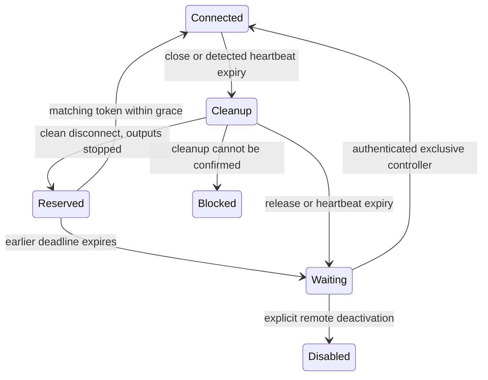

# Web reconnection implementation and validation

Implemented 9 November 2026 against the approved
[8 November plan](../../DevelopmentPlanDoc/WebServerReconnectionImplementationPlan_261108.md).
This record distinguishes offline software evidence from pending robot acceptance.

## Scope and architecture

The Agent/IDE boundary remains `user -> Agent -> IDE -> managed driver -> device`.
No managed driver, dependency, database, boot startup, live configuration, ngrok
account or public pairing format changed. The clean starting checkout passed all
1,141 root tests. Wiki evidence came from the registered 4 November manuals and
current code; the wiki README's older checkpoint statement was stale and corrected.
Serena inspected runtime recovery contracts; targeted source reads traced leases,
WebSocket dispatch, remote events, onboarding, display serialization and cancellation.

A healthy tunnel/server is independent of these states. Grace is the minimum of
the previous heartbeat deadline and disconnect plus ten seconds. Heartbeat timeout
remains fifteen seconds with watchdog polling at most one second. Device/thread
cleanup and scheduling can add latency; this is not a hard real-time deadline.

## Phases and implementation decisions

| Phase | Changes | Evidence / gate |
| --- | --- | --- |
| 0 baseline | Clean checkout; root regression baseline; existing source contracts checked | 1,141 root tests passed; fake clock, barriers and simulated display added for new cases |
| 1 leases | `web_control.py`, `web_app.py`: connection generations, separate state/transition locks, immediate quiescence, reserved reconnect, serialized availability, exception-safe setup/finalization | Reconnection regressions verify stopped admission, delayed cleanup barrier, stale finalizer, expiry fault and 100 once-only finalizations |
| 2 ownership/display | Existing connection tasks carry browser work; cancellation drains them. Browser-owned movement/transcription cancelled; voice ownership recorded and stopped without persistence. IDE display reservations gate ordinary frames; safety/privacy retain precedence | IDE waiting-frame tests, existing audio/behavior/camera tests, no managed edits |
| 3 pairing/status | `service_main.py`, `onboarding.py`, `remote_access.py`: post-cleanup automatic QR; non-revoking rotation; serialized render/refresh; endpoint invalidation; runtime supervision even without startup onboarding | 100 integrated fake handoffs, consumed-token refresh, runtime activation/deactivation and healthy tunnel persistence tests |
| 4 browser | `app-shared.js`, `app-agent.js`, four locales: one current socket/timer, stale callback rejection, pending promise rejection, pagehide close, pageshow reconnect, bounded lock retries, pairing feedback | Node VM runs actual client functions with fake sockets/timers; prior mic/keyboard tests retained |
| 5 regression | Focused offline suites, full root gate and separate managed suites | Actual final results recorded below |
| 6 documentation | README and new Installation/Development/Log raw successors `2026-11-09`; compiled wiki and registered originals preserved | Link/whitespace checks; ingestion/review left to owner |

The plan's illustrative transition future is implemented as a separate lifecycle
mutex: contenders join by waiting on it while the small state lock remains free
of hardware/network awaits. Cleanup is idempotent per attachment generation.
Cancellation marks cleanup complete only after its work returns, so shutdown can
retry an interrupted transition. Stale finalizers and queued requests are checked
against the generation. Silent expiry closes/cancels the registered transport and
its requests without waiting for another browser message.

Cleanup and transport drain run concurrently under a five-second cancellation
budget. Independent servo stop, movement cancellation, transcription stop and
owned voice stop are dispatched together. Failures leave admission blocked,
expose `cleanup_failed` in controller status, publish a sanitized error and request
the existing full stop. No success/availability is published after uncertain
cleanup. A local service restart/recovery is required; there is no automatic fault
reset. Cancellation cannot kill an arbitrary driver thread; existing IDE joins and
resource locks still govern safe completion.

Browser requests encompass chat/model work, behavior/game, audio and capture;
the existing coroutine cleanup propagates cancellation into those IDE operations.
This avoids a new parallel hardware execution registry. Confirmed future tasks
and stored data are not deleted. A boot/terminal-started voice listener is not
claimed by a browser that merely observes/enables an already enabled listener.
Explicit owner terminal activation can take over a browser-started voice listener;
the runtime ownership check then preserves it on browser loss. Owner IPC startup
completion is also distinct from an exclusive browser lease, so later remote
activation still advertises a QR. The gamepad's existing explicit activation arming is preserved; chat/voice motion
and camera grants are revoked before slow cleanup. AI actions never replay.

Presentation uses a generation-checked IDE reservation under the existing display
lock. QR integer modules and quiet border rendering are unchanged. Safety or
privacy may suppress a QR; pending waiting supervision can retry after explicit
recovery. Connection success cancels waiting presentation without clearing any
safety latch. Endpoint disable/replacement revokes the old remote controller and
removes obsolete presentation; actual tunnel loss retains local fallback.

## Browser and security limits

Browsers may omit departure events on mobile suspension. Server heartbeat remains
authoritative. A paired browser losing an acquisition race gets three retries at
four-second intervals; reload for another attempt. Close code 4401 stops retries.
For opaque 1006 closures, a bounded same-origin HEAD probe through the existing
HTTP authorization middleware distinguishes detectable 401/421 from network loss.
It does not bypass Host, Origin, cookie, marker or exclusive-control checks.
Unavailable networks remain retryable; not every browser reports denial distinctly.
QR fragments/tokens are not emitted in status, events or logs.

## Validation results

Final command results are appended after the complete gate. Initial integration
checks found an old test expecting delayed revocation; it now asserts immediate
disconnect cleanup plus cleanup of the subsequent attachment. A real privacy-frame
regression was also found: a finished foreground behavior retained its earlier
camera presentation reservation. The reservation now clears with the existing
foreground-to-idle transition, and its regression passes.

### Final gate — 9 November 2026

- Root: **1,152 passed**, one existing Starlette dependency warning, 57.09 seconds.
- Separate driver processes: servo **159**, buzzer **68**, camera **27**, display
  **65**, microphone **92**, distance sensor **71** passed. Existing microphone
  `audioop` deprecation warning remains.
- Compilation: passed for IDE, Agent, scripts and tests.
- Ruff lint: passed. Ruff format: **480 files** passed.
- Mypy: **122 source files** passed.
- Immutable-driver check: **226 tracked files / 67 existing authorized repairs**;
  workspace verifier: **all six libraries from checkout**. No baseline/ledger edit.
- Changed documentation relative links and `git diff --check`: passed.
- Four registered manual hashes: unchanged. New source files/fingerprints are
  intentionally left for the owner's ingestion/mapping workflow.
- Wiki check/lint: could not run, separate wiki environment missing. No setup,
  ingestion, semantic review, source registration or fingerprint refresh ran.
- Physical HAT/browser/network, movement, audio/capture and power tests: not run.

The new cases also verify shutdown retries interrupted cleanup, safety/privacy
suppression of late QR frames, and terminal takeover of browser-started voice.
An intermediate full run caught an incomplete object-based test fixture missing
the new waiting flag and links to a not-yet-written validation record; both were
repaired before the successful final full gate.

## Manual acceptance and safety

No hardware, provider, live tunnel, microphone/camera, deployment or shutdown was
operated by this task. Use separate browser profiles/devices for A and B. Do not
share QR fragments, pairing cookies, reconnect tokens or screenshots containing them.

| Category | Steps | Expected result / status |
| --- | --- | --- |
| Safe smoke | Run focused reconnection, pairing, onboarding, browser VM and display tests | Offline pass; no hardware access |
| Device communication | On the already authorized service, record PID/endpoint; pair A, close tab, wait grace, scan B; repeat reload/Back/Forward and several token lifetimes | Same Agent/tunnel, one controller, fresh QR, Idle without Greeting; pending physical acceptance |
| Browser variants | Chrome desktop, Safari/iOS, Android and installed web app where available; suspend app and interrupt network | Heartbeat recovery without requiring a goodbye; pending operator test |
| Actuator movement | Raised wheels/unloaded servos, operator ready to remove power; one bounded activity then disconnect | Stop on detected loss, competitor locked until cleanup/grace, no replay; pending separately authorized test |
| Audio/capture | With consent, test one browser speech/capture/listener activity at a time; no retained media | Departing work stops, independent services/data preserved; pending |
| Safety | Apply existing stop; attempt reconnect | Warning/latch retained; no automatic recovery or replay; pending |
| Power risk | No shutdown needed | No live power command ran; browser loss never powers off Pi |

Use the new full InstallationGuide's **Manual handoff validation** for the ordered
walkthrough. On unexpected movement/capture or cleanup fault, use existing stop,
remove power if necessary and stop acceptance. Rollback the coherent Agent/IDE/
browser change while preserving configuration, conversations and task data.
Restart only with operator authorization. Manual `/show remote access` remains a
fresh-QR fallback; it does not replace cleanup acceptance. Repeat physical checks
for DFR0566 + X1208, Fusion HAT+ and PCA9685.

## Wiki impact

Raw InstallationGuide, DevelopmentGuide and DevelopmentLog successors cover this
feature. The public MCP contracts and dependencies are unchanged, so their manual
and third-party notices need no change. No ingestion, semantic plan application,
semantic review or fingerprint refresh ran. Registered November 4 originals are
preserved. Native wiki checks are attempted without installing the missing
separate environment; their results are reported honestly below.
